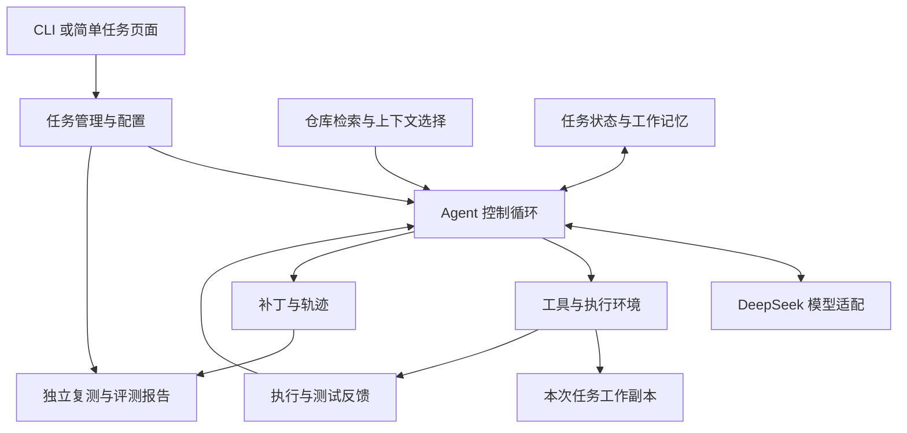

# 规划｜面向实习的开发框架与能力展示

日期：2026-10-07。状态：用户已认可后续开发方向，开始按V0真实任务推进；架构中的新机制和服务模块尚未实现，当前事实以00及过程验收记录为准。

## 项目要体现的能力

用户明确：目的是找到实习，准备可写进简历的 Agent 项目，希望覆盖有价值的技术与工程能力。近期按 Agent / LLM 应用开发实习来规划；若以后转向模型训练岗位，再单独增加数据或训练方向。

建议项目定位为“基于 Mini SWE Agent 的仓库修复与维护助手”：接收问题与仓库，定位相关代码，完成受约束的修改和测试，输出可检查的补丁与执行报告。Mini 是底座；个人贡献体现在工具、上下文、状态、可靠性、评测和服务接口的设计实现。

开发采用两条同时积累的线：工程线逐步做好任务、执行、记录与服务；机制线逐个验证检索、上下文或计划策略，再做组合。这样可以覆盖多种技术，也能解释每项技术为何存在、是否有用。

## 建议架构

以下是目标架构，不表示这些模块已实现。CLI 先行，API 与薄界面在执行闭环稳定后加入。

Windows / Git Bash 是当前运行入口；环境接口为以后 Linux 容器保留扩展位置。Docker 等进入相应评测或隔离需求时再配置。独立工作副本只是文件分离，不能等同于操作系统级沙箱。

## 模块与验收框架

| 模块 | 具体开发内容 | 能体现的能力 | 要留下的证据 |
| --- | --- | --- | --- |
| Agent 控制与模型接入 | 保留原版对照；统一配置；请求前预算、超时、异常分类、停止原因 | 理解循环、模型适配、成本管理 | 每次运行的配置、调用与退出记录 |
| 工具与执行 | 封装读文件、搜索、补丁及测试；参数校验、目录规则、输出限长、错误回传 | Tool / Function Calling、执行工程 | 错误参数、超时、失败测试与正常路径的检查 |
| 仓库检索 | 文件与符号索引、关键词检索、相关代码片段、仓库地图 | 代码分析、Retrieval、上下文选择 | 文件定位结果、读取步数、token 与任务成绩 |
| 工作记忆与上下文 | 结构化任务状态、固定目标、失败假设、已改文件、测试证据；长输出落盘与可追溯摘要 | Context Engineering、状态与 Memory | 长轨迹前后对照、摘要失真与遗漏检查 |
| 计划与恢复 | 记录下一步与验证条件；测试失败后更新假设；识别重复动作；恢复前核对副本与状态 | Planning / Replanning、流程控制 | 重复步骤、假成功、恢复案例和额外调用量 |
| 任务服务与观察 | 任务 ID、状态、取消、事件流、补丁/轨迹查询；最小 API 和页面 | 后端、异步任务、可观测性 | 可演示任务、失败信息、事件与状态一致性 |
| 独立评价 | 固定输入与环境、冻结测试、批量评分、错误分类、消融和成本统计 | Evaluation、调试、实验设计 | 可重跑配置、任务级成绩、负结果与对照表 |

上表是覆盖图。第一轮优先把执行和评价做好，再落实“仓库检索＋工作记忆/上下文”两个有深度的模块。计划机制、MCP 和有限多 Agent 作为后续候选，实际样本支持时再开展。

## 候选改进一：让 Agent 更快找到相关代码

适用证据：反复列目录、读错文件、遗漏调用关系，或给模型的代码很多但关键内容很少。

建议先从路径、函数名、报错堆栈与关键词搜索开始。Python 源码可先用 AST 抽取符号，跨语言需求出现后再考察 tree-sitter。把相关文件、关键符号、少量上下文按 token 预算组合成仓库地图，可参考 [Aider RepoMap](https://aider.chat/docs/repomap.html) 的设计。

顺序是“关键词/符号检索 → 仓库关系与排序 → 必要时增加语义检索或重排”。RAG 在这里的作用是为模型提供与当前修复有关的代码或文档。向量数据库不是第一版的必需依赖；代码修改后索引需要更新，不能给模型过期结果。

建议对照：原版逐步搜索；加入关键词与符号检索；加入受预算约束的仓库地图。独立衡量修复通过、定位耗时、读取次数和输入 token。定位准确率只有在评价侧有可靠标注时才报告；参考修复与评分答案不进入 Agent 的检索索引。

## 候选改进二：让长任务保留必要信息

适用证据：重复已经失败的尝试、忘记限制或已测结论，历史与工具输出持续增大。

建议定义有限的工作状态：任务目标、约束、候选文件、当前假设、已否定假设、已修改文件、最近测试结果、下一步、剩余预算。每一项尽量关联文件位置、执行事件或测试报告，缺失信息标成未知。

先实施明确规则：保留原问题与最近动作，长测试输出落入 temp 并生成结构化摘要；再试模型摘要，与不摘要、直接裁剪的方案对照。摘要必须保留关键报错和未解决问题，不能把未经验证的模型猜测记成事实。当前任务工作记忆与跨任务长期记忆分开设计；后者暂留扩展位。

衡量总 token、费用、重复动作、重要证据遗漏与任务通过结果。摘要自身的模型调用也计入同一总预算。若任务都很短，先承认该样本不足以验证压缩价值，不人为制造提升。

## 候选改进三：根据验证结果调整行动

适用证据：过早修改、模型说完成却没有测试、反复相同错误或改动扩散。

第一步可做单 Agent 的任务状态与提交检查：定位 → 重现 → 修改 → 验证；记录测试是否实际执行、是否通过、改动文件是否合规。它是可反馈、可调整的检查框架，不把所有题目硬编码成固定动作列表。

之后再考察计划更新：出现新错误时更新假设，明确下一次验证，重复失败达到阈值则换策略或停止。评价状态由独立检查给出，Agent 的提交标记仅表示结束运行。

有需要时做“小范围修复者＋只读审核者”实验。审核者只返回代码/测试证据与建议，限制为一次或两次往返，避免多方同时写代码。对照单 Agent 与双角色，在相同总预算下计入全部调用；若角色分工不改善任务或可靠性，就不保留默认启用。此处为设计候选，未启动协作 Agent。

## 工程补全：让它成为可以展示的应用

优先形成一个稳定的 CLI；再用轻量 API 提交和查看任务，最后提供简洁页面显示状态、动作、补丁与测试结果。FastAPI、SQLite、SSE 是可选的初版组合，具体依赖与接口在实施前确定，不引入复杂集群。

任务状态可以包括 queued、running、completed、failed、cancelled；completed 与“修复测试通过”分别记录。保存配置、环境、累计账本与事件。恢复不只是读回聊天记录：必须核对工作副本、源码版本、已执行操作及仍在运行的子进程，不能盲目重放写文件或测试命令，也不能恢复时重置预算。

工具层先复用当前 Bash 执行；封装高频操作以改善返回值和校验。上游 Mini 的模型工具 schema 与解析目前按 Bash 设计；若以后增加结构化工具，需要同步修改模型动作解析、分发和观察格式，作为独立架构变更保留对照，不能声称直接加一个函数就已完成。

MCP 可选一个真实用途：统一接入仓库问题信息或本地只读文档工具，并测试工具发现、参数与错误处理。先完成直接工具接入；是否转成 MCP 由扩展需求决定。外部只读信息也应明确来源，不自动成为高优先级指令；不自动发布补丁或向外部发送消息。

建议借鉴 [Deep Agents](https://github.com/langchain-ai/deepagents) 的上下文与持久状态组织、[OpenHands Software Agent SDK](https://github.com/OpenHands/software-agent-sdk) 的会话/工具/workspace 分工、[learn-claude-code](https://github.com/shareAI-lab/learn-claude-code) 的小步机制教学。借鉴后应说明自己的实现与上游已有能力的边界。

## 开发顺序与版本成果

下面是未来约 6–8 周的参考顺序，受实际投入、任务与预算影响；不保证固定日期完成，不需要全部结束才投递。

| 阶段 | 重点 | 完成后能够展示什么 |
| --- | --- | --- |
| V0，近期约第 1–2 周 | 3–5 题检查流程，再扩展固定任务集；记录原版轨迹、成本、失败与环境错误 | 可以复现的 Agent 基线流程 |
| V1，约第 3 周 | 从真实瓶颈实现仓库检索与上下文选择，配置开关、结果出处 | 一个能独立解释与比较的机制 |
| V2，约第 4 周 | 依据长轨迹实现工作状态与上下文管理；保留关闭版本 | 第二个模块及分项、组合对照 |
| V3，约第 5 周 | 任务服务、取消/状态、事件与最小展示；按证据加入提交检查或计划更新 | 可以演示的工程系统 |
| V4，约第 6 周起 | 固定评价集、关键重复试验、负结果、README、简历与问答 | 可复现仓库与求职材料 |

第一个机制若失败分布更支持规划或工具可靠性，可替换 V1 内容。任务、评价与记录持续维护；API 不影响原版与改进版的公平评分。MCP、多 Agent、更多检索方法和正式 SWE-bench 在主交付可展示之后按实际价值扩展。

## 评价与对照

先考虑 10–15 个可运行任务，其中一部分用于开发调试，另一部分冻结为评价集；数量是建议规模，尚未收集或付费运行。若条件允许，扩大到约 30 个。当前 more-itertools 一题是历史公开问题的流程检查；单题不能支持机制效果结论。

任务应逐步覆盖代码定位、跨文件依赖、实现错误和较长轨迹；短小空输入题只能验证其中一部分。开发时不用冻结评价集反复挑策略，历史参考补丁仅留在独立评价侧。样本选择和已知数据污染限制写入结果报告。

至少保存四个配置：原版；只加检索；只加上下文管理；两者组合。共享模型、基础提示、任务与运行环境，限制相同总 token、费用和时间；压缩、计划与审核的额外调用全部计入。固定配置不等于模型完全确定，关键差异需适量重复并记录服务端模型名与请求日期。

指标包含修复通过数及任务明细、环境错误、测试执行情况、步数、输入输出 token、费用、耗时与重复动作。小样本优先展示具体变化和失败案例；若没有提升，记录成本、退化与原因，不能只保留最好一次。

使用官方 SWE-bench 成绩时，按 [官方评测说明](https://www.swebench.com/SWE-bench/guides/evaluation/)执行相应评分路径，再核对 Docker 与环境条件。Windows 自选任务成绩写成“本地固定任务集”，不冒称官方 benchmark 分数。

## 简历与面试产物

完成版本应包含：自己的代码与清晰归属、README、架构图、任务与配置入口、运行轨迹/补丁、独立测试、对照表、两个典型案例、三分钟演示，以及本人能解释的设计取舍。

简历可以形成三条贡献，以下是模板，未完成内容不能当作当前经历：

1. 基于 Mini SWE Agent 二次开发仓库修复 Agent，设计模型适配、受约束工具执行、任务状态和事件追踪，支持……。
2. 实现符号/关键词检索、仓库地图与结构化工作记忆，在同任务同预算下比较原版与多个机制配置；实际结果填入完成的任务数、token 和通过情况。
3. 构建冻结测试与独立复测的评价流程，区分环境失败与修复失败，保存轨迹、补丁及资源消耗，形成可复现实验与案例分析。

面试应能够现场解释一个失败、一个模块如何影响模型下一步、为何选择该技术、怎样评分、哪里由上游提供、自己改了哪些代码，以及不成功的尝试。用户应参与核心模块讲解、关键实现和复现实验；AI 辅助实现后不能只留下本人无法解释的代码。

当前不将建议中的 RAG、Memory、Planning、MCP 或多 Agent 写成已实现。等模块与验收完成再更新项目状态和简历措辞。
