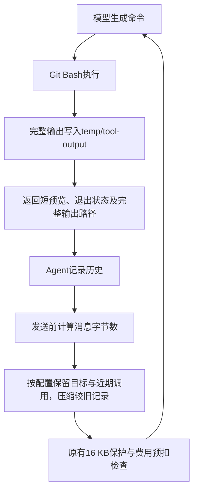

# 工具输出预算与上下文管理：第一轮实现与实验

日期：2026-10-07。上游 Mini SWE Agent 2.4.6，commit `04d809ceab9df28f9adaed044884180159172930`。本轮在 Windows、Git Bash 和 DeepSeek 上完成，没有配置 Docker。

## 本轮结果

已实现工具输出归档、有限预览、请求前历史压缩和测量记录，并完成六次真实开发实验。此前失败的 IndexedSet 任务，在保留助手分析内容、压缩旧工具调用的一版中生成了正确补丁：10项问题检查、5项上游针对性测试、423项全量测试以及全新副本补丁重放均通过。但 Agent 在发送下一条请求时又触发16 KB保护，未正常提交。因此，该版本的结果是“补丁经独立验收正确，执行流程未完成收尾”。

对之前成功的 split_after 任务做回归，同一候选版11次调用正常提交，14项针对性检查及补丁重放通过，全量仍为659/660，只有原来已有的计时失败。新增组件20项检查和既有预算/评分11项检查全部通过。

更激进的历史压缩没有改好 IndexedSet：它反复读取同几段代码，274次调用后达到300秒时间限制，未修改源码。这说明减少输入占用只是一个条件；保存文件不能自动让模型记住当前诊断和下一步。该版本保留为失败实验，不作为推荐版本。原版运行仍是默认选项，改进版需要显式选择。

## 为什么先改这一部分

09中的集合切片任务在修复前停止。当时下一请求的消息为16784字节，超过本项目的16384字节保护。这个16 KB阈值是本项目的请求保护配置，并不是 DeepSeek 宣称的上下文窗口上限。原版把每次查看代码、测试报错、模型动作都累积到后续请求里；单次读取多一点，多轮以后就可能没有空间继续。

本轮固定模型、任务源码、独立测试、提示模板、16 KB硬限制、300秒时间限制和同一5元总账。在同一公开开发题上逐步试验输出缩短、旧输出替换、完整调用压缩。各次都用独立工作副本和运行标识，保留当时源码及配置快照。方案是根据每次失败继续调整的，且每版只运行一次；这些结果不能用于宣称广泛成功率提升或消融统计结论。

## 改动前后的执行过程

改动前，模型发出命令，命令的完整输出进入对话历史，下一次模型请求继续携带所有历史。改动后，新增两个插入点：命令执行完先管理输出；发给模型前再管理整段历史。上游的“模型决定动作—工具执行—继续循环”结构保持不变。

### 1. 工具输出：保留全文，让模型先看有限片段

`ToolOutputBudget.process()`接收命令结果，先把完整的已解码输出文本写入工作副本的`temp/tool-output/0001.txt`等文件，再生成模型看到的内容。1024字节以内的输出原样返回；超出时提供头部、尾部和明确的省略提示，总预览不超过1024个UTF-8字节。这里按字节计算，中文一个字符可能占多个字节。

例如，一次查看代码返回了3000字节，模型会先看到不超过1024字节的预览，以及`sed -n 'START,ENDp' temp/tool-output/0001.txt`这一继续读取入口。中间部分仍在文件里。文件使用独占创建，避免覆盖先前结果；每次记录命令、退出码、异常信息、全文/预览长度、文件路径和SHA-256校验值，写入`events.jsonl`。

非零退出码和超时信息继续保留，工具失败不能被预览伪装成成功。上游提交标记也保留，避免结束命令被缩短后无法识别。提交后的最终文本不受预览截断限制，因为它用于结束循环，不会继续送入下一次模型请求。禁止删除命令的拒绝分支仍沿用原处理。

### 2. 上下文：只改变请求视图，保留运行证据

`ContextBudget.project()`在模型适配器准备好API消息后运行。它测量即将发送的JSON消息字节数；超过12288字节软目标才尝试压缩。16384字节硬保护继续有效，未因实验而调大。

简单模式用“退出码＋完整输出路径”替换旧工具输出正文，保留最近两条工具输出。完整调用压缩模式进一步识别“助手工具调用＋对应工具返回”这一完整组合，将较旧、符合条件的组合替换为程序记录的动作索引，保留近期组合。它不会留下只有调用却没有返回的孤立记录；未完成调用、原始用户任务及系统要求保留。索引保留最近8条较旧动作的命令片段、退出状态及文件引用，其他完整命令可从`events.jsonl`读取，避免索引本身无限增长。

这不是模型生成的语义摘要：程序记录执行事实，不替模型总结问题原因、修复方案或已经验证的结论。保存的轨迹不会被请求压缩改写；归档中可以核对完整命令、工具输出和压缩前后的长度变化。

`context_compacted`默认保留助手附带的分析文字。实验发现这有助于推进修复，但保留下来的文字仍可能把请求撑大。`context_complete`尝试先将这部分旧文字保存到`temp/context-history/`，再压缩整个旧调用组；全文可追溯，却缺少持续携带的有效任务状态，实际出现重复读取。软目标不是保证：如果受保护的任务或保留文字本身过大，仍由原硬保护停止，不擅自截掉用户任务。

## 新增和修改了哪些文件

下表代码位置均相对于本项目根目录，行号以本轮完成时为准。

| 文件 | 改动与关键位置 |
| --- | --- |
| [scripts/tool_output_budget.py](../scripts/tool_output_budget.py#L17) | 新增。第17行`process()`负责归档和预览；第45行`statistics()`统计输出占用，供实验比较 |
| [scripts/context_budget.py](../scripts/context_budget.py#L86) | 新增。第86行`project()`管理API请求视图；第30行`_compact_completed()`成对压缩完整调用；第25行开启可选的助手文字归档 |
| [scripts/run_deepseek_smoke.py](../scripts/run_deepseek_smoke.py#L59) | 修改。第59行在执行结果返回前调用第63行的`_process_output()`扩展接口；默认原样返回，原版实验行为保留 |
| [scripts/run_task_batch.py](../scripts/run_task_batch.py#L26) | 修改。第26行`BoundedTaskEnvironment`接入输出管理；第40行`RecordedModel`记录实际请求大小及是否发出HTTP；第61行`ContextManagedModel`接入历史管理。运行入口增加配置/版本选择、代码快照和归档复制，继续使用原独立验收和共享费用总账 |
| [configs/output_budget_trial_20261007.json](../configs/output_budget_trial_20261007.json) | 新增。固定任务、环境和五种实验策略，配置1024字节输出、12288字节软目标、两组近期调用、8条旧动作索引 |
| [scripts/test_tool_output_budget.py](../scripts/test_tool_output_budget.py) | 新增9项检查，覆盖全文与校验值、截断、中文、失败状态、超时、提交标记、读取被省略部分和固定旧轨迹重放 |
| [scripts/test_context_budget.py](../scripts/test_context_budget.py) | 新增11项检查，覆盖目标保留、调用匹配、近期记录、原始历史不被改写、没有归档时不丢弃、索引长度及助手文字归档 |
| [experiments/output_budget_trial_20261007/](../experiments/output_budget_trial_20261007/) | 新增正式证据：各版配置与源码快照、运行轨迹、补丁、修复前后验收、费用、完整输出、压缩记录及462个成果文件的校验清单（不含清单自身） |
| [AGENTS.md](../AGENTS.md)、[00](00_项目现状与快速接手.md)、[项目开发流水账](项目开发流水账.md) | 更新入口、实际进展及后续讲解要求；本文保存详细说明 |

`mini-swe-agent/`上游源码没有修改。模型为开发题生成的`boltons/setutils.py`补丁属于任务实验结果，保存在实验目录的`repair.diff`，不是手工替模型修改题目答案。一次性归档脚本、控制台日志和测试工作目录仍在`temp/`。

## 同一道失败题的五版结果

IndexedSet任务的原始问题检查为3/10通过。下表中的费用均按记录的用量和峰值单价保守估算，不代表账户账单的精确扣费。

| 策略 | 调用 | 费用/元 | 问题检查 | 最终状态 |
| --- | ---: | ---: | --- | --- |
| `raw`：原版输出及历史 | 8 | 0.043466 | 3/10 | 未改源码；下一请求19113字节，保护停止 |
| `bounded`：仅输出预览 | 11 | 0.056316 | 3/10 | 未改源码；下一请求17755字节，保护停止 |
| `context_managed`：旧输出换文件引用 | 19 | 0.115812 | 3/10 | 未改源码；下一请求17199字节，保护停止 |
| `context_compacted`：压缩完整调用，保留助手文字 | 16 | 0.095838 | 10/10 | 补丁验收和重放通过；下一请求17401字节，提交前保护停止 |
| `context_complete`：再归档旧助手文字 | 274 | 1.342634 | 3/10 | 实际请求最大11833字节；反复读取，300秒超时，未改源码 |

输出预览版累计输出从21355字节降至9664字节，但对话还有命令和助手文字，不足以解决全部历史增长。完整调用压缩版生成的补丁修改了`IndexedSet.iter_slice()`：正向切片按逻辑上仍存活的元素计算边界和遍历，避免删除元素后把底层存储位置当作逻辑位置；本题检查通过，既有负步长行为保留。这里只声称固定检查覆盖范围内的修复。

最激进版的三条相同读取命令分别执行64、63、63次。较小的请求仍可能不断重复动作；它没有降低费用，反而成为本轮主要支出。保留失败证据，是为了下一轮有依据地设计任务状态和重复动作检测。

推荐继续研究`context_compacted`，但不宣布它是可靠的最终方案，不把它设成默认，也不把当前补丁验收称为 IndexedSet 的完整自动修复成功。

## 验证与费用

1. 离线检查共31项通过：输出9、上下文11、既有预算10、既有评分计数1。重点验证了工具返回协议、UTF-8边界、任务保留、全文可追溯以及费用保护。
2. 固定历史动作与响应重放，在原先16784字节的停止位置，输出预览将请求降至9860字节，没有发出模型请求。这只证明在相同动作下减少占用，不证明模型会采取同样动作或完成任务。
3. 每次真实运行都先检查独立Git仓库、虚拟环境及`pipefail`；修复后检查测试和任务说明未被改动，并将补丁应用到另一份全新副本再验收。IndexedSet候选补丁10＋5项检查及全量423项通过，重放通过。
4. split_after回归11次调用正常提交，费用0.057284元，10项问题检查＋4项上游针对性测试通过；全量659/660，既有`TimeLimitedTests.test_zero_limit`失败保留，没有新增失败，补丁重放通过。首轮原版9次调用，本次没有证据表明调用或费用下降。
5. 正式成果复制前检查未包含当前密钥，完整工具输出校验值已复核；历史成果和冻结任务另外复核。运行轨迹、配置与评测结果通过校验清单长期保存。

本轮六次实验共339次请求，保守估算1.711350元。项目累计已知费用估算1.857514元，历史未知认证请求继续预留0.200000元，总计占用2.057514元，5元预算剩余2.942486元；没有新增待结算请求。历史预留未擅自释放。次数不限，时间和费用保护仍生效。

正式汇总入口：[summary.json](../experiments/output_budget_trial_20261007/summary.json)。最有进展的修复证据：[IndexedSet候选版](../experiments/output_budget_trial_20261007/indexed-set-removal/context_compacted/summary.json)、[补丁](../experiments/output_budget_trial_20261007/indexed-set-removal/context_compacted/repair.diff)。回归证据：[split_after](../experiments/output_budget_trial_20261007/split-after-boundary/context_compacted/summary.json)。失败版的记录也完整保留。

## 下一轮方向

本轮已经把输出管理和请求上下文管理做成可配置、可测量的工程组件。下一轮要围绕两个实际缺口继续：压缩时如何持续保留“定位了哪里、复现了什么、改了什么、哪些测试已通过、接下来做什么”的有效任务状态，以及如何识别无进展的重复读取并促使 Agent 换一步行动。然后仍用固定失败题与已成功任务回归，分别记录补丁是否正确、Agent是否正常提交、调用与费用。

任务状态和重复检测当前尚未实现。没有检索、长期记忆、多Agent或正式SWE-bench成绩；这些模块是否加入，继续由失败证据和实习展示的工程价值决定。
