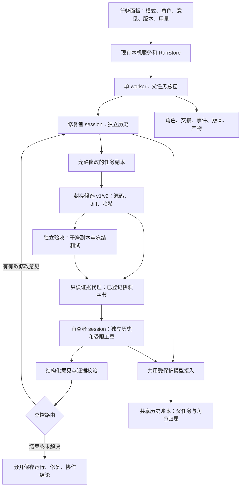
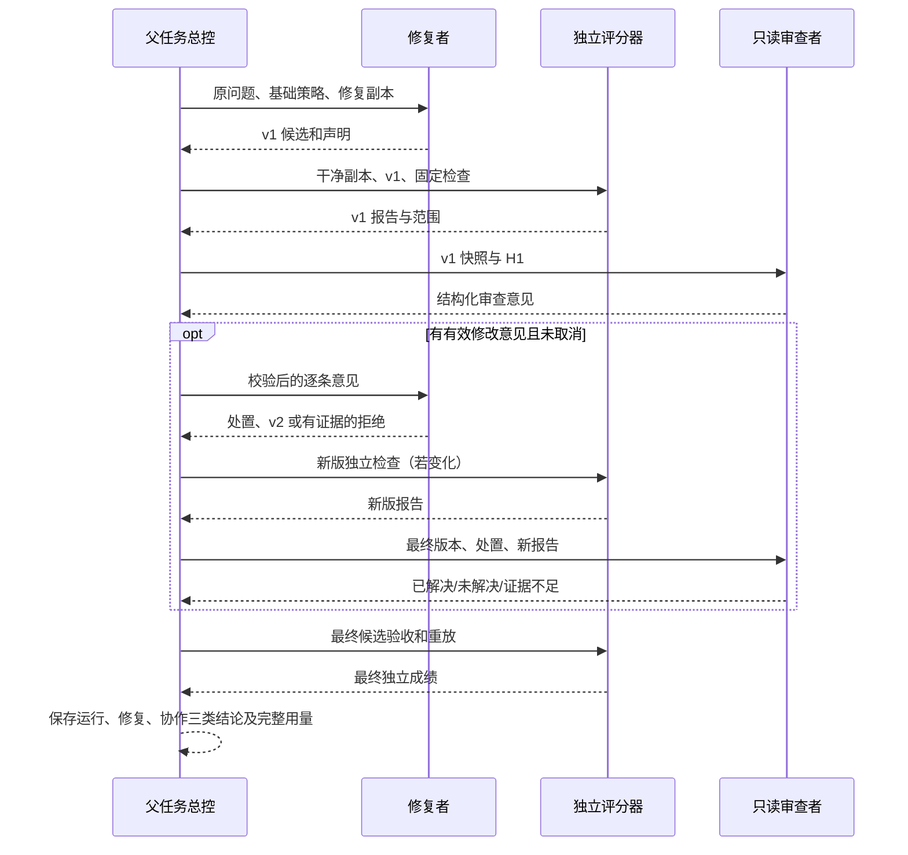

# 多 Agent 协作实施规划：修复、审查、反馈与后续委派

2026-10-25后续实施见[32](32_过程_双角色快照修复与第三文档角色离线接入.md)：快照二进制故障已修、可选第三文档角色及总控/存储/记账/取消/worker/面板已离线接通，脚本化五阶段和实际本机验收/重放通过；真实第三角色模型和页面点击未验，0真实请求。下节的“尚未实现”是路线调整当时状态；功能先行、统一比较后置的决定继续有效。

## 2026-10-25 用户调整：功能先行，统一比较后置

用户决定暂缓新题效果比较，先完善双角色功能，再接入第三个只读文档查阅角色，最后与最初的单 Agent baseline 比较。本节优先于下文历史 E→F 顺序、31的15槽位建议及“比较后再决定第三角色”的安排。本次只调整路线和交付标准，第三角色尚未实现。

新的推进顺序：

1. **补齐双角色使用所需的可靠性。** 优先修复已复现的二进制文件快照故障，确认修复、审查、返工、最终核查、取消和证据版本完整。开发保留必要的定向离线检查，不运行真实模型效果批次。二进制快照本身属于功能缺陷，不能因为延后评测而遗留。
2. **接入第三个只读文档查阅 Agent。** 沿用 F 的职责：接受明确问题，只读取总控登记且有版本的仓库文档，返回原文位置、适用说明、冲突或信息不足；唯一修改实现的仍是修复者。由程序总控控制一次委派及交回，不允许角色互相循环委派。先做本地受限文档工具、结构化交接，再接持久状态、费用、取消、worker与面板；离线脚本演示与真实模型验收分开记录。默认按需调用，不要求每题固定凑齐三人，不自动增加联网检索或RAG。
3. **完成功能集成与使用说明。** 面板能够说明哪个角色正在做什么、查到了什么、如何影响修复，最终产物可回查；缺资料和角色失败必须能结束并如实展示。具体实现前继续核对现有源码和成熟开源做法，避免重复开发或迁移底座。
4. **功能稳定后统一比较。** 主比较为最初冻结的单 Agent baseline 与完成的多 Agent 流程；可保留双/三角色的明细，但 S+ 自查及逐机制消融不再是当前开发的前置条件。最初单 Agent 的代码、配置、模型和执行适配身份须核实并冻结，不能默认为当前 adaptive_history，也不能拿不同题目的旧成绩直接比较。双方在同一批问题、源码和最终评分上重新独立运行，记录全部角色耗时、token和费用。该主比较只说明整套改进的总体收益，不能单独归因于角色数量。

统一实验初修入口、终态保留评分和批次执行入口移到统一比较的准备阶段；尽量复用既有 baseline 提示，必要适配须显式记录，不静默改写原版。31原准备包及冻结/封存保持，未来用新方案、新冻结和新运行身份；原15槽位不自动执行。未来真实模型接入与最终效果比较分别记录，本次没有启动任一付费运行。

本次文档调整未运行模型或回归套件。后续实现仍需必要的权限、版本、取消和数据保护检查；“先不测试”按暂缓真实效果比较理解，不将未检查代码称为功能完成。

2026-10-23最新进度：A/B内核与持久调度完成，C离线反馈及单题真实初修/首审见25（真实返工/在途取消未验）；D最小面板已实施并做本机浏览器/离线进程异常验收，详见[26](26_过程_双角色任务面板与本机异常验收.md)。正式库有备份、旧41条记录保持，导入C结果只读展示；本轮D无新增真实模型调用。E新题比较尚未开始，以下阶段表仍保留未覆盖门槛，不将页面接入等同效果证据。

更新日期：2026-10-22。原规划完成于 2026-10-20，深化 2026-10-18 的方案，保留原文件名作为稳定入口。

2026-10-22 进度：A 阶段的协议、快照和只读工具内核已实现，198 项离线检查中 197 通过、1 项文件 symlink 因权限跳过；示例为人工审查/修订与实际程序检查，不是模型协作。实现差异、证据和使用方式见 [22](22_过程_多Agent权限与证据交接内核.md)。下一步 B 持久调度，之后接真实模型与面板。用户已同意先完成双角色，再增加按需文档查阅者；系统不写死为两个角色。以下正文保留设计及初稿检查背景，未完成部分不因 A 完成而变成已实现。

2026-10-22 B 阶段补充：持久角色状态、mock 总控、候选/交接/报告注册和合成账本归属已离线实现，236 项中 235 通过、1 权限跳过，详见 [23](23_过程_多Agent持久调度与角色记账.md)。当前构造器仍拒绝生产协作库/角色账本，未改正式数据或调用真实模型；下一步 C 模型/worker 接线，随后 D/E。A/B 机制不等于真实双 Agent 已运行。

**2026-10-20 初稿交付是设计，不是功能实现。** 当时读取两个项目入口规则、主项目 00/README/20/原 21/流水账，针对执行、模型、工具、工作副本、记账、评分与测试核对源码；上游 HEAD 实际为 `04d809ceab9df28f9adaed044884180159172930`。当时没有运行模型、付费实验或重新执行历史 150 项检查。下文设计是否已实施以顶部进度和后续过程记录为准；20 的成绩保留为历史记录。

## 1. 最终想让用户得到什么

用户在已有任务面板选一道问题，选择“单 Agent”或“双 Agent 协作”。双 Agent 模式中，一个负责找原因、修改和自测；另一个用独立上下文核查补丁，找遗漏、错误假设和测试盲区。有具体意见时，修复者逐条回答并按证据修订，再检查新版。用户可以直接看到每人做了什么、交接了哪一版、哪些意见被采纳或拒绝、最终测试结果，以及两人全部用量和耗时。

例如：修复者让普通输入通过，但遗漏了空输入；审查者指出具体分支和预期行为，修复者补齐后由独立测试确认。反过来，审查者也可能误解接口，修复者提供原始要求和实际证据后拒绝意见。两种过程都要完整记录，不能只保留“有帮助”的故事。

第一版做成可运行、受控、能比较的双角色反馈闭环。完整蓝图继续覆盖按需定位委派、独立证据共享、有限并行和隔离修改；后续每一步都有触发条件。多 Agent 是重点建设方向，角色数量与修复收益分别评价。

本项目继续使用 Mini SWE Agent 2.4.6。RAG 扩展暂缓；现有模块准确称“仓库代码检索与上下文选择”。不同时更换模型策略、检索排序或历史压缩，旧实验与账本保持原样。

## 2. 现状、可复用部分与真实缺口

### 2.1 本轮从源码确认的事实

| 现有部件 | 实际能力与依据 | 多 Agent 中怎样使用、缺什么 |
| --- | --- | --- |
| 持久任务与事件 | [RunStore](../scripts/task_service_store.py:74) 使用 SQLite 保存任务、幂等创建、取消及事件；事件已有 actor | 保留一个父运行身份；补角色执行、交接、版本和意见结构。actor 本身没有调度或权限作用 |
| 单 worker 管理 | [Supervisor](../scripts/task_service.py:22) 加进程锁，串行启动 worker；重启时识别存活 worker/中断 | 第一版一个父任务持锁，内部角色串行；不让角色各自抢 worker 锁或进入顶层任务队列 |
| 执行主流程 | [run_one](../scripts/task_service_worker.py:173) 冻结、准备、baseline、一次 agent.run、收集、评分、重放、收尾 | 抽出角色执行与候选封存接口，再加协作总控。当前 model/env/status 单对象及一份最终 diff 不能表达多轮 |
| 取消与进程清理 | [hooks](../scripts/task_service_worker.py:71) 在请求/执行前与已计费响应后检查；[Job Object](../scripts/task_service_worker.py:38) 管理子进程寿命 | 各角色与评分阶段都接入父取消；保留在途用量。这是进程生命周期保护，不能隔离任意文件访问 |
| 任务独立副本 | [prepare_task](../scripts/task_workspace.py:39) 从固定清单复制、建立独立 Git，副本在所属任务 temp | 继续作修复副本和干净评分副本；额外建立不跟随修复变化的审查快照，禁止共享可写工作区 |
| 修改范围 | [collect_patch](../scripts/task_service_worker.py:155) 收集时拒绝新增、删除、越界文件及任务检查变化 | 沿用已有实现文件的范围限制；它是结果收集检查，并非对修复者任意 Bash 的系统级文件权限隔离 |
| 模型与记账 | [BudgetedDeepSeekModel](../scripts/run_deepseek_smoke.py:86)、[SharedBudget](../scripts/deepseek_budget.py:20) 保留每平台尝试、预留、未知费用和脱敏 | 所有角色通过同一路径；补父/角色/逻辑请求归属和父级路由状态，不能另开绕过保护的客户端 |
| 上游模型工具 | [LitellmModel](../mini-swe-agent/src/minisweagent/models/litellm_model.py:49) 请求中固定 `tools=[BASH_TOOL]`，解析也要求 bash | 不能只替换提示或传 config.tools。需本地可审计的工具集接入点及审查工具解析，保留费用/失败处理 |
| 上游循环 | [DefaultAgent](../mini-swe-agent/src/minisweagent/agents/default.py:38) 的 run 会重置 messages；保存各步轨迹并处理格式/运行停止 | 修订阶段不能再次调用 run 却假称“保留了历史”。需显式角色 session 接续或受控重建，并记录上下文来源 |
| 状态与检索 | [StatefulAgent](../scripts/state_agent.py:9)、[TaskState](../scripts/task_state.py:15)、[RepositoryRetrieval](../scripts/repository_retrieval.py:25) 保存状态、重复读取及带来源片段 | 修复者继续用选定策略；审查者有独立状态。检索会写 temp 缓存，不能原样运行在不可变审查快照内 |
| 独立评分 | [evaluate](../scripts/run_task_batch.py:126) 调用 [check_task](../scripts/check_task.py:64)，使用冻结检查、保护测试与既有失败对比，再由 worker 重放 | 复用评分口径，外加版本外壳和报告哈希。评分当前仍会执行候选代码，不是隔离不可信仓库的平台 |
| 展示和历史 | task_panel.html 展示运行/退出/修复三个维度，成果路由只读注册文件；历史只读 | 增加第四维“协作与审查结论”，角色时间线和版本选择；不改写旧历史填补不存在的角色 |

### 2.2 这次核对影响实现的细节

1. 新建模型对象会把 provider_index 设为 0。若每个角色各建对象但不共享父路由，会在同一任务重复探测已经失败的首选平台；不符合“本任务切备用后保持备用”的现有规则。
2. 当前 RunBudget 先写共享预留、再写 SQLite 事件。两次写入之间进程崩溃，可能留下没有 run 事件归属的预留。新增角色后应把可追溯身份与 ticket 在共享账本一次落盘，事件只作投影，不能假设跨文件事务。
3. model_metrics 和 finally 当前面向一个 model，逐次更新会覆盖父 metrics。多角色必须按 ticket/角色聚合；修订不能重复计入同一个累计 model 的消耗。
4. 当前结束时设置 model.ledger.completed，之后该模型会拒绝再请求。必须区分“初次修复阶段结束”“同一修复 session 继续”和“整个 session 永久结束”。
5. 评分报告没有候选版本身份；同名 verification/repair.diff 会覆盖多轮语义。多 Agent 中应保存不可变版本目录，不能只保留最后一份。
6. 根 shixi_project 是工程工作区，本轮 `git status` 确认其本身不是 Git 仓库；上游 mini-swe-agent 子目录才有固定 Git 身份。后续以现有冻结/哈希和局部变更管理推进，不假设根目录可创建分支。

以上是代码检查结论，不是新出现的线上故障，也未据此断言历史结果错误。

### 2.3 要解决的问题与尚待验证的假设

| 问题 | 双 Agent 设计假设 | 必须通过什么证据判断 |
| --- | --- | --- |
| 修复者可能沿自己的诊断忽略边界 | 独立上下文审查能发现实际遗漏 | 有来源的新增缺陷、独立复现、修订后的评分变化 |
| 自测通过不等于覆盖需求 | 审查者从原问题重查行为与变更影响 | 发现测试盲区；无效疑虑和误报也统计 |
| 多角色容易重复读取、互相传猜测 | 有版本的短交接能减少重复和过期信息 | 来源校验、过期拒收、实际输入与取证消耗；不能预设更省 token |
| 角色意见可能来回拉扯 | 逐条 disposition 和有限反馈可终止 | 拒绝有依据、未解决明确、无无限重试、无隐式审查通过 |
| 新角色增加故障和费用 | 父任务控制生命周期和共享用量能如实呈现 | 中断/取消/未知用量不丢失、不重复调用 |

历史已有上下文超限、反复读取和小样本策略收益不一致的证据；它们不能直接证明“缺审查者”。多 Agent 的可靠性先靠离线检查，修复收益再靠新任务比较。

## 3. 协作方式比较与第一版选择

| 方式 | 怎样工作、适合什么 | 当前取舍 |
| --- | --- | --- |
| 固定修复者＋审查者 | 先产候选，独立审查，按证据反馈；适合补丁可检查的任务 | **第一版采用**。职责清楚、无并发写冲突，能单独验证权限、反馈价值与新增费用 |
| 按需委派定位 | 修复者提出明确疑问，定位者独立只读取证，再返回定位包 | 后续优先候选。需证明定位占用上下文/时间且可独立回答，不在每题固定插入第三人 |
| 并行只读调查/审查 | 同一固定版本上分别检查接口、边界、影响面 | 在版本和取消可靠后做。必须有独立子问题、统一去重和证据合并；投票数量不能当正确性 |
| 并行修改子任务 | 多个独立副本各改一部分，最后整合 | 后期能力。需要可分解任务、修改范围租约、冲突检测与整合重测；当前小补丁不直接承受其复杂度 |
| 模型经理动态派活 | 额外 LLM 拆解、分配、协调多名执行者 | 暂不采用。先由程序控制确定状态；只有固定规则无法处理的实际复杂任务，才单独评估经理带来的收益 |

第一版采用“程序编排＋两个有独立上下文及工具循环的 LLM 角色”。程序总控、检索器和评分器均不计为 Agent。相同模型可以承担不同角色，但同模型仍可能有相关错误，独立上下文不等于统计独立。

这个选择参考 [Anthropic 的 evaluator-optimizer 与 orchestrator-workers 工作流](https://www.anthropic.com/engineering/building-effective-agents)：前者强调明确评价标准和可衡量迭代价值，后者适用于需要动态分解的任务。本文把这些模式映射到当前仓库属于设计判断，官方文章不保证本项目收益。

### 3.1 编排框架取舍

第一版复用 SQLite、worker、Mini 循环与模型包装，加小规模显式状态机。新框架不能替代当前的副本、权限、版本校验、费用归属和取消设计；直接迁移还会同时改变调用与轨迹，干扰效果判断。

[LangGraph 官方持久化说明](https://docs.langchain.com/oss/python/langgraph/persistence)提供 thread checkpoint 与跨 thread store，支持持久状态等场景。这些能力有价值；它们并不自动提供本项目 shell 副作用与付费请求的“恰好执行一次”保证。若以后需要多分支图、人审等待、多 worker 和显式恢复，再以已定义协议评估接入 LangGraph；保留可替换的 RoleRunner/Store 接口，不现在建立第二套状态存储。

官方资料核对日期为 2026-10-20。本文不评判哪个框架“更先进”，本次没有新增依赖或替换 Mini。

## 4. 总体架构与信任边界



修复者的 Bash 沿用可信固定任务原型的边界；不是操作系统沙箱。审查者只接收工具协议和代理返回字节，完全不获得 Bash/PowerShell/Python 执行能力。其快照与可写修复副本分开，审查期间修复者暂停；评分在其他副本执行。候选中的注释、文档、模型意见都是资料，不能改变角色权限或总控状态。

只有总控能够建立版本、登记证据、写协作状态和执行评分；模型不能通过输出路径或 JSON 字段自行注册“事实”、改账本或把 unknown 变成 passed。

## 5. 角色职责、输入输出与工具权限

| 对象 | 主要输入 | 输出 | 权限与边界 |
| --- | --- | --- | --- |
| 修复者 repairer | 原问题、明确实现范围、选定基础策略、自己的历史；修订时追加校验后的意见包 | 候选实现；目标/诊断、未验证项、声明自测；逐条意见响应 | 唯一实现写入者；沿用既有 Bash、临时目录和收集保护。不能改冻结题、评分原件或审查快照 |
| 审查者 reviewer | 原问题、原始/候选版本、diff、相关代码、程序测试摘要及范围 | approve / request_changes / insufficient_evidence；有身份和版本的 findings | 只读工具；不访问修复者完整聊天、不编辑实现、不自行运行新探针、不写报告文件 |
| 程序总控 | 父运行配置、角色结果、协议和固定策略 | 下一阶段、版本、状态、交接、终态 | 依据结构化结果调度；不凭空判断缺陷正确、不增设 LLM 经理 |
| 独立评分器 | 干净候选副本、冻结检查、修复前失败集合 | 测试成绩、保护检查、失败增量、版本报告 | 程序执行，不是 LLM 测试者；评分范围外性质保持未验证 |

### 5.1 审查工具第一版

工具均由 `ReviewEvidenceBroker` 实现，只操作总控登记的快照/报告对象。模型传 snapshot_id/document_id/evidence_id，不传本机绝对路径。工具调用先检查父取消、角色能力、版本、参数和大小；任何不匹配均拒绝并留事件。

| 工具 | 参数示意 | 返回内容/限制 |
| --- | --- | --- |
| list_files | snapshot_id, prefix, cursor | 快照注册清单；分页最多 100 条；prefix 只是清单内相对前缀 |
| read_lines | snapshot_id, document_id, start, end | UTF-8 原文、原始路径、1 基行号、文件/片段哈希；单次最多 80 行/4096 字节，截断明确标记 |
| search_text | snapshot_id, query, scope | 固定字符串大小写可配搜索；最多 20 命中，标出未穷尽；不执行正则代码或 shell |
| read_diff | candidate_id, cursor | 分页 diff、base/candidate/patch 哈希；不能取“当前最新”模糊版本 |
| read_report | report_id, section | 注册报告和范围；无报告为 not_available，不返回模型自述 |
| submit_review | review_id, target, verdict, findings, coverage, unknowns | 严格校验并由总控封存；不是写文件工具；最终消息与工具响应一起保存 |

权限实现约束：

1. 从固定 manifest 和合法候选构建快照；不复制 .env、用户目录、参考补丁、隐藏评分答案、任意 temp。公开给 Agent 的测试可登记只读；未来保留评分题时不泄漏隐藏测试。
2. 导出时拒绝越界、非普通文件及链接/Windows reparse point，包括路径各级目录；读取普通文件字节后重新创建副本，不建立硬链接。登记完整文件哈希和不可变内容对象。内容对象可使用内存索引，正式字节落在版本快照目录。
3. 代理不根据模型输入执行 open(path)，只按已登记 ID 返回已校验的字节；请求 ID 的 task/run/candidate 必须匹配。读取前后核对快照哈希，篡改则停止审查并标 integrity_error。
4. 审查角色 env 不继承 GitBashEnvironment；不存在“拒绝几个危险命令后执行其他命令”的分支。工具名 bash、exec、write、import_module、未知工具及额外字段均在分派前拒绝。源码永不 import/eval。
5. 审查工具输出、索引缓存、轨迹由总控写到角色自身目录；RepositoryRetrieval 如需复用其解析/排序，缓存指定角色 scratch，不能写入证据快照。V1 的 search_text 仅为只读取证工具，不改变修复者检索策略。
6. Windows 只读属性可以辅助，不能充当安全机制。保证范围是“模型通过审查工具无法写入/执行”；同权限的其他本机程序不属于受隔离攻击者。开放任意不可信仓库前需另做 OS 沙箱。

V1 审查者需要新测试时，只提交“输入、预期、依据、涉及版本”的验证建议。由修复者在允许的 temp 中运行并附记录，随后总控按固定测试独立验收；这些探针标记为模型提出/修复者执行，不自动变成独立评分。通用程序探针执行工具后置，不把任意脚本改名叫只读操作。

## 6. 来源、版本与交接协议

### 6.1 不可混用的身份

| 字段 | 含义 |
| --- | --- |
| run_id | 本次父运行，单/双模式均有；与 Codex 聊天 ID 无关 |
| session_id / role | 角色上下文身份；V1 一个 repairer session，可有初次与修订两个 attempt；每次审查新建 reviewer session |
| role_run_id / parent_role_run_id | 某次角色执行；反馈修订关联初次修复 attempt，审查关联被审补丁的产生者 |
| task_digest / baseline_digest | 问题/测试清单及原始源码身份，不能仅用任务名或 Git 时间戳 |
| candidate_id / source_tree_digest | v1/v2 只是展示编号；真实身份由全部允许实现文件的路径＋字节哈希按规范 JSON 排序计算 |
| patch_sha256 / snapshot_id | LF 格式补丁字节身份和审查快照身份；同样 diff 在不同 baseline 上不能视作同一候选 |
| report_id / evidence_id | 某版程序评分或取证对象；含产生者、内容哈希、范围和时间 |
| handoff_id / review_id / finding_id | 交接、审查及逐条发现的身份；不得只用自然语言段落关联 |

候选封存时冻结实现清单、保存每文件哈希及源字节；base、candidate 和 diff 都有身份。文件字节一致才可复用内容，但每个阶段的来源事件独立。现有 TaskState.revision 可作参考，不能直接当涵盖协议、manifest、补丁和评分的候选 ID。

证据分 `source`、`diff`、`program_test`、`tool_observation`、`model_claim`。程序校验“文件/引用存在且对应此版”只证明来源真实，不证明意见的逻辑正确。模型声称测试通过仍为 model_claim，除非能关联到程序登记的实际动作/报告。

### 6.2 交接示例

下面都是结构示意，DEMO 值不是已发生的运行或真实缺陷证据。

```json
{
  "schema_version": 1,
  "handoff_id": "DEMO-H1",
  "run_id": "DEMO-RUN",
  "from_role_run_id": "DEMO-F1",
  "to_role_run_id": "DEMO-R1",
  "purpose": "review_candidate",
  "task_digest": "sha256:DEMO_TASK",
  "baseline_digest": "sha256:DEMO_BASE",
  "candidate_id": "DEMO-V1",
  "source_tree_digest": "sha256:DEMO_TREE",
  "patch_sha256": "sha256:DEMO_PATCH",
  "snapshot_id": "DEMO-S1",
  "report_ids": ["DEMO-TEST-V1"],
  "scope": {"read_documents": ["DEMO-D1"], "write": false, "execute": false},
  "evidence_ids": ["DEMO-E1"],
  "unverified_claims": ["修复者认为边界情况已覆盖"],
  "questions": ["该补丁是否符合原问题，是否引入可说明的行为回归？"],
  "stop_policy": {"deadline_seconds": 120, "on_missing_evidence": "insufficient_evidence"}
}
```

scope 由程序生成和验证，模型不能通过交接 JSON 扩权。完整包封存，给模型的初始摘要目标不超过 4096 UTF-8 字节；长 diff/报告按注册 ID 拉取，不直接塞满 16 KB 硬保护。固定任务要求与未解决意见作为必要信息，不能被历史压缩悄悄删除；超出时明确报 handoff_too_large，不把截断当完整内容。

证据示意：

```json
{
  "evidence_id": "DEMO-E1",
  "kind": "source",
  "candidate_id": "DEMO-V1",
  "document_id": "DEMO-D1",
  "path": "package/module.py",
  "side": "candidate",
  "start_line": 12,
  "end_line": 18,
  "file_sha256": "sha256:DEMO_FILE",
  "span_sha256": "sha256:DEMO_SPAN",
  "producer_role_run_id": "DEMO-R1",
  "producer_event_seq": 23
}
```

### 6.3 审查意见与响应

```json
{
  "schema_version": 1,
  "review_id": "DEMO-REVIEW1",
  "run_id": "DEMO-RUN",
  "candidate_id": "DEMO-V1",
  "source_tree_digest": "sha256:DEMO_TREE",
  "verdict": "request_changes",
  "findings": [{
    "finding_id": "DEMO-FIND1",
    "severity": "major",
    "category": "behavior",
    "claim": "空输入的结果与问题要求不一致",
    "evidence_ids": ["DEMO-E1"],
    "requirement_ref": "issue:paragraph-2",
    "impact": "指定输入仍失败",
    "suggested_validation": {"input": "[]", "expected": "按问题约定返回"},
    "confidence": "medium"
  }],
  "coverage": ["本次修改的条件分支"],
  "unknowns": ["未运行额外探针" ]
}
```

修复者输出每条 `finding_id` 的 `accepted / rejected / needs_evidence`、理由、证据引用、后继 candidate_id（若修改）和验证动作/报告。模型没有提供响应的意见保留 `unanswered`。`confidence` 与 severity 不作为程序事实或自动裁决依据。

severity 枚举为 major/minor/informational；major 表示审查者声称会破坏需求或现有行为，minor 表示范围有限的具体问题，informational 不阻塞。blocking 指尚未有依据处置的有效 major 意见，不代表缺陷已被独立确认。requirement_ref 必须引用总控根据原 issue 登记的段落/条款 ID，不能由模型虚构需求。

程序要求 request_changes 至少有一条有效、针对需求的意见；approve 不能同时有未解决的 blocking finding。枚举/ID/哈希/行号/引用/长度/未知字段均严格检查，使用现有 Pydantic 或同等显式验证。格式错误最多按连续 3 次错误的既有机制纠正，费用全部保留；引用缺失不靠猜测修补。

旧版引用不会迁移到新版。内容未变也需要总控验证并生成新版关联；发生源码变化后，旧测试/审查仍可看，但不再证明当前候选。

### 6.4 上下文边界

- 修复者保存自己的 session 历史、工作状态和候选来源；修订追加有界交接，不把审查者整段思考过程塞入。
- reviewer-1 从原问题、base/candidate 和程序结果开始；修复者诊断放“未验证主张”独立区，可选择按需查看，不作为事实起点。
- reviewer-final 重新建立精简上下文，核查新版完整 diff、原意见、处置和新报告；只核查已讨论片段不足以检查返工引入的新问题。
- 同一内容可共享不可变 evidence，发送确认/历史/检索缓存按 session 分开；不能让修复者“已看过”导致审查者只收到不可用的去重引用。
- 第一次修复模型/策略保持原样；新增 reviewer 工具和上下文管理单独版本化，不以多 Agent 名义顺带调压缩参数。

## 7. 调度、状态流转和停止条件

### 7.1 第一版的完整执行顺序

1. 创建父运行、持久配置、协作 policy_digest；冻结输入；准备修复副本，做 baseline 和环境预检。baseline 不能复现则停止，不继续花模型费。
2. repairer 初次运行，沿用单 Agent 指令及基础策略。结束后检查保护与修改范围；无合法非空候选则不派审查者，保存失败或未知。
3. 封存 v1；在干净副本应用该版补丁并执行独立评分，保存程序来源的 `candidate_verification`。测试失败也可送审，帮助定位；评分器本身异常则报告不足，停止自动反馈。
4. 导出 v1 的只读审查快照，发 H1。reviewer-1 用受限工具读取并提交报告。总控验证协议、证据和版本。
5. approve 且无未解决有效意见：保留 v1 为最终候选。request_changes 且存在可处理意见：只给修复者一次集中反馈窗口。insufficient_evidence：保存缺口，不推断通过、不自动无边界重新调查。
6. 修复者逐条响应；有修改则封存 v2、做新版独立评分，再 reviewer-final 核查。无修改且全部拒绝/证据不足，也可让 reviewer-final 在 v1 上核对处置。仍只允许这一个修订窗口，不开启第二轮返工。
7. reviewer-final 若指出新问题、坚持原问题或证据仍不足：保存 unresolved/insufficient，自动结束；若同意处置则记录 addressed/approved。不会因轮数用完自动批准。
8. 最终候选做独立验收与新副本重放；同版同输入的已保存干净副本评分可以复用，但重放记录需独立。收集全角色成果与用量、脱敏、哈希并进入终态。

“初次审查＋至多一次修订＋必要的最终审查”是 V1 的反馈边界。它不同于全项目 API 次数/Agent 步数上限；后两者仍按用户要求不设上限。程序不能为了让审查故事完整而伪造一条修订。



### 7.2 状态分层

保留父运行 `queued/running/cancel_requested/finished/failed/cancelled/interrupted`；协作内部阶段不冒充父终态：

`preparing → baseline → repairing → candidate_sealed → candidate_verification → reviewing → [responding/revising → revision_verification → final_review] → final_verification → sealing → done`。

每次角色执行使用 `pending/running/succeeded/failed/cancelled/interrupted/skipped`，另存 `exit_reason`（Submitted、FormatError、deadline、provider_unavailable、integrity_error 等）。角色“提交报告”只表示协议完成。

结果明确分开：

| 维度 | 例子及解释 |
| --- | --- |
| 宿主状态 | finished 表示流程收尾，不代表代码正确 |
| Agent 退出 | Submitted、NoProgress、LimitsExceeded 等，保留每个角色 |
| 独立修复成绩 | passed/failed/unknown/not_run，附 candidate_id 和报告 |
| 协作完成情况 | completed/degraded/not_completed/skipped，表示规定交接是否完成 |
| 最终审查结论 | approved/changes_requested/insufficient_evidence/unavailable/stale/not_run |
| 意见处置 | accepted/rejected/needs_evidence/unanswered，及 independently_confirmed/refuted/unresolved 的独立核对状态 |

例如：审查 API 失败，v1 已独立通过，可显示 `finished + repair passed + collaboration degraded + review unavailable`；不能显示“双 Agent 审核通过”。父取消后留有某版 passed，只代表已有证据，不代表取消后的任务完成。

### 7.3 误报、冲突与拒绝采纳

| 情况 | V1 的确定处理 |
| --- | --- |
| 引用不存在、版本错、报告缺失 | 标 invalid/stale；不交给修复者执行修改；缺来源不能算真实发现。请求方可在格式纠正范围内补齐 |
| 只有风格偏好、泛泛风险 | 记录 informational，不自动返工；仍可在报告里看到 |
| 确认行为不符合原要求 | accepted，修订后关联新证据与报告；仅文字“已修”不算 resolved |
| 修复者认为是误报 | rejected＋依据，由最终审查核对；若审查仍不同意，保存 disputed/unresolved，不让程序凭角色级别裁决 |
| 两条建议互相矛盾 | 原问题和固定检查作为可核对约束；合并为 conflict_group，同一修订窗口提供两条完整证据；不能分别盲目执行 |
| 建议合理但验证能力不够 | needs_evidence / insufficient_evidence；指出缺什么，停止自动返工 |
| 修改后测试退步 | 保留 v2 和失败报告；不默认隐藏回退为 v1。最终输出最新合法候选，并提供 v1 对照，便于如实统计返工损害 |
| 修订越界或破坏保护 | v2 标 invalid，不登记为可用补丁；保留诊断和最后合法 v1，但协作 failed/degraded，不能悄悄声称整体成功 |
| 无新增源码且拒绝意见无依据 | unanswered/unresolved；停止，不为了耗尽窗口强制制造修改 |

合规与候选选择规则必须预先冻结。真正人工/离线裁决误报时记录评判依据与不能判定的项；不同模型投票和置信度不是独立真值。

### 7.4 时间和停滞保护

建议初始配置：初修 300 秒、首审 120 秒、修订 180 秒、最终审查 90 秒；父任务总墙钟 1800 秒，单次模型网络等待沿用 45 秒、Bash 30 秒、现有 evaluate 240 秒保护。时间数值是待离线/接入验证的初始配置，不宣称最佳。大批比较前冻结，不观察效果后延长失败组。

deadline 使用 `min(本阶段剩余时间, 父任务剩余时间, 原工具超时)` 传到请求/进程等待，不能只在下一轮查询前检查。超时计入已发生用量。初修/修订仍用已有重复读取保护；审查连续相同取证且无新文件/范围/版本时提醒，达到预先配置的 3 次同请求重复后终止该审查为 insufficient_evidence。格式错误沿用连续 3 次的保护。不同路径别名不能绕过同证据判断。

达到父 deadline、用户取消、协议/快照完整性失败、提供方不可用、评分基础设施异常或无合法候选时，不再调度下个角色。审查/修订超时保留既有候选及其成绩，协作状态明确降级。不会以更换模型重开角色来绕过停止条件。

## 8. 持久化、故障行为和请求去重

### 8.1 存储增量

在当前 runs.sqlite3 做有 schema_version 的增量建表，先在 temp 数据库测试迁移。旧任务 payload 没有 collaboration 时按 legacy/single 展示，不伪造角色、审查或精确耗时。迁移前保存数据库一致性备份；不重建或清空正式数据库。

| 新表/结构 | 关键字段与约束 |
| --- | --- |
| role_runs | id, run_id, session_id, role, phase, ordinal, parent_role_run_id, status, input_digest, output_digest, timestamps, deadline, exit_reason；同父/角色/phase/ordinal 唯一 |
| candidates | id, run_id, ordinal, producer_role_run_id, baseline_digest, source_tree_digest, patch_sha256, snapshot_manifest, validity；封存后不可改 |
| handoffs | id, run_id, from/to_role_run_id, candidate_id, kind, payload_digest, status；相同交接身份不可改内容 |
| reviews/findings/responses | 审查目标、verdict、意见及引用；响应关联 finding 和 attempt；历史版本追加，不能覆盖 |
| evidence/artifact_registry | id, run_id, role_run_id, candidate_id, kind, registered_relative_path, sha256, size, visibility；读文件只能来自注册项 |
| logical_requests | id, run_id, role_run_id, session_id, ordinal, input_digest, state, started, receipt_digest；逻辑请求可关联多个平台尝试 ticket |
| events（沿用） | actor 保留角色名，payload 加 role_run_id、candidate_id、handoff_id、logical_request_id；全父递增 seq，不用时间戳代替顺序 |

任务状态更新与相应事件在同一 SQLite 事务，使用预期状态/版本号 CAS 防止晚到结果覆盖取消或终态。角色状态不能由 HTTP 客户端随意写；一个 task worker 是唯一调度者。父子关系是运行数据，不额外创建用户侧面板顶层任务。

### 8.2 正式产物组织

```text
data/task_service/runs/<run_id>/
  run_config.json                  # 含 mode、collaboration policy、模型公开身份
  inputs.json + frozen_inputs/     # 沿用冻结，纳入新增代码/提示/协议/配置
  candidates/v1/                  # base/tree/patch 哈希，源码快照、repair.diff
  candidates/v2/                  # 只有真正产生新版才出现
  roles/<role_run_id>/             # trajectory、ledger、上下文来源、角色结果
  handoffs/<handoff_id>.json
  reviews/<review_id>.json
  responses/<response_id>.json
  verification/<candidate_id>/    # baseline/候选/最终/重放各有固定报告身份
  collaboration.json             # 各角色、交接、版本、发现、处置的只读汇总
  summary.json + artifact_sha256.json
```

正式成果由总控写入。过程日志/索引/模型归档草稿放根 `temp/task_service/<run_id>/`，修复与评分副本沿用 tasks/<task>/temp。临时审查副本在根 temp，核验后的正式快照长期保存到 candidates。新增组件仍属于主项目，不创建另一个独立项目或给 scripts 每层加 temp。

大产物先写临时完整文件，flush/fsync 后原子改名，再登记 SHA-256/可见性。DB 与文件不是单个事务：未登记孤立文件不开放、缺文件的已登记项报 unavailable；重启只做只读完整性核对，不补跑模型。旧 `repair.diff` 顶层兼容入口指向 summary 指定最终合法候选的只读副本，并携带来源，避免历史导入器扫描角色文件把子阶段误当顶层运行。

### 8.3 取消、中断与失败矩阵

| 位置/故障 | 必须发生什么 | 不允许发生什么 |
| --- | --- | --- |
| 排队取消 | 父 cancelled，未启动角色标 skipped | 不调用模型、不生成虚假审查 |
| 角色交接前/后取消 | 持久父取消，角色启动前事务复核；后续 pending 标 skipped | 不能因交接已写就继续下一请求 |
| 模型请求在途取消 | 等待已发请求的受限收尾，先记录实际回执/未知，再阻止动作、备用与下个角色 | 不丢费用、不为了“得到结果”重发 |
| Bash/评分执行中取消 | 首版允许当前受限进程收尾，取消后不启动下一命令/评分/角色；UI 显示等待哪个阶段及最长等待 | 不宣称点取消立即停进程；不能取消后继续整套新验收 |
| 父 deadline/强制终止 worker | 关闭所属 Job Object 清理子进程，保存已有证据；reconcile 标父与 running 角色 interrupted，其余 skipped | 不杀无归属 PID，不把没有报告的测试标 failed 或 passed |
| 首选平台失败 | 同一逻辑请求按既有规则尝试备用一次，父路由记 sticky fallback；每次平台尝试单独 ticket | 后续角色不能再从首选开始；不能偷偷多次重试 |
| 两个平台均失败 | 停止付费调度；保留 ProviderUnavailable 的结构原因、候选与已知成绩 | 不盲目重开模型，不统一写“余额不足” |
| 解析/引用错误 | 保存已计费原响应并进行有限格式纠正；不执行非法 action | 不因模型报告无效就漏记那次调用 |
| 快照/冻结输入篡改 | integrity_error，停止自动流程，受影响成果不作可信成绩 | 不重建新哈希假装原件没变 |
| 评分器超时/崩溃 | assessment unknown，保存错误阶段；不产生通过声明 | 不把基础设施错误算作修复失败来美化或歪曲比较 |
| 管理器重启、worker 存活 | 沿用进程锁，不启动第二 worker；展示既有事件与运行 | 不按页面状态误判死进程或重复派角色 |
| worker 已死/电脑重启 | 父与未完角色 interrupted，reservation 保留；已封存报告仍对应原版 | V1 不从消息记录自动恢复、不重发最后一次付费请求 |

V1 受控取消沿用收尾语义；实际强制进程终止另作离线验收，使用已确认的 worker 身份。对评分 subprocess 的总超时需要确定子树都退出，不能仅结束外层 Python 留下 pytest；现有 worker Job Object 是基础，还需验证长评分超时时的清理路径。

### 8.4 幂等与“恰好一次”的边界

父请求的幂等指纹扩充为 task/profile/execution_mode/collaboration_mode/policy_digest。相同 request_key 同内容返回原 run，不同内容 409；新 key 是用户明确发起的新运行，不凭任务名自动吞掉。页面请求超时重试必须复用本次 key，不能每次重试生成新 UUID。

角色 claim、交接接受、意见响应、结果收尾都有唯一约束；双写/晚到结果不得重复调度。HTTP 外呼前保存 logical_request `prepared`，写入带 attribution 的账本预留，然后记 dispatching。响应成功/费用完成但 DB 尚未更新就崩溃时，可按 ticket 对账并显示“回执已记、角色未完成”；不重新调用模型。

网络发送与本地落盘无法形成原子事务；prepared/dispatching 都可能实际没发出或已被平台接收。无可验证回执时统一标 `outcome_unknown`、保留未知占位，不宣称 exactly-once。V1 的保证是不会自动重发不确定的付费请求；人工再次尝试需新 run 并引用 interrupted_run_id，不能重用已结束身份。

恢复蓝图：以后仅从完整封存且无在途请求的阶段边界恢复；核对输入/策略/凭据公开身份/版本、工作区所有权与副作用，创建 continuation 身份关联旧 run，并仍由用户显式启动。阶段恢复与网络请求自动重试分别设计，不现在承诺自动断点续跑。

## 9. 模型接入、共享费用与时间口径

### 9.1 最小模型适配

本地 BudgetedDeepSeekModel 中保留 `_query` 的保护、reserve、平台循环和失败处理，只抽出受保护的 provider 发送方法（建议 `_perform_completion(messages, provider)`）。默认实现继续走当前上游 Bash 请求；新的 ReviewModel 使用常量只读工具 schema，并覆盖工具解析及 observation 生成，仍走同一预算与计费。

不得在外部传 `tools`/api_key/timeout 等任意 kwargs 绕过现有 guard，不直接复写整份 `_query`，也不直接改上游源码。deadline 由总控可信上下文计算并收紧内部 timeout，不向模型开放。工具 schema、提示和解析版本纳入输入冻结；Bash 默认调用请求形状、温度、token/字节保护、无重试参数须离线对照保持。

reviewer 可沿用上游 DefaultAgent 的步进、保存、格式异常机制，配不含 shell 的 ReviewEnvironment 和显式 submit_review 结束路径。角色 runner 处理已结束 session 与 finally，不依赖 echo 完成字符串。修复者初次流程保持原样；修订通过 RepairSession.continue_with_feedback 接续现有 messages，清除阶段 exit 标记并追加交接，同时保留累计成本/自增调用和独立阶段计量。不能直接再次 `agent.run()` 重置历史；如上下文不得不重建，需明确 fresh_context 和来源，不称连续会话。

接续前还必须校验 API 消息序列：初次 COMPLETE 提交可能以 exit 结束，最后一个 assistant tool_call 没有普通 tool observation。不能只删 exit 后追加 user；应由 runner 为已实际完成的提交动作补入对应 tool_call_id 的真实完成观察，构造不含内部 exit、没有悬空 tool_call 的 API 视图，原始轨迹完整保留。若无法证明最后动作完成，则停止接续，不能重放命令。阶段计时重新设置为修订 deadline，父墙钟与累计费用不重置；session 只有最终结束才设置 ledger.completed。

`RunProviderContext` 在父运行级共享当前平台、切换原因与停止状态；新角色构建模型时注入该身份。激活备用必须先持久记录；取消检查仍在每个平台 reserve 前执行。新父 run 才重新尝试首选。这个改动需要重点回归旧单 Agent 路径。

### 9.2 费用归属

SharedBudget.reserve 增加可选 attribution，和 ticket 在同一锁内、一次原子保存中写入：run_id、role_run_id、session_id、logical_request_id、attempt_ordinal、provider。旧调用不传仍兼容，旧条目不回填；不改历史金额、未知状态或总账位置。

各角色分别保存 ledger/trajectory；父汇总按唯一 ticket 聚合，不能把每阶段累积 model.usage 再相加。单个逻辑请求首选失败＋备用成功是两个 API 尝试，一个逻辑请求；response 解析失败也是已消耗响应。总统计包含初修、首审、修订、最终审查、格式纠正、平台失败、未定价成功与在途未知；基线/评分额外墙钟也纳入父耗时。

| 指标 | 口径 |
| --- | --- |
| API attempts / successful responses / logical requests | 三者分开，按已持久证据计数 |
| prompt/completion tokens | 已知回执求和；未知用量标 known_tokens＋has_unknown_usage，不能显示为完整总 token |
| known_price_estimate_cny | 有已知价目且回执完整的保守估算；不等同平台实扣 |
| unpriced / reserved_unknown / placeholder | 未确认价格或无回执的数量与占位，沿用原口径；占位不是收费 |
| complete_cost_estimate_cny | 任一相关尝试费用未知则 null；不把未知当 0 |
| role active / waiting / total | 每阶段开始结束、活动/等待时间分别记；无法确认精确结束的中断保留未知/已观测时长 |
| parent wall / model wall / verification wall | 从准备到收尾的父墙钟包含协调和测试；未来并行时父墙钟不等于各角色时长相加 |

汇总依据本 run ticket 集，不用共享账本总额前后差冒充本 run 费用（即便当前单 worker，其他入口仍可能调用）。账本锁忙应明确终止或在无外呼的有限等待后退出，不能并行失败时退回无锁写账。

若预算预留成功但事件落盘失败，attribution 仍保留；若有预留但 dispatch 未确认，显示未确认发送。所有成果扫描两套凭据，HTTP 页面只开放经过完整性和脱敏检查的注册文件，不返回 .env、私有配置或 API 原异常。

## 10. 面板最终如何使用

### 10.1 创建任务

保留“离线补丁重放/真实 Agent 运行”的运行方式；另外增加“协作方式：单 Agent / 双 Agent 审查（实验）”，和“基础策略：原版 / 上下文 / 按变化检索”分开。不能把双 Agent 挤进基础 profile 导致比较时连检索策略也变了。

初始仍为离线模式，打开页面、查看历史不请求模型。离线重放不能宣称创建了新的双 Agent 审查；不支持的组合明确禁用。真实双 Agent 选定后显示将经过哪些角色、反馈次数、总时间保护及全部调用计费口径，不要求用户选择编排库或 schema。

### 10.2 查看一条运行

1. 顶部同时显示执行状态、各角色退出、独立修复成绩、协作/审查状态；例如“补丁通过，审查服务失败”可以同时成立。
2. 角色卡显示初修、首审、修订、最终审查；每张有开始/结束、正在处理的版本、原因、耗时和用量，未启动显示原因。
3. 时间线可按角色过滤，能点开交接包、证据、格式错误和意见处置。证据来源明确是代码、程序结果或模型主张。
4. 意见列表显示严重性、具体行为、引用、版本、采纳/拒绝/待证据及理由，另显独立核实状态；历史意见不因新版出现消失。
5. 补丁区切换 v1/v2，分别看 diff、对应测试及是否过期；不能选择 v2 却显示 v1 的通过。最终使用哪版清楚可见。
6. 用量区先给全角色总计，再可展开每角色/平台/阶段；费用未知明确展示，父耗时含测试与等待。
7. 取消后显示“正在等待首审请求返回/当前命令收尾”，完成后显示最后已知版本与未执行阶段。断电或 worker 异常显示“中断，未自动续跑”。

历史单 Agent 记录继续只读，不补出 reviewer。页面刷新、快速切换 run/版本/角色时沿用现有选择版本过滤，晚到请求不能覆盖当前视图。模型文本和路径用 textContent 渲染，防止报告内容当 HTML 执行。意见核对/版本功能先只读，不引入未经设计的“点击采纳便直接改源码”按钮。

### 10.3 服务接口增量

沿用 `/api/runs`、事件和已注册成果接口；创建 body 增 `collaboration_mode` 和 policy 版本，缺字段默认 single 以兼容旧调用。新增建议只读路由：

```text
GET /api/runs/<id>/collaboration
GET /api/runs/<id>/roles
GET /api/runs/<id>/candidates
GET /api/runs/<id>/reviews
```

首版也可由一个 collaboration 响应带上述索引，避免无必要接口数量。所有路由保留 Host/Origin/本机 token、所属 run 校验、大小分页和注册文件限制。页面事件仍按全局 seq 拉取；角色过滤在显示层不能漏掉父取消/异常。

## 11. 预计新增/修改文件与核心接口

以下为 2026-10-20 初稿的文件规划。2026-10-22 已落实的 A 阶段文件和实际接口见 22；其他项仍未实现，不以空目录/空文件冒充成果。

| 文件 | 计划职责 | 实施阶段 |
| --- | --- | --- |
| 新增 scripts/collaboration_protocol.py | 严格 schema、身份/版本、证据/交接/审查/响应校验、候选哈希约定 | A |
| 新增 scripts/review_tools.py | 快照导出、EvidenceBroker、只读工具表、大小/路径/版本边界 | A |
| 新增 scripts/test_collaboration_protocol.py、test_review_tools.py | 确定性夹具、实际文件权限边界与引用校验 | A |
| 修改 scripts/task_service_store.py | 增量迁移、角色/交接/候选/请求与事务事件、幂等身份、旧记录兼容 | B |
| 修改 scripts/deepseek_budget.py | 可选 attribution 随 ticket 原子保存，旧接口兼容 | B |
| 新增 scripts/collaboration.py | 父状态机、RoleRunner/RepairSession、分阶段停止、候选选择和结果汇总 | B/C |
| 新增 scripts/review_model.py | 经受保护请求路径的只读工具模型/解析与审查 session | C |
| 修改 scripts/run_deepseek_smoke.py | 最小内部发送扩展点、可注入父级路由状态；保留旧 default 请求形状 | C |
| 修改 scripts/task_service_worker.py | single 分支保持；dual_review 分派、全角色取消/记账/封存和评分版本封装 | B/C |
| scripts/run_task_batch.py、state_agent.py | 优先直接复用；仅必要时增加显式 session 接续/可传阶段 timeout，不批量重构旧 CLI | C |
| 新增 configs/multi_agent_v1.json | 角色提示/工具协议版本、反馈轮次、时间、失败/候选策略；不含密钥 | B/C |
| 新增 test_collaboration_store.py、test_collaboration.py | 迁移/CAS/故障注入、完整 mock 场景、计费/取消/中断不重发 | B/C |
| 修改 scripts/task_service.py、task_panel.html | 创建参数、只读协作索引、角色/意见/版本/总用量展示 | D |
| 修改/扩展 test_task_service.py、test_provider_priority.py、test_deepseek_budget.py | 单 Agent 兼容、父路由与新模型保护回归 | B—D |
| 新增 scripts/evaluate_collaboration.py 及新任务/冻结配置 | 配对新任务评价、全组汇总、不可变身份；待评测清单冻结时创建 | E |
| README、00、流水账与本篇 | 每阶段说明实际完成/未验收；真实过程记录按下一可用序号建立 | 每阶段 |

核心接口草案（细节允许在 A 的协议测试中定稿，修改必须更新 schema/version）：

```python
seal_candidate(task_manifest, work, candidate_dir) -> Candidate
build_review_snapshot(candidate, visible_sources, reports, scratch) -> Snapshot
ReviewEvidenceBroker.dispatch(role_identity, action, cancel_token) -> Observation
validate_handoff(handoff, registry, expected_receiver) -> ValidatedHandoff
validate_review(review, candidate, evidence_registry) -> ValidatedReview
RunStore.claim_role(run_id, phase, expected_parent_state) -> RoleRun | None
RepairSession.continue_with_feedback(validated_handoff, deadline) -> RoleResult
RoleRunner.run(role_spec, session, handoff, deadline, cancel_token) -> RoleResult
CollaborationCoordinator.run(parent_run, policy) -> CollaborationResult
RunBudget.reserve(provider=...) -> ticket  # attribution 来自 RunBudget 的固定身份
aggregate_run_usage(ticket_ids, role_results) -> UsageSummary
```

模型输出不直接实例化带任意文件路径/执行函数的对象；接口的 work/registry 来自程序可信配置。候选摘要与最终产物格式需要版本号，兼容层读取旧格式时缺失项保持未知。

## 12. 验证方案：先证明机制可靠，再检查收益

### 12.1 离线测试矩阵

不把“创建两个角色的对象”当验收。下列覆盖真实失败风险，测试夹具均在本项目 temp，不接真实 API，也不删除批量夹具。

| 类别 | 必须覆盖的行为 | 证据/通过标准 |
| --- | --- | --- |
| 权限 | bash/写文件/删除/导入/嵌套未知 action/超长字段均拒绝；绝对路径、`..`、反斜杠、UNC、盘符、ADS、符号链接和 junction/reparse 越界 | 对真实 temp 文件、外侧诱饵及快照前后逐字节哈希；代理 subprocess/open 执行分支不可达。系统不支持创建某链接时明确 skip，并补受控属性夹具，不能宣称实际链接已验收 |
| 快照 | v1 封存后修复副本变 v2，审查仍读 v1；快照被外部改写被识别 | 读出字节、manifest 和 evidence 目标一致；篡改后停止 |
| 来源/协议 | ID 存在但所属 run 不同、行号错、span hash 错、缺报告、model_claim 冒充测试、过期评审 | 拒绝或 unknown，不生成通过、不进入返工 |
| 审查/响应 | approve、request_changes、空 findings、误报拒绝、冲突意见、needs_evidence、未回复、最终仍有异议 | 所有状态可解释且终止；拒绝不自动改为误报，接受不自动改为真实缺陷 |
| 调度 | 初修无补丁、已通过无意见、有意见修订、新版变差、无变化拒绝、最终审查新发现 | 角色执行次数符合冻结策略；修改只来自修复者；不超出一次返工窗口 |
| 持久 | 旧 DB 迁移、重复创建/交接/claim、晚到结果、终态不可复活 | 同 key 不重复父任务/角色；冲突 409；取消事务优先 |
| 故障窗口 | reserve 前后、HTTP 前后、计费后解析失败、产物改名/DB 登记前后、每个交接边界崩溃 | ticket 可追溯；不重发；缺产物 unavailable；未知保持未知 |
| 取消/进程 | 每个角色请求前、首选失败转备用前、已计费响应后、工具前、评分中、封存中取消；真实 worker 终止及子树退出 | 取消后无新动作/外呼/角色；Job Object 清理只影响所属树；在途真实请求边界另作接入声明 |
| 路由/费用 | 首选失败后审查/修订直接备用；未知价格成功、失败无 usage、重复结算、角色累计量切阶段 | 全角色 ticket 并集和父汇总一致，无重复、遗漏或未知置零；旧金额/记录不改写 |
| 时间/停滞 | 请求/命令剩余 deadline、同证据多别名、连续格式错误、审查重复读取 | 不在超时后启动新动作；阶段原因明确；未把测试结果缺失当失败 |
| 单 Agent 回归 | 原创建 API、原版/adaptive/on_change、离线 replay、只读历史、敏感内容阻断 | 旧路径请求形状、默认策略和三个结果维度保持；原测试检查通过 |
| UI/API | 切 run/版本/角色晚响应、意见文本 HTML、仅凭路径读取私有文件、漏 token/origin、事件分页 | 不串版、不执行文本、不越权；完整意见与取消事件可访问 |

同流程故障用 mock 精确注入；权限、副本、数据库重启、HTTP 与进程清理用实际本机离线操作补验。mock 的“计费后取消”不能写成真实付费请求已故意中断成功。

### 12.2 真实接入验收

阶段 C/D 才进行，必须使用新 run_id、新冻结输入和共用模型保护。本轮不启动。

1. 先选已有开发题做单个双 Agent 冒烟：验证角色独立上下文、只读工具真实调用、结构化审查、页面与全部账本关联。若没有意见，无需人为返工；记录仅证明接入。
2. 另用预声明的开发夹具/已知不完整候选，验证“有具体意见→修复者逐条响应→新版评分→最终审查”的反馈分支。夹具经过人工设计且审查可能知道线索，只能证明机制和有限取证能力，不能当自然新缺陷发现。
3. 用实际本机进程在审查阶段测试取消/中断和重启查看，付费请求若未故意在途取消则保留“仅 mock 覆盖”边界。不为造异常无目的增加收费调用。
4. 保存原始/最终补丁、各版报告、全部发现及处置；至少展示一个成功流程与一个异常或证据不足流程。无真实有效新增发现时明确写“未证明审查有效”。

验收要求：角色/交接版本一致；非法动作不能执行；总费用含全部角色；最终修复由固定外部检查确认；所有异常能收尾。真实模型不遵守协议若导致失败，先保存失败身份再修代码，用新开发身份回归，不能覆盖原运行。

### 12.3 新任务公平比较

**主问题：加入独立角色的整套流程是否值得其新增成本；第二个问题：若改善，来自独立审查还是单纯多一次推理/更长时间。**

第一批建议 6 道此前未用于本项目策略开发的公开问题，覆盖至少 3 个仓库，包含边界、跨文件调用/接口一致性、测试通过但行为遗漏等不同类型。Windows 可运行、依赖已可用，baseline 能复现且固定检查明确；不按哪组已经成功挑题。确认具体来源/许可/版本和检查后才冻结任务清单，本规划不虚构题目或许诺数量已准备好。若只能准备较少，完整报告实际覆盖并降低结论范围。

实验分两层：

| 层次 | 比较 | 回答什么/限制 |
| --- | --- | --- |
| 实用比较 | S：现有单 Agent（300 秒初修） vs D：相同初修＋审查/一次返工 | 用户选协作模式的整体结果和代价；D 允许更多时间，不据此单独归因多 Agent |
| 资源/机制对照 | S+：一个角色保留自己的修复上下文，按同样阶段时间自查、修订；自查阶段切为 D 审查者同样的只读工具，固定评分机会与 D 对齐 | 区分额外时间/反馈机会和独立上下文的作用。成本难以精确相同，报告实际 token/费用及随累计资源的结果，不声称完全等预算 |

首批主比较 S/D 各一次，共最多 12 个预定运行；S+ 至少在预先选定的 3 题各一次用于机制检查。任务数和重复数须在付费批次启动前写入新配置，不根据结果追加“补救运行”。如准备更稳的比较，可预先规定每题两个重复，共同增加样本；首批结束后决定的新重复属于新批次，不能拼接成无选择偏差的首批结论。

为隔离审查本身，再做“同一已封存 v1 候选”的诊断审查/自查分析，使用干净独立副本，不覆盖主运行。这是同输入机制分析，不能把共享单 Agent 产物的一半费用省略后当新双 Agent 总成本；主比较仍每组完整独立运行。

公平性规则：

- 相同原问题、源码/可见测试、候选限制、模型路由配置、工具/上下文/检索基础策略和评分原件；检索策略在各组一致，单 Agent 默认不因实验改变。
- 每组独立副本、独立历史和新身份，禁止互读答案、其他组轨迹或参考补丁。预先交错 S/D 顺序，减少同一时段服务差异；记录实际响应模型、平台切换与版本。
- D 首修与 S 初修模板保持一致，审查是后续阶段；分别呈现 v1/v2，便于判断返工增益/损害。
- 固定测试结果若提供给 D 作为反馈，S+ 在相同阶段也能得到同范围结果；最终保留的隐藏评分不得提前反馈任一组。旧任务公开可见检查不能称隐藏评价。
- S/D 使用不同总资源的事实必须展示。S+ 对齐模型活动时间和评分机会，报告硬保护/实际消耗；不重新启用用户取消的全项目请求/Agent步数上限。
- 任一组平台变化/评分基础设施故障单列为 incomparable/infrastructure_error；保留原结果。只按预声明规则用新身份重试两组或另做诊断，不只重跑失败一边。
- 冻结代码、协议、提示、基础策略、超时、候选选择、失败规则和所有评分输入；新框架/换模型/压缩调整分开实验。查看结果后调参的题转开发，不再称独立新题。

### 12.4 评价与证据表

每题每运行至少记录：

```text
task / variant / repetition / run_id / freeze_digest / provider_sequence
v1、最终版 / flow_status / agent_exit / repair_result / replay_result
review_verdict / findings(valid, invalid, confirmed, refuted, unresolved)
accepted / rejected / needs_evidence / unanswered
true_new_findings / duplicate_findings / false_positives / unverified_findings
changed_after_review / useful_revision / harmful_revision / ineffective_rework
all_role_tickets / attempts / known_tokens / has_unknown_usage
known_price_estimate / unknown_count / placeholder / complete_cost_estimate
parent_wall / role_active / review_wall / revision_wall / verification_wall
```

“真实新增发现”须针对原要求，由冻结检查或独立复现支持，且不只是重述已有程序失败；仅引用正确文件不算。“误报”需要独立证据反驳；证据不足单列，不算误报或真阳性。“无效返工”指有修改却没有修复被指问题/只产生无关变化；“有害返工”含从通过变失败。accepted 不等于正确，rejected 不等于误报。

报告每题的 S/D/S+ 结果及配对变化，保留失败、超时、未提交但补丁正确、未知费用和既有测试失败。给出小样本成功数量、从失败转成功/从成功转失败、已确认发现精度（只在已裁决项上算并同时报告未裁决率）、总成本/耗时和每个真实改善的增量代价。样本小或费用未知时不推断广泛成功率、稳定提速或成本优势。

若 D 没有改善、误报增加或收益不足以抵消代价，保留可选开关和负结论，先修具体机制问题；不得自动提升默认。统一 baseline/更广泛新题/模块消融和 SWE-bench 缺口仍需分别完成，不能用本比较替代官方成绩。

## 13. 分阶段实施、完成标准与退路

阶段推进以实际门槛为准，不承诺未经环境核实的工期。A—E 是本轮详细实施路线；F—H 是有条件的完整蓝图。实现过程中用户新增需求可调整方案，但变动需记录，不能把设计决定写成已完成。

| 阶段 | 目标与产物 | 依赖 | 完成标准/验证 | 失败退路 |
| --- | --- | --- | --- | --- |
| A：权限与交接内核 | protocol、版本快照、只读工具与确定性夹具 | 当前任务 manifest 和已读源码；无模型/API/正式 DB 变更 | 真文件权限与 v1/v2 隔离、错版本/错引用/缺报告拒绝；合法 review/response 链可序列化；原件哈希不变 | 不接服务，先修协议或路径边界；现有单 Agent 照常 |
| B：持久调度与故障闭环 | 增量表、父/角色状态、ticket attribution、mock 总控和候选目录 | A 协议冻结 | mock 覆盖正常/拒绝/不足/取消/每阶段崩溃；旧数据迁移和不重发；全角色账本对账 | 在 temp DB 继续验证；不部署到正式库、不破坏旧结果 |
| C：真实模型适配与双角色反馈 | ReviewModel/ReviewEnvironment、父路由、RepairSession 接续、一次修订/最终核查 | A/B 通过；原单 Agent 回归 | 离线保护/路由/计费/接续检查通过，再一题真实双角色和预声明反馈分支验收 | 保存失败新身份；退回显式 single 或禁用 dual，审查未完成如实展示 |
| D：面板可用与异常实测 | 模式、角色/交接/意见/版本、全角色费用和中断展示，README | B/C 稳定 | 本机实际操作成功/异常两类；刷新切换/取消/重启/子树退出；本人使用未做就标明 | 先提供已有 CLI/只读成果路径，不能把静态页面当运行完成 |
| E：冻结新任务比较 | 新任务来源、配置/冻结、S/D（S+机制）结果、发现裁决与阶段讲解 | C/D 接入验收，不再用开发题调参选优 | 全部预定身份有结果或明示异常，独立验收/重放、全成本/时间/误报公开 | 多 Agent 保持实验开关；按负结果确定改进或止步，不增加角色掩盖失败 |
| F：按需规范查阅/定位委派 | 双角色跑通后增加只读文档查阅者，针对具体问题返回适用条款、原文、版本、冲突和未知；代码定位按实际缺口扩展 | A—D 基础可靠，并有适合独立调查的任务；E 的比较框架可复用 | 规范解释可回查、无循环委派、证据能复用；与直接查阅比较要求遗漏/误解/修复与总成本；每题不必启动第三人 | 返回 information_not_found 或冲突待确认；修复者/审查者可回看原文，不将摘要当唯一权威 |
| G：有限并行只读取证 | 同版本拆 2 个独立问题并行、父取消 fan-out、合并去重/冲突显示 | F/其他真实任务存在独立子问题，父级记账/锁并发已验证 | 实际并行墙钟、来源/版本/冲突/费用完整；任一子项取消无孤儿进程 | 退回串行；不把互相依赖问题强拆以凑并行 |
| H：隔离并行修改与恢复 | 独立副本/分支、任务 DAG、文件范围租约、补丁整合、阶段 continuation | 实际跨文件大任务价值、G可靠、独立整合评分可行 | 冲突/陈旧补丁拒收，合并前后全量验证；恢复不重发在途请求；任务分解有单独消融 | 冲突交给单一整合修复者，原补丁保留；暂不自动合并或自动恢复 |

### 13.1 下一轮可以立即开始的 A 阶段

2026-10-22：以下 A 阶段已完成，具体边界及 1 项权限跳过见 22；B 的离线持久调度/记账实现另见 23，接下来执行 C。此处保留原实施清单作为对照。

**目标：让“审查者只能看正确版本、意见有出处”成为程序事实。** 这个阶段不接真实模型，不改生产数据库，不改默认策略。

1. 在 `collaboration_protocol.py` 定义 Candidate/SourceRef/EvidenceRef/Handoff/ReviewReport/Finding/FindingResponse 和 schema_version=1；明确 canonical JSON 的编码/排序、路径规范及摘要计算。
2. 在 `review_tools.py` 实现 manifest 限定的候选快照、注册 ID 映射、list/read/search/diff/report/submit 六类分派。先用内存注册表＋temp 正式形状夹具，数据层接入留给 B。
3. 用一个最小自建 temp 仓库构造 base/v1/v2：v1 一处边界不完整，v2 补齐。人工编写合法审查和误报审查夹具，清楚标“离线人工”，不要调用模型生成后假称真实发现。
4. 优先写能暴露故障的测试：合法读取；写/执行工具完全不可达；越界/reparse；同名文件跨 run 拒绝；快照 v1 在工作区改 v2 后不变；旧报告不能给 v2 背书；model_claim 不能成为程序测试；错误 finding 不触发返工；证据不足可以结束。
5. 定向检查通过后执行已有离线回归；临时输出均放 `temp/multi_agent_stage_a_<date>/`。若本机 loopback/链接创建权限受限，标明受限项并用不受影响测试推进，不把跳过写成通过。
6. 交付 A 阶段代码、检查日志、一个无需 API 的证据交接示例和逐项边界说明，更新 00/流水账。正式过程文档按当时下一可用编号建立，不覆盖 20 或改写本文为历史实验成果。

预计检查入口（文件实施后才存在，本轮未运行）：

```powershell
.\.venv\Scripts\python.exe -B -m unittest discover -s scripts -p 'test_collaboration_protocol.py' -v
.\.venv\Scripts\python.exe -B -m unittest discover -s scripts -p 'test_review_tools.py' -v
.\.venv\Scripts\python.exe -B -m unittest discover -s scripts -p 'test_*.py' -v
```

A 的停止门槛是来源或权限有一个绕过就不接模型。无需先给用户做技术选型问卷；协议内实现细节由项目协作自行判断，关键使用方式改变再讨论。

## 14. 后续多 Agent 能力的具体扩展边界

2026-10-22 讨论后确认的顺序为先双角色、再按需增加文档查阅者，通用身份/工具/交接不写死两角色。文档查阅应回答“本次修改遵守什么、依据和版本在哪里、哪些仍冲突或不明确”，返回可核对原文，区分现行规范/历史/示例/推测；修复者与审查者均可按需请求且能自行核对，避免共享错误摘要。短而明确的条款直接读取即可，不要求固定三角色每题全跑；不因此自动恢复 RAG 开发。下面代码定位/并行蓝图继续按实际问题推进。

定位委派的输入需要明确 question、why_needed、scope、snapshot_id、已有证据、期望答案格式和 deadline；输出是候选符号/调用关系、可反驳假设、证据与未知。repairer 可以在已有定位信息不足时调用，但 V1 不开放任意创建新角色工具；F 首版每任务至多一个串行定位委派，无递归委派，是否增加由实际轨迹判断。

并行只读时，所有子任务绑定相同快照；每人独立上下文、session 和 ticket。同一事实按“版本＋路径＋范围＋规范 claim”合并展示但保留各来源；相互矛盾观点放 conflict_group，交回修复者求证，不用多数票自动裁决。共享证据追加写，任何角色不能覆盖别人的证据。

并行修改时，每个子任务有独立副本和预计写集合，调度前检测重叠；即使无文本冲突也可能有接口语义冲突。整合者先按 baseline 验证 patch，再做 git apply 检查/合并、范围与保护验证、组合测试和干净重放。陈旧 baseline、重复改动或范围越权拒收，不能“后写覆盖前写”。只有整合候选才送最终审查/评分，各子候选单独成功不能等于系统成功。

框架迁移、异构模型、长期记忆、自动恢复与人审等待分别作为机制；不因多 Agent 蓝图同时启动。若以后需要“负责人 Agent”，必须证明它比程序委派更能正确分解实际任务，评估分解错误、通信和所有管理调用费用。小项目可以先展示这些边界设计和受控实现，不声称已支持生产分布式调度。

## 15. RAG 的当前决定与恢复讨论门槛

现有模块仅称“仓库代码检索与上下文选择”，有 Python 符号/关键词、导入邻接线索、来源指纹及按变化发送；没有据此完成向量知识库、通用文档 RAG 或专门检索 Agent。多 Agent 第一版复用可选模块，并增加受限只读取证接口，这不自动构成一次 RAG 扩展。

如要重启 RAG 设计，先用真实轨迹回答：缺哪类信息、现有直接读取/关键词/符号办法为何找不到、拟增加的文档/语义/混合检索怎样验证找回质量、版本更新和增量成本。定位后推理错误、错误修改或审查误报不能统统归咎于检索。选择向量库必须有需要，不能为凑技术栈安装。

候选仅包括按实际报错查询、显式文档清单、代码/文档证据统一、必要的调用关系和单独的排序对照；它们都不是当前排期。RAG 不自动接在 E 或 F 之后，只有通过上述适用性论证才决定是否投入。

## 16. 2026-10-20 初稿交付范围与后续完成口径

2026-10-20 完成源码检查与详细规划，明确了可复用组件、模型工具接入与路由/记账缺口、权限和版本协议、反馈/停止/异常、持久化/UI、比较和 A—H 路线。当时只更新文档与入口；没有新增运行能力、模型请求、实验成绩或默认策略变更。2026-10-22 的 A 阶段代码与离线检查另见 22，不能仍将当前状态概括为仅规划，也不能将基础内核写成完整双 Agent 已实现。

后续交付每阶段都要分别说清：代码已实现、离线已验证、真实接入已验证、效果是否有证据。只有 A—D 完成且真实运行后，才能说已实现双 Agent 协作；只有 E 有结果后，才讨论在哪些任务上有益。不能凭文档、模型自述或两个角色名字提前写简历成果。
