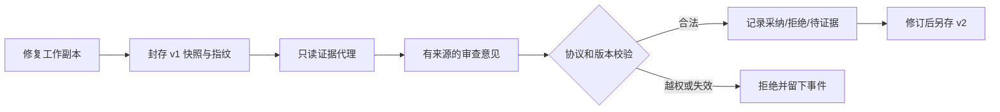

# 多 Agent 第一阶段：只读权限、版本快照与证据交接

日期：2026-10-22。对应 [21 号规划](21_规划_RAG与多Agent协作深化.md) 的 A 阶段。

本轮完成协作基础代码及离线验收，还没有接入真实审查模型、角色调度、生产数据库或面板。没有发生真实模型调用，共享账本和原有运行代码保持不变。后续先完成双 Agent，再按需要增加文档查阅者；架构不限制为两个角色。

## 本阶段解决了什么

假设修复者交出第一版代码，审查者据此提出意见。在它审查期间，如果修复者又修改了代码，不能让审查者不知不觉读到第二版；第一版通过的测试，也不能给第二版背书。除此之外，“审查者只能读”必须体现在工具能力里，而不能只靠提示词。

现在的基础组件能够做到：

1. 将允许范围内的原始代码、候选代码、问题和补丁复制为独立快照，记录内容指纹；后续修改工作副本不会改变旧快照。
2. 只提供列目录、读行、字面搜索、读补丁、读报告和提交审查六类操作。模型输入只能引用登记的对象 ID，没有命令执行或任意文件路径入口。
3. 审查意见必须关联当前任务、候选版本、有效出处及原始要求。不存在的引用、其他任务的证据和旧版本报告会被拒绝。
4. 分开保存程序测试结果与模型主张。审查意见校验通过只说明来源与格式有效，不能据此宣布缺陷真实或修复成功。
5. 允许逐条记录采纳、拒绝和证据不足；拒绝需要来源，采纳本身不等于已经修复。

这些组件现在由离线程序调用。完整模型协作需要后续 B/C/D 阶段接上调度、记账、模型及界面。

## 改动前后

以前只有单 Agent 运行及其最终补丁、测试报告，没有审查者工具或版本化交接校验。

本轮增加的离线链路是：



总控仍由程序承担。图中的审查意见在本轮示例中由人工编写，不是已经调用了审查模型。

## 文件与关键接口

| 新增文件 | 作用 |
| --- | --- |
| [collaboration_protocol.py](../scripts/collaboration_protocol.py) | 不可变的角色、候选、文档来源、交接、审查和响应结构；严格类型、版本、枚举和额外字段校验 |
| [review_tools.py](../scripts/review_tools.py) | 候选快照、文件与链接边界、只读代理、证据登记、取消与拒绝事件 |
| [collaboration_demo.py](../scripts/collaboration_demo.py) | 不调用 API 的完整合成交接示例，实际在独立 Python 进程执行三种输入检查 |
| [test_collaboration_protocol.py](../scripts/test_collaboration_protocol.py) | 19 项协议与语义边界测试 |
| [test_review_tools.py](../scripts/test_review_tools.py) | 29 项文件、权限、版本、取消、重放及既有任务兼容检查 |

可沿下面的顺序读代码：

- [seal_candidate](../scripts/review_tools.py:121)：检查 manifest 原件、保护文件和实现范围，生成基准/源码/补丁摘要，复制独立快照。它也能封存未修改的仓库；是否值得调度审查由后续总控判断。
- [ReviewSnapshot](../scripts/review_tools.py:98)：核对快照清单和每个对象的内容；快照没有依赖工作副本的硬链接。
- [ReviewEvidenceBroker.dispatch](../scripts/review_tools.py:344)：核对调用者、允许工具、参数、版本、取消和快照完整性，再分派操作；没有 shell 回退分支。
- [validate_handoff](../scripts/collaboration_protocol.py:268) 与 [validate_review](../scripts/collaboration_protocol.py:289)：核对身份、范围、版本、证据和需求来源。
- [validate_response](../scripts/collaboration_protocol.py:309)：核对修复者对具体意见的响应及后继候选来源，不自动将采纳标为已解决。
- [run_demo](../scripts/collaboration_demo.py:66)：展示这一阶段实际可运行的内容。

本轮没有修改原有运行脚本、模型包装、共享费用配置、检索策略、压缩策略或上游 Mini 源码。新增代码使用已经安装的 Pydantic 2.13.5，无新增依赖。

## 权限与快照的具体边界

快照来源必须是项目内、manifest 指定的普通 UTF-8 文件；拒绝越界路径、Windows 盘符/UNC/ADS、设备名、大小写冲突、链接、reparse point、硬链接，以及 .env、.git、temp 等私有或运行目录。导出副本按字节重新创建，不通过链接复用源文件。

检查实现变化时，manifest 中实现目录以外的文件必须保持原样；任务描述和已登记行为检查受保护；不接受额外实现文件。范围规则延续当前“修改已有实现文件”的约定。

审查者的每次读取都通过注册 ID 映射，不能让模型指定本机路径。每次操作前后核对快照，发现篡改或 I/O 完整性异常后阻止后续操作。即使外部又把文件改回去，这个 broker 也不会自行恢复为可信状态。

读取最多 80 行、正文 4096 字节，搜索最多 20 条命中；输出明确说明截断。超过正文限制的单行返回 line_too_large，不生成虚假的完整片段证据。查阅源码不会 import 或执行候选文件。来源映射和证据只读视图不允许通过公开操作覆盖。

这是工具层的只读保证，不是操作系统安全沙箱。快照在磁盘上仍可被同权限的其他本机程序改写；本组件的保证是检测变化并停止。极端的同权限并发恶意竞态、不可信仓库执行隔离和网络沙箱尚未覆盖。

角色名是有界身份字段，没有写死 repairer/reviewer 两个枚举；但工具权限单独授予。新建“文档查阅者”名字不会自动获得额外权限。当前冻结任务已包含部分 .md/.rst 文档，快照可保存这些文档；还没有实现自主规范调查 Agent、PDF/Word 导入或 RAG 扩展。

## 协议与规划示例的落地差异

21 中的 JSON 是设计示意，本轮将实际 wire format 定为 schema_version=1：

- 摘要使用完整 64 位小写十六进制 SHA-256，不含示例中的 `sha256:DEMO` 前缀。
- Handoff 将只读范围明确为 read_document_ids、report_ids、evidence_ids，write/execute 固定为严格布尔 false；接收对象由可信程序指定。
- 工具提交使用 `submit_review({"report": ...})`，由程序登记审查；审查者没有写文件操作。
- 所有集合存为不可变 tuple，拒绝未知字段、字符串整数、布尔冒充整数、非法枚举和其他 schema 版本。
- 原始问题按段落生成 requirement_id，审查者只能引用这些已登记条款；它仍可能误解条款，程序校验不代替事实判断。
- 当前 EvidenceRef 支持 source、diff、program_test、model_claim。跨角色工具观察、完整共享注册表和持久事件序号在后续 B 阶段接入；当前事件序号只在各 broker 内递增。

ProgramReport 必须由可信程序接入点登记，模型不能通过工具新增“程序报告”。A 阶段不为外部任意 JSON 提供身份认证或签名；后续评分器适配需要保持这个信任边界。broker 当前存于内存，重启后不会自动恢复或继续调用。

## 本轮实际检查

完整离线回归运行 **198 项：197 通过、1 跳过**。其中原有 150 项全部通过，新增 48 项中 47 通过、1 跳过；不是“198 项全部通过”。

| 场景 | 本次证据 |
| --- | --- |
| 旧版快照与新修改隔离 | 实际改写工作副本并创建 v2，v1 仍返回原字节 |
| 写入/执行和扩权 | bash、exec、write、import_module 等拒绝；测试监视 subprocess.Popen，拒绝路径没有启动子进程 |
| 路径与身份 | 越界、UNC/ADS、设备名、其他 run/角色/版本、超长或额外字段被拒绝 |
| 快照完整性 | 改源码对象、改清单、缺对象均不能继续正常审查 |
| 来源与报告 | 旧报告、错误行号/哈希、伪造需求、模型主张冒充程序检查被拒绝 |
| 审查与处置 | 空意见/纯风格不能要求返工；重大意见不能与 approve 并存；证据不足可正常表达；拒绝需要依据，采纳不自动标已解决 |
| 取消 | 请求前取消拒绝读取；提交过程后检查发现取消时，不登记完成审查 |
| 实际链接 | 本机硬链接、Windows 目录 junction 均创建后被拒绝；目标诱饵未被写入 |
| 文件符号链接 | 本机创建权限不足，**跳过 1 项实际文件 symlink 测试**；不能将属性夹具或 junction 当作该项实测 |
| 补丁重放 | 缺少末尾换行的补丁通过实际 git apply；补丁存为 LF |
| 既有任务接入 | split-after-boundary 的真实 manifest/文档/保护文件可封存，冻结原件哈希不变；没有重新做模型修复 |
| 既有功能回归 | 账本、平台、检索、上下文、任务服务/本机接口等原有 150 项通过 |

初次受限环境不允许创建硬链接和目录联接，导致 1 错误、2 跳过；允许本机检查后，硬链接与 junction 实际分支通过，文件 symlink 仍受操作系统权限限制。本轮未调整系统权限或防护设置。

开发中还发现 Pydantic 对 Literal[1]/Literal[False] 可接受数值相等的 bool/float/int，已改为严格标量及值约束，并验证 `true`/`1.0` 不能冒充版本、`0` 不能冒充权限标记。一次中间方案使严格 JSON 数组解析失败，离线示例暴露后改正；最终代码另经完整回归。没有因此修改项目运行保护或重跑付费身份。

正式检查日志和源文件快照保存在[本轮成果目录](../experiments/multi_agent_stage_a_20261022/qualification.json)，完整回归见 [all_tests_native.log](../experiments/multi_agent_stage_a_20261022/checks/all_tests_native.log)。35 个产物条目由同目录 artifact_sha256.json 封存。过程夹具和初始失败日志留在 temp，不删除。

## 可以直接运行的离线示例

在主项目目录运行：

```powershell
.\.venv\Scripts\python.exe -B scripts/collaboration_demo.py
```

程序会新建一个独立 temp 示例目录，打印结果与 summary 路径。无 API 请求，不连接任务面板或生产数据库，不删除旧材料。

示例的要求是：空输入返回 0，非空输入保留其和，包括负数。执行情况：

| 版本 | 实现与过程 | 实际独立检查 |
| --- | --- | --- |
| baseline | 人工准备的错误实现 | 0/3 通过 |
| v1 | 人工准备的首版，误用 abs 丢失负数结果 | 2/3 通过 |
| 审查 | 人工编写意见，引用代码与程序报告，要求核对负数行为 | 来源及版本校验通过；没有 LLM 判断 |
| v2 | 人工准备修订，删除 abs | 3/3 通过 |
| 边界 | 尝试 bash；将 v1 审查用于 v2；再次读取 v1 | bash 被拒、旧审查被拒、v1 字节未变 |

已核验示例见 [summary](../experiments/multi_agent_stage_a_20261022/demo/summary.json)、[初审](../experiments/multi_agent_stage_a_20261022/demo/review-v1.json)、[修复响应](../experiments/multi_agent_stage_a_20261022/demo/response.json)、[新版程序报告](../experiments/multi_agent_stage_a_20261022/demo/report-v2.json)。

它证明权限、证据、交接和版本机制能工作，不能据此声称模型发现了真实缺陷、双 Agent 已提升效果或完成了真实协作。

## 下一阶段与保留限制

下一步进入 B：把父任务/角色/候选/交接写入增量存储，接 mock 总控及完整故障状态；为共享账本增加父运行和角色归属，保留原账本金额和未知记录。先在 temp 数据库和合成账本上验证迁移、去重、取消和中断不重发，再接生产路径。

之后 C 接真实模型和一次反馈，D 接面板，E 做新任务比较。当前页面还不能选择双 Agent，尚未有真实 reviewer 调用或新增模型费用；单 Agent 使用方式和默认策略保持。双角色闭环可靠后，再加入按需查项目规范的第三角色，并与直接查阅比较。RAG 继续暂缓。

## 2026-10-23：按 A 阶段实施请求核对已有实现并重新验收

本次先读 Job/主项目 AGENTS、00、21 第 13.1 节及本篇，再核对源码和测试，确认请求中的 A 阶段已于 10 月 22 日完成，B 的离线工作也已有独立记录。本次没有重新创建或覆盖实现，不把已有能力记为今天新增，也未进入 C、调用真实模型或修改任何账本代码与正式账本。

实际主项目根目录不是 Git 仓库，无法用根目录 `git status` 判断近期修改。因此改用封存证据核对：10 月 22 日 A 阶段成果清单中的 **35 个条目全部吻合**；当前的两个内核、两个测试和离线示例共 **5 个文件**均与当时 inputs 副本逐字节一致。源码确实存在，历史完成记录有对应产物，不能仍按“尚待实现”处理。

### 本次核对的代码与行为

| 规划要求 | 当前实现与本次验证 |
| --- | --- |
| 版本绑定的交接/证据/审查 | `collaboration_protocol.py` 的 Candidate、SourceRef、EvidenceRef、Handoff、ReviewReport、FindingResponse 和 schema_version=1 已存在；bind_version 及各 validate 函数拒绝跨任务、旧候选、错误来源及无依据的返工意见 |
| manifest 限定快照 | `review_tools.py` 的 seal_candidate 按清单与实现前缀封存独立文件，保护问题和检查；ReviewSnapshot 核对清单和对象哈希 |
| 只读分派 | ReviewEvidenceBroker.dispatch 只接受 list_files/read_lines/search_text/read_diff/read_report/submit_review；先校验身份、授权、版本和快照，再执行固定分支，最后再次核对完整性与取消状态 |
| 越权、污染及过期 | 实际 temp 夹具覆盖执行/写入分支不可达、路径越界、跨 run 同名 ID、v1/v2 隔离、快照篡改后永久阻止、旧程序报告/审查拒收、model_claim 不冒充程序检查 |
| 可解释的离线交接 | 重跑 collaboration_demo.py：人工构造 baseline/v1/v2 和意见；独立 Python 进程执行检查，分别 0/3、2/3、3/3；bash 被拒、旧审查拒收、v1 旧字节保持 |

两个内核均不 import 模型客户端，也不连接生产数据库或费用接口。审查通过只代表格式和出处有效，不能代替缺陷真实性与修复结果的独立判断。上述流程与文件讲解沿用本篇前文，本次没有接口变化。

### 本次实际运行结果

按 21 的三个原命令运行两组定向检查和全量回归，并另跑离线示例。完整命令在日志对应 qualification.json 中；本轮全量包含已存在的 B 阶段检查，不能全部算成 A 新增测试。

| 检查 | 本机补验结果 |
| --- | --- |
| `unittest discover -s scripts -p 'test_collaboration_protocol.py' -v` | 19 项，19 通过 |
| `unittest discover -s scripts -p 'test_review_tools.py' -v` | 29 项，28 通过、1 跳过 |
| `unittest discover -s scripts -p 'test_*.py' -v` | 236 项，235 通过、1 跳过；无失败或错误 |
| `scripts/collaboration_demo.py` | 退出码 0；三项版本/权限布尔检查均为 true；无模型调用 |
| 正式文件前后核对 | scripts、configs、data 中共 1,370 个文件哈希与文件集合未变，包含正式共享账本；未输出 .env 内容 |

首次受限运行如实保留：工具测试 29 项中 26 通过、1 个硬链接创建权限错误、2 个链接跳过；全量运行 236 项，日志记录 6 个错误、2 个跳过（包含同一测试方法的子测试错误，不直接按错误条数计算通过项数）。错误为 1 个硬链接 WinError 5 和 5 个本机 HTTP 访问 WinError 10013。随后在本机权限范围补验同一组命令，真实硬链接、目录 junction 和 loopback 回归通过。**实际文件 symlink 仍因权限不足跳过 1 项**，属性夹具/junction 不替代该项实测。本次未调整系统权限或修改测试掩盖限制。

本次新建夹具仍全部位于 temp。沿用的测试与示例内部基础路径含 `multi_agent_stage_a_20261022`，但每次使用新 UUID 子目录，不覆盖历史材料；本次复核脚本、初次失败和补验日志统一另存 `temp/multi_agent_stage_a_20261023/`。没有执行删除操作。

正式复核证据另存 [multi_agent_stage_a_recheck_20261023](../experiments/multi_agent_stage_a_recheck_20261023/qualification.json)，未覆盖 10 月 22 日成果。其中保留两次完整日志、文件前后哈希、五份源码输入副本和本次示例；[artifact_sha256.json](../experiments/multi_agent_stage_a_recheck_20261023/artifact_sha256.json) 的 **47 个条目全部复核通过**。可直接查看[补验全量日志](../experiments/multi_agent_stage_a_recheck_20261023/checks/native/all_tests.log)、[受限首次日志](../experiments/multi_agent_stage_a_recheck_20261023/checks/restricted/all_tests.log)及[本次示例 summary](../experiments/multi_agent_stage_a_recheck_20261023/demo/summary.json)。

结论：本次要求的最小离线 A 能力已有实现，本次复核未发现需要补改的缺口，交付为重新验收与证据补充。仅证明这些离线机制在列出的范围内工作；不是 OS 沙箱、真实模型审查或多 Agent 效果验证。同权限极端并发竞态和实际文件 symlink 检查仍保留限制。项目整体仍停留在 A/B 离线完成、C 尚未接入；本次任务到 A 的复核记录结束，不自动启动 C。
