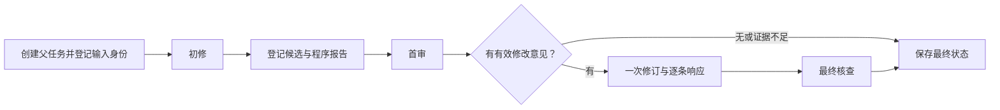

# 多 Agent 第二阶段：持久调度、故障状态与角色记账

日期：2026-10-22。承接 [22 的权限与证据内核](22_过程_多Agent权限与证据交接内核.md)，对应 [21 规划](21_规划_RAG与多Agent协作深化.md) 的 B 阶段。

**本轮已实现离线协作总控和持久存储，还没有调用真实模型。** 新协作数据库和角色账本限定在项目 temp；正式面板、正式数据库与共享账本内容没有迁移或改写。角色行为和费用回执由脚本构造，不能当作模型修复成绩或实际 API 收费。

## 现在解决了什么

上一阶段能够检查“意见来自哪份代码”，但角色和审查状态只在内存中。现在把父任务、四个阶段的角色执行、候选快照、交接、意见、响应和逻辑请求保存下来，并由程序按固定规则串行调度。

实际效果是：

- 首审没有要求修改时，跳过返工和最终审查；要求修改时，至多进入一次修订及最终核查，不继续循环。
- 进程已经退出但状态留在 running 时，重新进入只标记中断，不从轨迹自动恢复、不重复运行角色。
- 同一个创建请求、角色 claim 或平台派发不能被重复执行；取消发生后，不能再提交该角色成功或启动下一角色。
- 一次费用预留会连同父任务、角色、会话、逻辑请求及平台尝试序号一起落盘。随后 SQLite 写事件失败，预留仍有归属。
- 所有角色按唯一 ticket 汇总。没有回执的 token 和费用保留未知；未定价成功回执可以有已知 token，但完整费用仍未知。

用户仍通过原面板使用单 Agent。本轮新增流程暂不出现在正式页面里。

## 流程与持久数据



父任务仍有 queued/running/cancel_requested/finished/failed/cancelled/interrupted。角色另有 pending/running/succeeded/failed/cancelled/interrupted/skipped，保存因果父角色、会话、输入/输出指纹、开始结束、运行时间和时间限制。

初修和修订使用同一会话身份，首审和最终审查使用各自身份。这里是持久身份设计，真实模型的消息接续与独立上下文将在 C 阶段接入，不能把两个身份当成已验证的模型隔离。

SQLite 增量结构包含：

| 结构 | 职责 |
| --- | --- |
| collaboration_schema | schema_version=1；未知或不完整版本明确拒绝，不重建数据库 |
| collaboration_runs | 父运行的阶段、revision、活动角色、当前候选/审查和策略指纹 |
| role_runs | 四阶段执行身份与状态；同父同阶段唯一，同父最多一个 running 角色 |
| collaboration_objects | 交接、报告、证据、意见、响应及快照登记；内容追加、带哈希，不允许相同身份换内容 |
| logical_requests | 角色请求的幂等 key、输入指纹和 prepared/dispatching/received/outcome_unknown 状态 |
| request_attempts | 每平台尝试的 ticket 和派发状态；同逻辑请求同平台唯一 |
| runs/events（沿用） | 原父运行与递增事件；状态改变与事件写入在同一事务 |

迁移前用 SQLite backup 保存一致性副本，以迁移锁防止两个进程同时建表。测试核对旧任务 payload 逐字不变，重新打开不重复备份。当前 CollaborationStore 构造器拒绝生产 data 路径；导入代码本身也不会打开正式数据库。

## 本轮文件和关键接口

| 文件 | 变化及阅读入口 |
| --- | --- |
| [collaboration_store.py](../scripts/collaboration_store.py)（新增） | CollaborationStore 继承 RunStore；create_collaboration/claim_role/register_snapshot/register_record/complete_role/finish 管理身份、证据及阶段；stop/reconcile_collaborations 保留故障 |
| [collaboration.py](../scripts/collaboration.py)（新增） | CollaborationCoordinator 串行调度；RoleContext 检查取消/超时；RoleBudget 关联费用；attributed_usage 做全角色汇总 |
| [collaboration_mock.py](../scripts/collaboration_mock.py)（新增） | ScriptedRunner 和 run_demo 提供无 API 的完整持久化示例 |
| [deepseek_budget.py](../scripts/deepseek_budget.py)（修改） | reserve 增可选 attribution；settle 增可选 usage；旧调用不传新参数时保留原预留形状；未定价回执增加严格计数校验 |
| [test_collaboration_store.py](../scripts/test_collaboration_store.py)（新增） | 24 项存储、迁移、身份、费用与故障窗口检查 |
| [test_collaboration.py](../scripts/test_collaboration.py)（新增） | 14 项分支、进程退出、边界崩溃、取消、期限、锁与完整性检查 |

未修改既有 task_service_store.py、task_service_worker.py、模型包装或面板。底层继续用既有 SQLite 和共享账本，无新增依赖或编排框架。

## 身份、来源与防重复的约束

父创建身份包括任务、基础策略、离线协作模式、协作策略指纹以及冻结输入指纹。相同 key 同内容返回原记录，换题、换策略、换时间配置或换输入均拒绝。生产题目从其固定 manifest/issue 计算身份；合成示例使用明确的 synthetic-arithmetic 身份，不借用真实题名冒充成绩。

第一个候选也必须与父任务输入一致，不能只检查后续 v1/v2 相同。候选生产者须为当前修复角色；源码快照被复制到数据库所属目录，写入并 fsync、核对哈希后才登记。文件写好而 DB 未登记时崩溃，会留下不可用的孤立文件，不把它自动当作成功输出。

读取持久对象核对 payload 摘要，读取快照再次检查内容；源码证据的行号、文件哈希和片段字节同时复核。审查只能针对活动候选；修复响应只能针对活动审查。一个角色不能换 ID 交两份不同审查，同条意见不能用不同响应 ID 覆盖处置。

角色 claim 使用预期 revision 与事务检查；取消标记、旧 revision 或已有 running 角色均阻止新的 claim。角色有未确定的 prepared/dispatching 请求时，不允许结束该角色并启动下一人。

最终核查即使输出 approve，只要前序意见仍是 unanswered 或 needs_evidence，父汇总就保持 insufficient_evidence。采纳和拒绝仍不等于独立事实裁决。B 阶段的 parent.repair_result 始终 unknown，不能把脚本审查或三项示例检查提升为正式修复验收。

## 费用归属和跨存储故障

每个新多角色 ticket 的 attribution 至少包含：

```json
{
  "run_id": "parent-run-id",
  "role_run_id": "role-attempt-id",
  "session_id": "role-session-id",
  "logical_request_id": "logical-request-id",
  "attempt_ordinal": 1
}
```

provider 单独保存。该信息与原预留金额在同一账本锁内、同一次原子保存中写入；不依赖随后才能写好的 SQLite 事件。旧账本记录不回填、不改金额、不清除未知占位。

调用顺序为：登记逻辑请求 → 账本预留并绑定归属 → SQLite 登记 ticket → 检查取消并把该 ticket 标为 dispatching → 请求/回执 → 共享账本结算 → SQLite 记录回执。B 只模拟这条流程，没有 HTTP 外呼。

| 故障窗口 | 已实现行为 |
| --- | --- |
| 预留前取消 | 不产生新 ticket |
| 账本已预留，DB 事件失败 | ticket 仍带完整身份，汇总可查；没有回执保留未知；再次预留被阻止 |
| 重复派发同 ticket | 只能从 reserved 转一次 dispatching，重复转移被拒绝 |
| 首平台失败 | 费用占位保留；仅明确可切换的失败允许下个平台，最多两个平台，各一次 |
| 首平台结果未定 | 不允许擅自再用备用平台；不确定请求不能借切换自动重发 |
| 响应已计费后取消 | 账本可先记回执，角色/DB 后续操作被取消阻断，汇总仍保留费用与 token |
| 进程退出、DB 仍未完结 | 角色和父任务标 interrupted，未确认请求/尝试标 outcome_unknown；不自动重发 |

共享账本与 SQLite 不可能组成网络调用的一个原子事务，所以不宣称付费请求“恰好执行一次”。当前保证是：身份和已知回执能追溯，遇到不确定情况停止，不自动重发。即使 reserved 请求可能尚未真正发出，也保留未知占位，不能当成确认收费。

汇总按本 run 的唯一 ticket 集，不按共享总账前后差。报告已知输入/输出 token、是否还有未知用量、已知价格估算、未知数量/占位、完整费用及每角色明细。任何价格未知项使 complete_cost_estimate_cny 为 null；已知 token 不代表已知价格。

RoleBudget 本阶段强制使用注入的 temp 合成账本。正式模型对该桥接层的接线、同父任务保持备用平台的路由状态和实际故障回执，在 C 阶段完成；不要把模拟备用测试当成新的真实平台连通验证。

## 实际验收及其边界

最终完整离线回归 **236 项：235 通过、1 跳过**。新增 B 阶段 38 项全部通过；原有 198 项中的文件 symlink 仍因 Windows 创建权限跳过，真实硬链接和 junction 检查通过。

已验证：

- 旧 SQLite 行与一致性备份，迁移锁/未知版本保护，创建请求及角色并发 claim 去重。
- 首候选与冻结输入绑定、跨版本来源、持久对象篡改检测、证据不足、拒绝意见及最终仍有异议时不再返工。
- 四个角色开始边界取消、输出已生成后取消；未回答意见不能被最终 approve 掩盖。
- before_role_claim、after_role_claim、after_role_output、after_role_completion、before_finalization 五个边界注入进程级中断异常；新 store/总控只识别中断，不再调用 runner。
- 实际启动独立 Python 子进程，写入 running 后退出，再由新总控识别 interrupted；这不是对在途真实 HTTP 请求或断电的实测。
- 预留与事件之间失败、重复派发、计费后取消、首失败/备用成功、未知价格、旧账条目保留及跨角色 ticket 汇总。
- 已结束运行重新打开后不执行，普通异常不把任意异常文本写入公开父状态，协作锁阻止第二个总控。

一次受限运行在 temp 路径保护检查处失败；单独检查路径解析未复现，未确定原因。随后本机权限检查及最终完整回归通过，初始日志保留；没有为绕过失败而放宽 temp-only 限制。

期限写入父策略和角色记录，成功阶段保存实际运行时长。同步 runner 只能在调用前、返回后及其主动 check 时检查取消/超时，**不能强制抢占任意阻塞回调**。真实网络/命令剩余超时及 worker 子树清理仍需 C 接线。进程中断时精确结束时间保持未知，另记识别时间。

## 可运行的持久离线示例

在主项目目录执行：

```powershell
.\.venv\Scripts\python.exe -B scripts/collaboration_mock.py
```

它创建新的 temp 数据库、独立快照和合成账本，依次运行四阶段，并重新打开同一个运行验证不重跑。示例只测试算术函数；规范、审查、修改由脚本预写，三项行为检查在独立 Python 进程真实执行。

已核验结果：finished；四角色均有持久记录；两份审查/交接、一份修复响应；重开不重跑；repair_result=unknown。示例的 4 个票据、40/8 token 和 0.004 元均为**人工构造的记账测试数字**，不是 API 消耗或收费。

成果入口：[qualification.json](../experiments/multi_agent_stage_b_20261022/qualification.json)、[示例汇总](../experiments/multi_agent_stage_b_20261022/demo/summary.json)、[最终回归日志](../experiments/multi_agent_stage_b_20261022/checks/all_tests_qualified.log)。同目录保留一致性 SQLite 副本、快照、合成账本和源文件快照，31 个文件由 artifact_sha256.json 封存；正式包不作为可续跑的生产库。

## 下一步：接真实模型，而非扩大角色数

C 阶段需要完成：

1. 在现有受保护模型请求路径上添加只读审查工具，保留所有计费、路由、脱敏和取消保护，不直接另开客户端。
2. 接修复会话的反馈续接，处理提交工具调用的消息闭合与阶段 completed 状态；首审/最终审查保持独立上下文。
3. 把父路由状态、角色记账和上述持久状态接入现有 worker/Job Object，验证剩余 deadline 与所属子进程清理，再按新冻结身份做一题真实接入。
4. 明确审查服务失败时保留已有补丁/验收的降级呈现。当前 B 的 runner 异常统一 failed，不假称该降级分支已实现。

随后 D 接页面，E 做新任务公平比较。新增只读文档查阅者仍在双角色闭环可靠之后按需引入；RAG 暂缓。当前没有真实双 Agent 结果、广泛效果提升或自动恢复能力。
