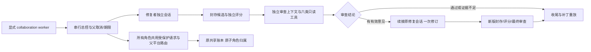

# 双角色模型接线、离线反馈与单题真实验收

日期：2026-10-23。对应 [21](21_规划_RAG与多Agent协作深化.md) 的 C 阶段。

同日最新补正：报告语义与拒绝原因索引已离线完善，新增5项检查通过；C定向24项全部通过，统一回归上游301通过、项目260项中259通过/1权限跳过。复核确认非法响应原文已在旧轨迹的 `extra.response` 中，上一轮“原文未保存”的判断有误，现明确纠正。旧854个封存条目不改，另封存15条补正证据；本次0真实调用、共享账本未变。实现和限制见末节。

本轮实现了受保护的审查模型、修复会话续接、父平台路由、角色请求归属、独立评分/重放和显式 worker 分支。**代码与离线接线已完成；用户明确确认后，一题真实初修＋独立审查接入通过。** 首次准备运行曾在执行前被自动审批拒绝，随后用户确认目的地、发送内容和费用范围，才执行唯一新身份。真实审查直接批准，返工和最终核查跳过；这两个分支仍只有离线验收，不能称 C 的所有真实分支已覆盖。

最终默认回归：上游原样适用子集 **301 通过**；本项目 **255 项中 254 通过、1 项权限跳过**，新增 C 阶段 **19 项全部通过**。适配诊断为 **169 通过、6 失败、1 跳过**，相较 24 修正了超时字段一项；其余差异保留。上述离线检查期间正式共享账本未变；之后获确认的真实运行追加了16次尝试，原账目逐项保持。生产任务数据库未迁移，单 Agent 默认策略和面板模式不变。真实结果和限制见文末。

## 从 B 阶段到现在，实际增加了什么

B 阶段由程序预写各角色输出，主要验证存储和调度。现在的调用链已经接到既有模型保护路径：



图中“模型”传输在离线集成测试里均由固定响应代替。工作副本、Bash 命令、SQLite、快照、冻结检查和补丁重放实际执行；离线记录本身不是模型效果。用户确认后的真实初修/审查另行封存，未覆盖离线记录。

## 文件与关键接口

| 文件 | 本轮改动及其作用 |
| --- | --- |
| [review_model.py](../scripts/review_model.py:19) | 新增 ReviewModel，实际请求只携带六种受限工具的 schema；工具解析、参数大小与单调用限制独立于 Bash 模型 |
| [collaboration_runtime.py](../scripts/collaboration_runtime.py:23) | 新增 LiveRoleBudget、角色请求 hooks、RepairModel、ProtectedReviewModel、RepairEnvironment、RepairSession 和审查循环 |
| [collaboration_live.py](../scripts/collaboration_live.py:25) | 新增可接入的角色 runner：准备固定任务、预检、封存、评分、审查、响应登记、最终重放和证据收尾 |
| [multi_agent_v1.json](../configs/multi_agent_v1.json) | 新增有界时间、一次反馈窗口、候选选择与降级规则；采用已有 adaptive_history 基础策略，不改它的参数 |
| [run_deepseek_smoke.py](../scripts/run_deepseek_smoke.py) | 原模型新增可选父路由/检查/期限和内部发送扩展点，默认仍调用上游 Bash 发送；超时输出补上 extra.exception_type |
| [collaboration.py](../scripts/collaboration.py) | RoleBudget 增加可选角色检查入口；原 mock 调度和记账逻辑继续复用 |
| [collaboration_store.py](../scripts/collaboration_store.py) | 增显式 live 身份、live 中断识别及受约束的终态验收/用量附件；数据库仍限定 temp，不放开生产库 |
| [task_service_worker.py](../scripts/task_service_worker.py) | 新增显式 --collaboration 分支，沿用 worker 锁和 Windows Job Object；新建 subprocess 可按所属 PID 清理。原 single 分支保留 |
| [test_collaboration_runtime.py](../scripts/test_collaboration_runtime.py) | 19 项 C 接线与真实文件离线检查；API 传输使用固定响应和故障，账本均为 temp 合成数据 |

### 审查工具怎样保证只读

[ReviewModel](../scripts/review_model.py:19) 覆盖的只有请求工具集、动作解析和 observation 格式。它继续经 BudgetedDeepSeekModel 的上下文保护、平台顺序、预留、结算和错误分类，不另开不记账的客户端。

请求工具严格为 list_files、read_lines、search_text、read_diff、read_report、submit_review。解析时要求恰好一个调用，再交给 A 阶段 broker 做身份、范围、版本、快照与证据校验。提出 bash、任意路径、额外字段或旧版本引用都不会转成执行命令；提交意见也不是写文件权限。

审查者使用独立消息历史。旧工具正文只在 API 视图中按需缩短，保留真实 tool_call_id、证据 ID 和原始再读取参数；原始轨迹不改。连续重复相同文件/范围/内容证据会停止，不能通过新生成的 evidence_id 绕过重复检测。格式错误至多连续三次，不无限尝试。

### 修复者怎样接着原会话修订

[RepairSession.continue_with_feedback](../scripts/collaboration_runtime.py:142) 不再次调用 agent.run 清空消息。它先确认上次确实由提交命令结束，并将最后 assistant 调用与执行环境保存的实际完成凭据逐项核对。

只有能够证明提交已执行，才补入对应 tool_call_id 的真实完成观察，再追加审查意见。原始 exit 留在轨迹中，发送 API 的视图去掉内部 exit；提交命令不会重放。累计调用数、费用、TaskState 和历史保留，只有阶段计时与角色归属切到修订阶段。无法证明末次动作完成时拒绝续接。

修复者需在受检查的 `temp/finding_responses.json` 逐条声明 accepted/rejected/needs_evidence、原因与证据。读取拒绝链接/硬链接/越界及超大文件，字段不能覆盖程序指定的任务或候选身份。拒绝意见必须有可校验的目标版本证据；采纳只是记录意图，独立评分才判断代码行为。缺失的回复保持 unanswered，最终 approve 不会将其掩盖。

### 全角色请求怎样计费和切备用

[RoleModelHooks](../scripts/collaboration_runtime.py:38) 在发送前为每次逻辑请求准备持久身份；[LiveRoleBudget](../scripts/collaboration_runtime.py:23) 调用已有 SharedBudget 的原子预留接口，将父运行、角色、session、逻辑请求、平台尝试一起写入同一张 ticket。真实模式使用原共享账本和原锁，离线测试则显式注入 temp 合成账本，不创建实际角色独立总账。

父级 route_state 由所有模型对象共享。首选失败并切备用后，新审查对象与复用的修复模型都读取父状态，不重新尝试首选。每个平台在同一逻辑请求最多尝试一次；上下文、鉴权和服务保护不绕过。响应先结算/保存真实 usage，再解析动作或检查响应后取消；未知用量和未知价格保留未知。

请求前、备用前、工具前、已计费响应后和评分轮询均检查取消/期限。模型网络 timeout 取原45秒与剩余时间的较小值；Bash 取原30秒与阶段剩余时间的较小值；评分进程取原240秒与剩余时间的较小值。无法在 Python 回调中抢占已发出的同步 HTTP，实际策略是响应到账后保存用量并阻止下一动作。Windows worker 沿用原 Job Object，主动评分超时只清理该 worker 新建的所属子进程树。

## 实际离线验收

| 场景 | 实际结果 |
| --- | --- |
| 默认统一回归 | 上游301通过；项目255项中254通过、1个实际文件symlink权限跳过 |
| 本轮新增C检查 | 19项通过，包含请求wire、已结算格式错误、取消/备用/期限/去重、凭据阻断、连续反馈和失败降级 |
| 上游执行适配诊断 | 169通过、6失败、1跳过；超时extra字段修正通过。其余3项env和3项路径表示差异没有偷偷排除 |
| 正常返工全链路 | 在已有公开split-after任务的新工作副本，固定7次模型响应完成四角色；实际修改、独立验收和新副本补丁重放通过，父finished、repair passed、review approve |
| 审查服务故障 | 固定初修输出＋模拟审查503；共3次合成尝试后停止，角色状态为succeeded/failed/skipped/skipped；已有补丁实际验收/重放通过，父failed、repair passed、collaboration degraded、review unavailable |
| 费用/路由 | 首选失败→备用成功，复用/新模型保持备用；记录每次合成票据和角色归属，未知用量不填0 |
| 取消 | 请求前无ticket；首选错误时取消不发备用；收到响应后取消仍保留usage且不执行动作 |
| 真实进程 | 实际启动并超时终止评分替身进程，没有模型请求；真实反馈链中的评分/Bash均为本机子进程 |
| 终态 | 普通update仍拒绝终态修改；显式live附件不可改status/复活角色，同kind不同内容拒绝；重开interrupted身份不创建runner或模型 |
| 正式文件 | 最终检查期间1,514个上游/本项目源码、配置及data文件哈希未变；相对24，仅4个旧运行文件按本轮说明修改，其余1,505个旧文件保持 |

返工夹具的首版由脚本故意加入“非空但全0的余项被丢弃”问题，意见和修订也预写。它验证完整接口能接上，不能说审查模型自主发现了缺陷。合成7次/3次请求的token和费用都是离线构造值，不是API消耗。

开发中真实暴露并修正了两类接线问题：一是原普通RunStore.update在总控收尾后会拒绝写独立成绩，导致结果仍为unknown；现改为明确、不可覆盖且不改终态的验收/用量附件，既保留终态保护，也能附上实际验收。二是对接参数与固定模型夹具不一致，定向检查发现后修正。失败日志与最终结果分开保存，没有覆盖失败后重跑选优的真实任务。

超时结构修正后，24的七项差异减少为六项。环境变量仍受限，不因上游测试要求通用透传就放开；pwd路径表示差异仍单独记录。本轮未扩大环境权限、改检索排序、增加第三角色或恢复RAG。

## 入口、证据和未完成部分

以下帮助/默认回归不调用真实API：

```powershell
.\.venv\Scripts\python.exe -B scripts/collaboration_live.py
.\.venv\Scripts\python.exe -B scripts/run_regression.py
```

真实运行入口已接好：`scripts/collaboration_live.py --run --task split-after-boundary` 会创建新temp协作库/新run_id，通过 `task_service_worker.py --collaboration` 执行；默认不运行。首次工具执行被自动审批拒绝后，未绕过审批；用户明确回复“确认”后只执行了一个新身份，结果见末节。独立面板尚未加入双角色开关，生产库没有迁移，不能将CLI接线写成D阶段完成。

正式证据：[qualification.json](../experiments/multi_agent_stage_c_offline_20261023/qualification.json)、[最终项目日志](../experiments/multi_agent_stage_c_offline_20261023/checks/final/project.log)、[适配诊断](../experiments/multi_agent_stage_c_offline_20261023/checks/adapter/adapter.log)、[离线反馈示例](../experiments/multi_agent_stage_c_offline_20261023/offline_feedback/run/summary.json)、[离线降级示例](../experiments/multi_agent_stage_c_offline_20261023/offline_degradation/run/summary.json)。同目录保存模型轨迹、SQLite一致性副本、候选快照、独立报告、补丁、输入源码与失败记录，**598个条目**由artifact_sha256.json封存并复核。归档库是只读证据，不作为自动恢复入口。

离线验收结束时尚无真实双角色轨迹，其后真实初修/审查已补验；真实返工收益、付费在途取消和模型在途worker强杀仍未实测。测试导入的SDK曾在修正导入顺序前尝试获取公开价格元数据，受环境限制未成功；这不是模型推理请求，没有计入实际模型用量。当前初始化已先设置本地价格表/配置位置。离线证据中共享账本未变的结论只指当时；之后真实用量已按确认范围追加。上游回归仍保留24记载的可选异步配置/退出提示，不将异步UI功能说成验收。

### 首次审批阻塞与随后确认的范围

[live_approval.json](../experiments/multi_agent_stage_c_offline_20261023/live_approval.json)保留首次执行前被拒绝的历史，以下范围随后已获用户明确确认：

- 只跑已用公开任务`split-after-boundary`（more-itertools公开问题#658），不是新题效果比较。
- 按已有优先级发送到北邮`https://myai.bupt.edu.cn/llm-gw/v1`的`deepseek-v4-flash`，不可用时转`https://api.deepseek.com`的`deepseek-flash`，每逻辑请求每平台最多一次。
- 发送原始公开问题、固定任务工作副本中的相关源码片段、候选补丁、有界测试摘要、角色提示和反馈。冻结的本项目脚本用于本地留证，不自动作为模型输入；密钥只用于请求认证，不放入提示。
- 一个新身份、最多一次修订、父任务30分钟；不批量增加任务，不复用已付费身份重跑。
- 沿用用户已取消项目金额上限的现有策略，真实请求追加原共享账本；北邮定价未知，不能承诺总价或按官方价格算它。历史金额与未知记录保持。

自动审批最初要求就以上外部发送和费用范围获得明确确认。收到用户“确认”后，核对598个离线成果条目及9个当前C输入与封存一致，再执行以下唯一新身份；没有追加付费任务或重跑选优。旧拒绝记录保持原样，不改写为API错误。

## 用户确认后的单题真实接入

运行身份：`4891bcbc29c9439cb41439f13a203f3a`；任务为已有公开开发题 `split-after-boundary`，2026-10-23本地时间约16:26—16:27完成。CLI启动实际worker；修复者17.250秒、审查者12.234秒。它验证接入，不能作为独立新题或单/双Agent效果对照。

| 项目 | 实际结果 |
| --- | --- |
| 流程 | 初修succeeded、首审succeeded、修订skipped、最终审查skipped；父finished、repair passed、collaboration completed、review approve |
| 修改 | 仅 `more_itertools/more.py`，将余项先转为列表，仅在非空时产生最后一组；测试与受保护文件未改 |
| 基线 | 10项问题检查5通过/5失败，4项针对性通过；全量660项659通过/1项既有计时失败 |
| 候选和干净重放 | 两次都是问题10/10、针对性4/4；全量659/660，仍仅 `TimeLimitedTests.test_zero_limit` 失败，没有新增失败；实际包导入来自各自独立副本 |
| 审查取证 | 实际只执行read_diff、read_lines、read_report、submit_review；登记3份当前候选证据，提交3条informational意见，没有独立发现新缺陷 |
| 格式保护 | 前2次审查响应触发FormatError，未分派工具；之后合法调用完成。6次审查响应全部入账，不因解析失败少记费用 |
| 平台 | 北邮一次连接/请求错误，SDK给出status 500；随后15次官方成功响应。父route_state保持备用，审查者没有重新尝试北邮。不能据此判断北邮鉴权、余额或实际扣费 |
| 用量 | 共15个逻辑请求、16次平台尝试；修复者9个逻辑请求/10次尝试，审查者6/6；已知输入41,891、输出2,265 token，另1次用量未知 |
| 费用 | 已知价格估算0.101902元（修复0.044362、审查0.057540），另保留北邮0.10元未知占位；完整费用未知，占位不是已确认扣费，也不能与估算相加宣称实际总价 |
| 对账与封存 | 旧账所有字段/请求逐项不变；16张新ticket的父任务/角色/session归属吻合。156个冻结输入、179个运行自带条目核验一致，SQLite完整性检查通过，封存256条；两套实际凭据扫描无命中 |

正式证据：[qualification.json](../experiments/multi_agent_stage_c_live_20261023/qualification.json)、[summary.json](../experiments/multi_agent_stage_c_live_20261023/run/summary.json)、[补丁](../experiments/multi_agent_stage_c_live_20261023/run/repair.diff)、[重放报告](../experiments/multi_agent_stage_c_live_20261023/run/patch-replay/report.json)、[审查轨迹](../experiments/multi_agent_stage_c_live_20261023/run/reviewing-trajectory.json)、[审查结论](../experiments/multi_agent_stage_c_live_20261023/run/reviews.json)、[增量票据](../experiments/multi_agent_stage_c_live_20261023/ledger_delta.json)、[哈希清单](../experiments/multi_agent_stage_c_live_20261023/artifact_sha256.json)。同时保存冻结源码、候选对象、SQLite一致性备份、账本前后副本和worker日志。归档是证据，不用于恢复或重发请求。

### 本次暴露的限制与下一步

审查报告引用的程序摘要字段 `extended_passed=true` 实际表示“按基线比较后接受，没有新增失败”，不是“全部扩展测试通过”。原始评分保留了既有计时失败，但审查者将摘要概括成扩展检查通过；此表述过强。当前成绩以原始基线/候选/重放报告为准，不用approve覆盖失败事实。后续离线补正已将两种判断拆开，并提供既有失败名，详见末节；没有改写已付费身份的冻结输入或原审查记录。

关于两个非法格式响应，上一轮只检查了普通assistant消息，误判为没有完整正文。再次逐项读取错误消息的 `extra.response` 后确认：两次原始响应都已保存，每次均同时调用read_diff和read_lines，因不满足单工具规则而被拒绝，费用也已结算。本次补的是明确、有界的拒绝原因索引，原始响应保留能力来自上游，不能算作本轮新增。旧封存qualification中对应的“正文缺失”限制也是错误描述，保留原文件，并由[纠正记录](../experiments/multi_agent_stage_c_reporting_20261023/historical_audit_correction.json)明确更正，不覆盖历史哈希。

真实返工/最终审查未触发，尚未验证模型自主发现缺陷、接受/拒绝反馈或返工增益；离线7次响应完整链路仍仅是合成验证。在途取消/强杀也没有真实付费实测。当前可写“离线反馈链路和单题初修/审查接入通过”，不能写“C所有真实分支通过”或“多Agent提高成功率”。D面板、正式协作库和E新题比较均未开始；single默认和RAG暂缓的决定保持。

该次真实验收本身没有修改运行源码或测试，因此当时沿用执行前的301项上游、254项项目检查及1权限跳过。之后的报告/审计补正改了代码，已重新执行以下回归；6项适配差异仍未解决。

## 同日报告语义与拒绝审计补正（离线）

这一步只改后续运行的报告与诊断，不重新发送真实请求，不更改单Agent默认、角色权限、平台/费用策略或正式数据库。原真实身份继续绑定其156个旧输入；下一次运行必须创建新身份并冻结当前代码。

| 改动 | 行为与依据 |
| --- | --- |
| [verification_summary](../scripts/collaboration_live.py:25) | 移除含糊的extended_passed，分别提供accepted_against_baseline、full_suite_all_passed、基线/剩余/新增失败的数量和名称；名称预览截断时显式标记。沿用原评分接受规则，不更改成绩门槛 |
| 摘要长度 | 完整JSON不超过ProgramReport的2000字符限制；超长时减少名称预览，保留总数/截断标志和真假判断，不再直接切断JSON文本。摘要内部schema_version=2；外层交接/ProgramReport协议仍为1，旧记录可原样读取 |
| [ReviewModel._parse_actions](../scripts/review_model.py:29) | FormatError补review_rejection索引，区分数量错误、未知工具/缺ID、JSON错误、参数超长和schema错误；最多两条调用预览，整个索引不超过2048字节，保留完整参数SHA256。它是诊断索引，不是证据或执行许可 |
| 凭据与原始记录 | 保留ProtectedReviewModel在解析前扫描完整响应的顺序；发现凭据就停止，不落原文或索引。无凭据时，上游仍在extra.response保存原始响应及结算费用，未将原文再发起一次模型请求。索引有界不代表原始响应被截断 |
| [run_review](../scripts/collaboration_runtime.py:185) | 审查提示要求区分相对基线接受与全量全绿，必须提到剩余/新增失败；实际模型是否遵守此新提示尚未实测 |

新增5项有故障意义的检查：既有失败仍可接受但不能全绿、新增失败拒绝、原失败消失可全绿；大量/长失败名保持JSON有效；两工具响应拒绝后只有后续合法调用真正分派；超长参数索引有界而原始正文/摘要可追溯；含凭据非法响应在审计前阻断且计费保留。前三种评分情形合在同一测试方法，不重复计数。原有真实文件返工和服务失败降级也在本次回归中重新通过，模型传输仍为固定响应。

定向24/24；统一回归上游301通过、41未选、0保护违规，项目260项中259通过、1个文件symlink权限跳过，整体退出0。1,514个源码/配置/data文件在回归前后未变；相对补正前仅4个本项目源码/测试文件变化，上游、配置、共享账本与旧成果保持。此次没有改执行环境，未重跑适配诊断，上一轮169通过/6差异失败/1跳过仍是其最近实际结果；可选异步提示/退出警告也未解决。

用旧真实评分报告离线生成的[新摘要示例](../experiments/multi_agent_stage_c_reporting_20261023/report_example_from_historical_checks.json)明确显示accepted_against_baseline=true、full_suite_all_passed=false，以及原计时失败名。它不是新模型运行或对旧审查意见的事后替换。[验收记录](../experiments/multi_agent_stage_c_reporting_20261023/qualification.json)、[定向日志](../experiments/multi_agent_stage_c_reporting_20261023/checks/targeted.log)、[统一回归](../experiments/multi_agent_stage_c_reporting_20261023/checks/regression/summary.json)和4份当前源码共15条封存，旧598＋256条逐项验真。

当前两项离线补正完成，下一步为D面板。真实返工/最终核查、付费在途取消/强杀，以及新摘要对模型表述的实际约束仍未实测；不追加付费任务来凑覆盖，也不将本次离线通过当作双Agent效果提升。
