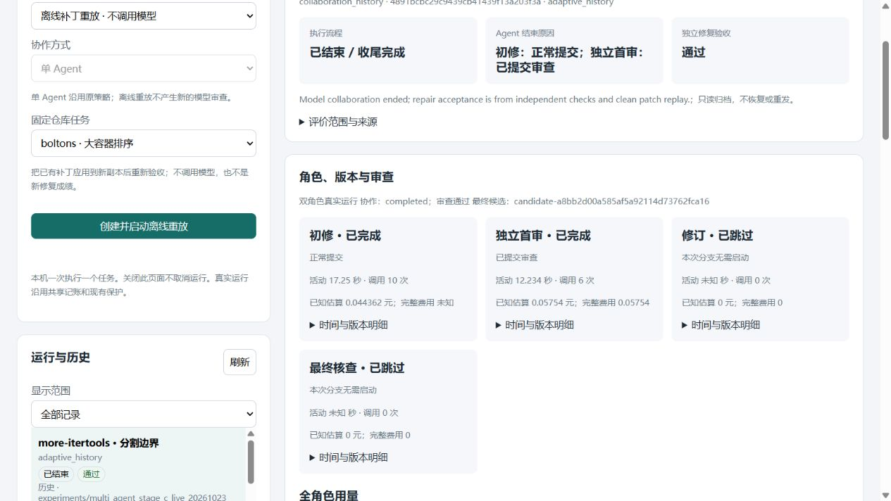
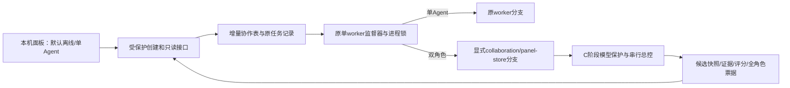

# 双角色任务面板与本机异常验收

日期：2026-10-23。对应[21](21_规划_RAG与多Agent协作深化.md)的D阶段；接续[25](25_过程_双角色模型接线与离线反馈验收.md)。

**双角色最小面板已实现并完成本机浏览器、离线进程与异常验收。** 用户仍双击原启动入口，默认离线/单Agent；新增双角色实验选项、角色卡、交接/证据、候选版本、意见处置和全角色用量。原41条正式记录保持原始payload，增量建表前已有一致性备份；C阶段那次真实结果作为第42条只读历史展示，不恢复或重发。本轮0真实模型调用，共享账本逐字节未变。

最终回归：上游原样适用子集301通过、41未选、0保护违规；本项目273项中272通过、1项文件symlink权限跳过；新增D检查13项全部通过。浏览器和本机进程实际执行，不是只做静态页面或语法检查。真实模型请求在途取消、模型驱动返工/最终核查，以及用户本人独立使用仍未验证。

## 怎样使用

1. 双击根目录[启动任务面板.cmd](../启动任务面板.cmd)，或打开运行中的[本机面板](http://127.0.0.1:8765)。打开页面、刷新和查看历史不会调用模型。
2. 在列表选择“more-itertools · 分割边界”，来源为 `experiments/multi_agent_stage_c_live_20261023` 的历史项。能看到初修和首审完成、修订/最终核查跳过，完整费用未知；点击证据或运行级完整评分报告核对依据。它是C阶段旧结果，不是本轮新修复。
3. 需要新运行时，先选择“真实 Agent 运行”，再选择“双 Agent 审查（实验）”。本版双角色仅支持“上下文与任务状态”；原版、检索策略和离线重放的双角色组合明确禁用/拒绝。点击创建才入队，所有角色沿用共享记账、平台顺序及保护。
4. 运行中可取消；当前请求可能需要先返回，页面显示等待收尾。worker中断后保留候选/请求记录并标记中断，不自动恢复。关闭页面不等于取消；停止面板服务前必须无待处理任务。

双角色显示修复—首审—最多一次修订—必要的最终核查，父时限30分钟。它是可选实验模式，未提升为默认，未改变基础策略参数或费用上限。

## 从C到D，修改解决了什么

C只能显式CLI运行，协作库默认限定temp；现有页面只理解单Agent。D将它们接到同一任务服务：

| 文件/入口 | 具体变化与作用 |
| --- | --- |
| [collaboration_panel.py](../scripts/collaboration_panel.py:34) | 新增创建校验、协作索引、候选/证据读取、注册成果与C归档导入；HTTP客户端不能写角色状态、意见或代码 |
| [usage_view](../scripts/collaboration_panel.py:47) | 按父身份只读共享账本快照，汇总所有角色/平台的尝试、token、已知估算、未知次数和占位。读取不创建请求、不初始化模型、不写总账；合成演示账目明确标注 |
| [candidate_view/evidence_view](../scripts/collaboration_panel.py:112) | 以run内登记ID取候选/原文，核验快照、文件/报告摘要。每版只带自己的报告和审查，不能用v1通过给v2背书；意见真假仍标未独立裁决 |
| [registered_artifact](../scripts/collaboration_panel.py:142) | 只读登记成果，限定正式实验/所属运行目录；拒绝路径各层链接/reparse、硬链接、过大或读取期间变化的文件，协作成果对照哈希。读取最多32MiB，HTTP仅预览256,000字节；失败明确不可用 |
| [collaboration_store.py](../scripts/collaboration_store.py:37) | 默认temp-only保持；D显式能力只允许标准 `data/task_service`，不开放其他data目录。复用B的版本化增量迁移与SQLite备份；协作中断统一更新父/角色，请求保持未知且不重发；历史禁止取消 |
| [task_service.py](../scripts/task_service.py:24) | 同一Supervisor/worker锁调度单/双Agent，实际双角色worker附显式标志。新增collaboration/candidates/evidence只读路由；保留Host、Origin、token，全部返回体在预览前检查实际凭据。正文大小仍有上限 |
| [task_panel.html](../scripts/task_panel.html)、[collaboration_panel.js](../scripts/collaboration_panel.js) | 协作方式与基础策略分开；角色简要结果、时间明细、全角色费用、版本切换、意见/证据、交接、角色事件过滤。只用textContent渲染模型文本；角色过滤仍保留父取消/中断/异常 |
| 页面重试与切换 | 一次创建的key在sessionStorage保留到收到结果，超时重试复用；run/候选切换有递增选择版本，晚到结果不会覆盖当前视图，切版本立即清旧意见。刷新保留选中run；候选新增审查后会更新其内容 |
| [task_service_worker.py](../scripts/task_service_worker.py) | 新增显式标准面板存储能力参数；单Agent分支保留。冻结输入纳入新增JS，避免页面版本漏记 |
| [collaboration_live.py](../scripts/collaboration_live.py) | 全角色用量附件增加准备至收尾的实际墙钟时间，注册有界补丁/评分/审查成果。旧C记录没有此完整计时，页面只显示“创建至流程结束，收尾耗时未知”，没有事后编造 |
| [test_collaboration_panel.py](../scripts/test_collaboration_panel.py) | 13项定向检查，包含真实HTTP、迁移/备份、幂等、模式限制、版本/跨run隔离、快照篡改、未知费用、历史只读、worker锁及成果硬链接拒绝 |

索引首版最多预览250个候选/每类对象并标明截断，整体响应最多2MiB；事件仍按全局seq每次最多500条拉取。版本与证据按需读取，不增加模型工具或任意文件接口。没有新增依赖、第三角色、RAG或并行修改。

## 正式库迁移与历史结果

启动前实际读取正式库，确认41条记录均无排队/执行中任务，另存一致性副本。首次启用协作表复用B迁移逻辑，生成 `data/task_service/before_collaboration_bfe3245d9bab402c995f936093592c59.sqlite3`；备份中原41条payload与启动前完全一致，SQLite完整性检查ok。正式库新增协作表，不重建/清空原runs和events。

随后只导入已知C归档。导入前核验其256条成果哈希，再复制登记快照、导入父/角色/意见/证据，以collaboration_history标记只读；归档原件和旧身份不变。历史路由不启动worker，重复启动不重复导入。原41条payload在正式启动后仍逐项一致，仅新增一条C历史。详见[迁移核验](../experiments/multi_agent_stage_d_20261023/acceptance/production_migration_result.json)。

本版没有把以前全部temp实验自动升级成正式运行；只有这一条已封存、已验证的真实C验收作为只读历史导入。新双角色由用户在正式页面主动创建时，才使用正式库/快照目录；离线测试始终在temp，合成账目不混入共享账本。

## 实际验证，哪些是真做的

| 验证 | 实际结果 |
| --- | --- |
| 最终统一回归 | 上游301通过、41未选、0保护违规；项目273项中272通过、1权限跳过，退出0。回归前后所有被保护文件哈希一致 |
| 13项新检查 | 全部通过；旧记录/SQLite备份不变、未知不填0、run间证据拒绝、v1/v2报告隔离、篡改/硬链接成果拒绝、HTTP权限及实际敏感文本阻断 |
| 实际浏览器正常展示 | 在隔离服务上选择人工v1，看到失败报告/请求修订及采纳响应；选v2显示其通过报告。点开证据得到当前引用原文；含img/onerror的文本按字面显示。切换真实C历史后显示15次官方成功/1次北邮未知、总费用未知、两个后续阶段跳过 |
| 创建控件 | 在无Supervisor的隔离验收服务，实际选择真实/双角色/支持策略创建排队身份，再点击取消；4角色均skipped。此身份从未派发模型，不能当一次真实双角色运行 |
| 执行中取消 | 实际启动仅用于验收的离线worker，预写初修并在首审等待，创建自己的sleep子进程；在页面点击取消，先cancel_requested后cancelled，后续角色跳过；GetExitCodeProcess确认所属子进程退出 |
| worker异常 | 只终止探针自己创建的worker；Windows Job Object使所属子进程退出。重新打开后父interrupted，角色为succeeded/interrupted/skipped/skipped，无排队/重发。已有worker持锁时，新监督器未启动第二个worker |
| 刷新/停服/重启 | 实际点停止、重启隔离服务，原成功/取消/中断记录保留；页面刷新保留选择。正式服务也经页面正常停服，最终重新启动并保留用户可查看的页面 |
| 正式入口 | 直接启动原task_service入口，浏览器查看导入C历史及完整评分报告，确认原计时失败仍在，不因approve隐藏。双击包装沿用原脚本，本轮未用真人双击代替程序操作 |
| 账目与旧成果 | 共享账本逐字节未变，0新模型请求；C离线598＋真实256＋补正15共869个条目逐项验真不变 |

异常进程验收只使用脚本自己创建的进程与子树，没有关闭其他任务。真实模型在途取消、真实模型worker强杀与返工分支仍未覆盖，不能用这些离线进程结果替代。

第一轮完整回归发现原B测试要求默认temp-only错误提示文字兼容；D仍保留这个默认边界，修正提示后通过，没有删掉旧断言。另一次补验在正式服务运行时被Windows server.lock字节锁阻止读取哈希，测试尚未启动；通过页面正常停服后重跑通过，失败/受限过程保留。Git Bash行为没有改，本次未重跑适配诊断；最近实际结果仍169通过/6项环境变量与路径差异失败/1跳过。可选异步配置/退出警告也未解决。

## 证据与当前边界

正式目录[experiments/multi_agent_stage_d_20261023](../experiments/multi_agent_stage_d_20261023/qualification.json)封存187条：最终/首轮日志、8份源码、正式库前后与浏览器夹具库的一致性副本、登记快照、取消/强杀结果、两张实际截图，全部在[哈希清单](../experiments/multi_agent_stage_d_20261023/artifact_sha256.json)中核验。保存前扫描两套实际凭据无命中。归档库是证据，不能用作恢复/重发入口。

本轮可写“实现双角色本机任务面板，浏览器和离线异常流程验收通过”；不能写“通过页面新跑真实模型全链路”“真人已使用”或“成功率提升”。新D冻结尚无真实模型运行，C的旧真实身份继续保留其旧代码和报告语义；页面提醒extended_passed只是相对基线接受，并提供完整原报告。基础策略默认、全项目费用政策和平台顺序保持。

下一步先由用户实际查看面板并反馈，再按21的E准备独立新任务、固定S/D/S+条件、评分及发现裁决方案；付费批次和身份需预声明，不借本次D验收追加任务或重跑选优。真实反馈和在途取消的覆盖缺口继续单列。RAG仍暂缓，不自动增加角色。
