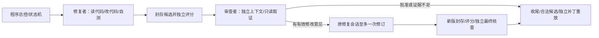

# 多Agent主流模式对照与未完成项

核对日期：2026-10-24。范围：本项目当前源码、C/D封存结果，以及下列官方文档/源码。本文是实现核实与下一步建议，没有新实现、真实模型调用或效果实验。

**结论：我们的设计对应成熟的“评估—改进”协作模式，已经实现了有实际工具循环的双角色工作流；它覆盖的是一条受控修复/审查链，不能等同于主流产品完整的动态委派、并行团队或可恢复运行平台。当前最大缺口是真实反馈闭环和独立效果评价，而不是再增加几个角色名字。** 这是基于下述样本的架构判断，不是市场占有率调查，也不是对这些产品内部全部实现的验真。

## 我们现在到底是哪种多Agent

这里是**两类角色、至多四个执行阶段**，不是四个可自由交谈的Agent。修复者的修订续接原会话；首审/最终核查各用独立审查上下文。总控是Python程序，不是另一个负责规划的模型。修复者和审查者目前沿用同一套平台/模型路由，所以“独立上下文”不能写成“不同模型独立判断”，更不能保证没有共同盲区。

依据包括：[CollaborationCoordinator](../scripts/collaboration.py:38)固定推进阶段，[RepairSession](../scripts/collaboration_runtime.py:134)续接原修复历史，[LiveRunner.repair/review](../scripts/collaboration_live.py:167)接模型、评分和只读broker，[multi_agent_v1.json](../configs/multi_agent_v1.json)声明一次反馈及时间/降级规则。每个模型角色能多次选择工具和读取结果，因此不只是用两个提示各生成一次文本；全局流程仍由代码确定。

## 与代表性官方方案相比

| 官方对象及实际核对资料 | 官方公开机制 | 与我们的关系及差异 |
| --- | --- | --- |
| [Anthropic：Building effective agents](https://www.anthropic.com/research/building-effective-agents) | 区分固定工作流与模型动态控制；包含生成者接受另一模型反馈的evaluator-optimizer | 最直接的模式对应。我们将其具体化为编码修复/审查，并限定一次反馈；这支持当前方向，不证明审查有效 |
| [LangGraph：Workflows and agents](https://docs.langchain.com/oss/python/langgraph/workflows-agents) | 同时提供评估—改进和orchestrator-worker；后者可按任务动态拆分/派发 | 我们接近前一种，有条件分支及状态机；没有实现模型拆任务/动态派worker。是否画成图或使用LangGraph，不决定是否算多Agent |
| [Claude Code：Subagents](https://code.claude.com/docs/en/sub-agents) | 独立上下文、专用提示与工具配置；官方给出code-reviewer示例 | 独立审查与角色工具限制思路对应。我们从专用只读broker读取固定候选；尚无通用按需Explore/Debugger委派。官方示例可含Bash，不能将其示例的“只读”当作我们broker权限的同一实现 |
| [Claude Code：Agent teams](https://code.claude.com/docs/en/agent-teams) | 独立会话、共享任务及直接消息，适合相互独立的并行工作；文档仍标实验性，并说明协调/费用开销 | 我们没有实现这种通用团队。串行的修复—审查依赖关系本身不适合硬拆成同时改同一份代码；未做团队功能不等于当前架构错误 |
| [Deep Agents：Subagents](https://docs.langchain.com/oss/python/deepagents/subagents) | task委派、隔离或fork上下文、可配工具/模型及结构化返回 | 我们已做独立上下文和结构化交接；目前由程序固定启动审查，模型不能任意spawn/委派。未做通用长期记忆或异步子任务，也不必为当前审查链全部引入 |
| [OpenAI Agents SDK：Orchestration and handoffs](https://developers.openai.com/api/docs/guides/agents/orchestration) | 区分将控制权转给专家的handoff，以及管理者保留控制、将专家当工具调用 | 我们属于外层程序保留控制的协作逻辑；没有实现LLM经理或SDK的handoff控制转移。本项目Handoff是版本化交接数据，名称相同不代表语义/协议相同 |
| [Google ADK：Template workflows](https://adk.dev/agents/workflow-agents/)及[官方Sequential文档源码](https://github.com/google/adk-docs/blob/main/docs/agents/workflow-agents/sequential-agents.md) | 存在不依靠模型决定顺序的串行/循环/并行编排；当前文档也说明Python/Go的ADK 2.0转向更灵活的图/动态工作流 | 说明“总控由代码实现、子角色内部用模型”是正常架构选择。这里只对照模式，不建议照旧API示例迁移底座 |
| [OpenHands SDK委派源码](https://github.com/OpenHands/software-agent-sdk/blob/main/openhands-tools/openhands/tools/delegate/impl.py) | 建立子会话，继承持久化；可用线程并行派发任务，并合并子角色指标以避免重复计数 | 我们有持久角色/全角色票据，但没有其通用动态派发和并行执行。已查看的实现把workspace参数传给子会话；不能凭“子会话”就假设每人都有隔离文件系统 |

这些是官方公开机制与我们的映射，不是声称我们复刻了其产品，也不是证明任何一个框架默认具备我们的Candidate/EvidenceRef/哈希语义。外部资料本次按页面可见版本读取；GitHub相关文件是main分支，不作为已经安装、运行或固定依赖版本的证据。

框架的持久化也需区分“保存记录”与“恢复执行”。[LangGraph持久化文档](https://docs.langchain.com/oss/python/langgraph/persistence)展示checkpointer/状态存储及恢复相关能力；本项目当前选择中断后保留记录、不自动续跑。不能把SQLite里有历史写成已支持恢复。

## 已完成的能力，可以怎样准确表述

| 能力 | 目前证据和范围 |
| --- | --- |
| 有职责的两个模型角色 | 代码已实现；C有一题真实初修/首审，审查实际读取diff、源码和程序报告后提交approve |
| 审查权限与上下文隔离 | 六类登记工具，不能执行Bash或改文件；工具读取受manifest/候选/运行身份和摘要校验。修复历史不直接作为审查者消息历史 |
| 版本交接与证据 | Candidate、Handoff、ReviewReport、FindingResponse等结构已实现；旧报告/跨运行证据不能给新版本背书。验证引用出处，不自动验证观点真假 |
| 一次反馈、回复及新版核查 | 实现已存在，离线固定响应驱动过真实文件修改、评分和干净重放；真实模型尚未走到该分支 |
| 状态、用量与故障 | SQLite父/角色、幂等请求、取消/中断、未知票据与全角色费用；父平台切备用后各角色保持备用。离线故障及进程验收已有记录 |
| 本机可观察界面 | D页面已实现并由助手实际操作，能看角色、版本、证据、意见、费用及中断；正式库已增量接入，不能继续把当前总状态概括为“协作库仅temp” |

本次对D成果187条哈希及8份当前源码快照逐项核对一致，未发现这8份代码在交付后又完成了下述缺口。最新已封存回归仍是2026-10-23的上游301通过、本项目272通过/1权限跳过；本次是只读核实，没有重跑这些测试。

真实C身份 `4891bcbc29c9439cb41439f13a203f3a` 的四阶段状态确为succeeded/succeeded/skipped/skipped，15个逻辑请求、16次平台尝试，review approve、repair passed。问题10项和针对性4项通过，干净重放通过，全量仍有原计时失败。因此可写“单题初修/审查接入成功”，不能写“真实返工闭环已验收”或“多Agent提高成功率”。

## 尚未完成：分清缺实现、缺实测和有意后置

| 项目 | 当前实际状态 | 下一步必要性 |
| --- | --- | --- |
| 真实审查提出有效问题→修复者回答/修订→新版核查 | **实现有，真实分支未验**；已有模型直接批准，后两阶段跳过 | 优先补。可用冻结的受控缺陷候选验证模型接口和原会话续接，明确标机制诊断；不能伪装为独立新题效果 |
| 从新面板创建并完成一次真实运行 | **创建/派发代码有，完整付费页面链未验**；浏览器创建在无Supervisor的隔离页取消过，真实C由CLI启动 | 与真实反馈诊断配合验收，避免另花一轮只证明同样的首审批准。由用户实际查看也仍待完成 |
| 每条意见的独立真假/价值裁决 | **尚无完整实现与实测**；已有引用校验和accepted/rejected/needs_evidence/unanswered，页面仍标未核实 | 需要建立程序复现/保留检查及裁决记录，否则无法统计真正新增发现、误报或有害返工 |
| 单Agent与双Agent的公平新题对照 | **E只有规划，没有结果**；S+的等阶段自查也未接成运行分支 | 决定能否说“有用”的核心工作。两组全成本和额外机会必须报告，不以接口测试数量替代 |
| 修复执行的系统级隔离 | **尚无完整沙箱**；本机Bash、受限环境变量、命令检查、工作副本、提交后范围校验不等于OS文件/网络隔离 | 扩到不可信仓库、外部输入或并行写入前需补。当前先明确可信固定任务边界，保持凭据/账本与执行子进程分离；不要求本轮立刻迁Docker |
| 真实模型请求在途取消/worker强杀 | **仅离线模拟/真实本机等待进程验过**，未覆盖真正付费HTTP在途 | 单独小范围验收：记录已预留/已收到/未知，取消后不再派发、不丢费用；不能用反复失败重试代替 |
| 按需角色委派、并行调查/修改、角色消息 | **未实现**；目前固定串行双角色，无通用任务图、spawn或同伴聊天 | 条件性后续。只有定位/规范调查确实可独立时再做21的F/G；并行修改还需各自副本和整合验收 |
| 安全恢复、长期跨任务记忆、不同角色模型配置 | **未实现通用能力，部分属于有意后置**；中断不续跑是当前声明行为 | 不应全部当成近期必做。恢复须证明不会重发已计费请求；换模型会改变评价条件；长期记忆还涉及过期证据 |
| 检索与双角色的组合 | **未完成组合接入/评价**；D仅允许adaptive_history，raw/retrieval双角色禁用 | 先固定基础条件评估审查，再单独评估检索组合，避免同时改变两个机制 |

有两点尤其不能夸大。第一，[validate_review/validate_response](../scripts/collaboration_protocol.py:289)确认ID、版本和引用有效；引用了真的源码也可能做出错误推断，所以accepted不是“已证实”。第二，[GitBashEnvironment.execute](../scripts/run_deepseek_smoke.py:45)最终仍调用本机subprocess执行模型命令；当前没有OS沙箱证明，不应对外说“整个系统已实现严格最小权限隔离”。审查者broker边界和修复者执行边界要分别陈述。

## 建议执行顺序与完成标准

1. **先收尾C/D的真实验收，不扩角色。** 准备一个已冻结、有已知缺陷及独立复现的诊断候选，让真实审查给出意见，再用原修复会话响应和修订，最终核查/干净重放；同时通过面板看完整状态。若模型没有发现或没有正确修订，照实保存，不重跑选优。受控候选可以是人工构造，但必须明说；不能强写一条假审查意见后称模型自主发现。
2. **把发现裁决和评价入口补齐。** 保存finding与reviewed/target版本、独立复现、confirmed/refuted/unresolved、是否在已给测试中已知、修订前后是否改善；接上S、D及S+同阶段自查。先用离线夹具确认能准确记有害/无效返工及未知费用，不改变默认策略。
3. **再进入E，先选题和冻结，再运行。** 沿用21的建议：条件允许时6个未用于本项目调试的问题、至少3仓库，S/D各一次共12次，S+至少预选3题；这是待准备/预声明方案，非本次已授权批次。实际准备不足就缩小并降低结论范围。两组同问题/基础策略/评分输入，独立副本，交错顺序；保留评价检查不提前反馈，公开老题不得称隐藏评测。
4. **根据结果选一个扩展。** 若修复者常找错位置，考虑独立只读定位；若常遗漏版本化规范，考虑文档查阅；若有独立问题且串行等待明显，再做并行取证。若审查没有增益或误报较多，先修审查/证据机制或保持可选，不靠增加角色掩盖负结果。

系统隔离的要求随运行范围升级：在任何不可信仓库/任意命令入口开放前应落实；可信固定任务下不以“已经有工作副本”替代这条边界。真实在途取消可作为受控接入验收的一部分，范围预先声明，不能边测边无限追加任务。

第一优先建议是**“完成一个真实反馈诊断，再准备有裁决的S/D/S+评价”**。目前没有证据支持为此更换Mini SWE Agent底座、立刻上通用编排框架、增加第三个经理模型或恢复RAG。保留自建小状态机，能够解释职责、权限、版本、失败与取舍，本身就是工程能力；是否提高修复率要由下一轮数据回答。

## 核对范围与限制

- 本地读取了协作协议、快照/broker、状态机、模型hooks、原会话续接、评分/重放、面板创建与Bash适配；核验D187条成果及8份当前源码。没有重跑全部测试、做渗透测试、调用真实模型、修改运行源码/默认配置/共享账本或部署新框架。
- 官方网页以2026-10-24实际可见内容为准；核心证据是官方文档和官方仓库，不使用第三方转载或非官方还原材料判断当前产品。部分旧URL发生重定向/失效时，转查官方文档或仓库；未从失效页推断能力。
- 代表样本不是“全部主流”的穷举，也未对外部框架进行本机安装、相同任务或同预算实跑；因此不能给出性能排名、功能覆盖百分比，或保证迁移即改善效果。
- 持续使用[25](25_过程_双角色模型接线与离线反馈验收.md)、[26](26_过程_双角色任务面板与本机异常验收.md)区分代码完成、离线验收、真实接入与效果证明。此次建议尚未执行，不把路线表写成已完成项目成绩。

后续实施状态（2026-10-24）：第一优先项已执行唯一人工候选真实诊断，首审request_changes、原会话实际改正源码；修订未正常提交且缓存越界使新版未登记，最终核查跳过，失败保留。另副本事后验收通过不能覆盖原运行；通用意见裁决、S+和新题对照仍未实现。详情、301/280通过的离线回归及封存见[28](28_过程_真实反馈诊断与原会话返工验收.md)。

2026-10-24后续：[29](29_过程_审查意见独立裁决与有害返工检查.md)实现可信冻结检查/精确映射的最小离线裁决，覆盖真假/未知、版本变化、有害返工及去重；20项定向通过。正式worker/面板接线、任意意见裁决、S+和新题对照仍未完成，28修复后真实闭环仍待复验。
