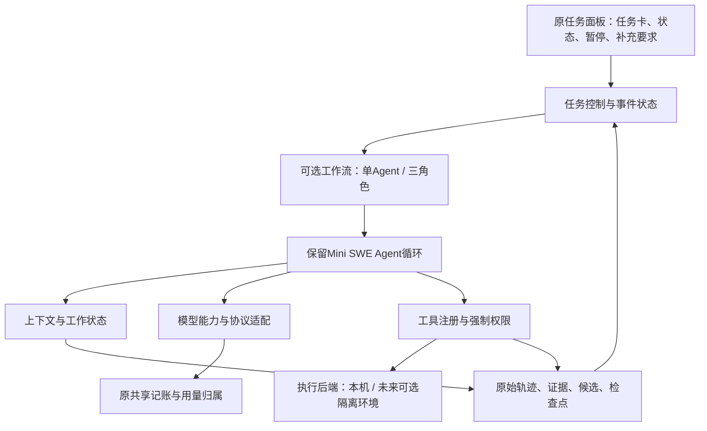

# Agent Harness主流方案与项目演进建议

2026-10-26接续：用户已认可本篇整体框架并要求按阶段继续完善。[36](36_过程_Harness任务卡与运行中要求补充.md)已实现第一组的首版任务卡与运行中要求补充；暂停/检查点续做、工具/Skills扩展及模型适配仍待。下文“未获认可/未实现”等表述保留为调研当时快照，当前实现以36为准。

调研日期：2026-10-26。范围：官方文档、官方GitHub仓库及部分实现文件；对照本地Mini SWE Agent 2.4.6与当前三角色实现。沿用用户最新要求：先做功能，后统一测试；本轮只调研和提出候选方案，不开发运行功能、不启动模型调用、不新增测试项目、不更换底座。

## 一、结论与定位

建议把项目逐步定位为“基于Mini SWE Agent的可配置、可恢复、可扩展的Coding Agent Harness”。这是建议中的演进定位，不是当前全部完成的能力或已确认的最终路线。

目前已经在做Harness：上下文整理、工具回执、停滞检测、角色权限、持久状态、执行取消和全角色记账，都在模型外围决定任务怎样运行。继续发展时，优先补长任务的计划与干预、受控续做、模型能力适配和工具扩展，不必通过继续增加Agent数量来贴近这个方向。

我最推荐的下一项可见功能是“任务计划与过程干预”：用户能看到目标、子步骤、当前阻塞、已有修改；可以暂停并补充要求。之后再补“从明确检查点续做”，把长任务能力做完整。三角色保留为一种可选工作流，单Agent也复用这些基础能力。

## 二、Harness具体包括什么

这里研究的是Agent的运行支撑层，通常包括模型调用循环、工具执行、上下文、状态、权限、环境和反馈。它与模型本身分工：模型提出动作，Harness决定动作能否执行、执行后如何记录、下一轮看什么、何时暂停或结束。OpenAI官方对开源Codex Harness的介绍也将循环、会话、工具、边界和事件作为组成部分。[Codex as a platform](https://developers.openai.com/blog/codex-as-a-platform)

需要区分两个相关层面：一是Agent运行时；二是仓库的开发环境，包括任务说明、构建入口、文档、可运行检查和完成标准。后者让Agent知道怎样在这个仓库工作；只整理AGENTS.md或只加多Agent，都不能涵盖整个Harness。

Anthropic的长任务实践强调：压缩聊天历史本身不够，还需要明确的任务清单、增量工作和跨会话交接材料。这给我们的启发是让程序保存“完成到哪里、证据是什么、下一步是什么”，而非仅保存长轨迹。该文章中的完整Web应用实验不直接等于我们的仓库修复场景。[Effective harnesses for long-running agents](https://www.anthropic.com/research/effective-harnesses-for-long-running-agents)

## 三、主流项目与复用取舍

本表的能力来自各项目现行官方说明；“适合借鉴什么、成本高低”是结合本项目的判断。查看当前main或dev分支不等于固定了稳定发布版本。没有用Star数量代替维护质量，也没有安装这些项目或复现其榜单成绩。

| 项目 | 可核实的设计与维护线索 | 许可与接入成本 | 本项目建议 |
| --- | --- | --- | --- |
| [Mini SWE Agent](https://github.com/SWE-agent/mini-swe-agent) | 简洁模型—动作循环，模型/环境分离；当前上游列出多类环境与模型端点，本地仍固定2.4.6 | MIT；继续利用现有底座成本最低，上游新能力不代表本地适配已接入 | 保留；在外层增量建设，不整体升级来获取所有功能 |
| [Deep Agents](https://github.com/langchain-ai/deepagents) | 当前README包含独立子Agent上下文、可换文件后端、工具输出落盘、Skills、持久状态；本轮main的包配置为0.7.32，仍有Beta标记 | MIT；当前包要求Python>=3.11，本地3.10.6不能直接安装替换 | 重点参考中间件、上下文和技能组织；不迁整仓 |
| [OpenHands Software Agent SDK](https://github.com/OpenHands/software-agent-sdk) | Agent/Conversation/Event/Workspace分工；持久会话、工具与状态核对；本轮组件包配置1.58.2 | MIT；当前SDK要求Python>=3.12，另有工具/workspace/server组件，迁移成本高 | 重点参考事件、状态与执行环境接口 |
| [Pi](https://github.com/earendil-works/pi) | 原badlogic/pi-mono地址重定向至此；当前文档强调小内核、扩展、Skills和SDK，子Agent/计划模式可由扩展提供 | MIT；TypeScript生态，与现有Python混用有额外边界 | 重点参考生命周期事件和扩展接口，不抄整套CLI |
| [OpenCode](https://github.com/anomalyco/opencode) | 当前默认dev分支；官方文档提供插件事件与allow/ask/deny权限规则 | MIT；现成产品较完整，迁移现有运行身份、证据和账本有成本 | 参考插件及人工干预交互，不以其界面替换项目核心 |
| [Codex](https://developers.openai.com/blog/codex-as-a-platform) | 官方2026-08-19文章区分exec、SDK、app-server；后者面向持久会话、事件和审批交互 | [仓库Apache-2.0](https://github.com/openai/codex/blob/main/LICENSE)；开源Harness与模型服务分别提供 | 作为产品事件协议参考；直接嵌入可做另一条方案，但会显著改变个人自主实现范围 |
| [Claude Agent SDK](https://code.claude.com/docs/en/agent-sdk/overview) | 官方SDK包含会话、权限、Hooks、Skills和文件检查点入口，Python/TypeScript均可编程接入 | [Python SDK包装层MIT](https://github.com/anthropics/claude-agent-sdk-python/blob/main/LICENSE)；它运行Claude Code二进制，不能据此称整个Claude Code内核均MIT开源 | 借鉴官方接口；不把Job中的非官方还原源码当可直接复用的可信运行内核 |
| [DeerFlow](https://github.com/bytedance/deer-flow) | 当前官方仓库定位长时任务Harness，集成技能、沙箱、记忆、子Agent和应用入口 | MIT；完整应用和依赖较多，搬迁成本高 | 作为整体产品组织参考，不在本轮扩成通用研究/办公Agent |

关键依赖与许可已直接核对：[Deep Agents包配置](https://github.com/langchain-ai/deepagents/blob/main/libs/deepagents/pyproject.toml)、[OpenHands组件配置](https://github.com/OpenHands/software-agent-sdk/blob/main/openhands-sdk/pyproject.toml)、[OpenHands许可](https://github.com/OpenHands/software-agent-sdk/blob/main/LICENSE)、[Pi扩展文档](https://github.com/earendil-works/pi/blob/main/packages/coding-agent/docs/extensions.md)、[OpenCode许可](https://github.com/anomalyco/opencode/blob/dev/LICENSE)、[DeerFlow许可](https://github.com/bytedance/deer-flow/blob/main/LICENSE)。正式引入具体包或复制源码时，再固定commit/tag并保留对应许可声明；本轮没有做依赖兼容实验。

### 值得复用的五种机制

1. **长任务计划和工作状态。** 保留目标、待办、阻塞、下一步和交接依据；计划改变必须留版本，不能只让模型写一句“正在处理”。
2. **事件和受控恢复。** 原始事件按顺序保存，请求、动作、回执与候选相互关联；恢复前核对状态和已执行动作。OpenHands明确提供持久化和恢复能力，值得参考其边界，而非仅照搬保存JSON的形式。[OpenHands Persistence](https://docs.openhands.dev/sdk/guides/convo-persistence)
3. **工具/模型调用前后的扩展点。** 在关键位置统一接入权限、上下文处理、记账和观察；现有强制保护不能成为插件可随意覆盖的选项。Claude Hooks及Pi扩展提供了这类接口样例。[Claude Hooks](https://code.claude.com/docs/en/agent-sdk/hooks)、[Pi Extensions](https://github.com/earendil-works/pi/blob/main/packages/coding-agent/docs/extensions.md)
4. **上下文按任务阶段组织。** 原任务与权限固定保留，近期结果完整，远期材料按引用取回，当前任务状态单独提供。我们已有不少基础，主要缺统一策略入口和跨会话交接，而不是从头做压缩。
5. **工具、技能和执行环境分离。** Skills组织可重复工作方法，MCP提供工具接入协议，沙箱约束执行资源；三者不能互相替代。插件本身具有宿主进程权限，不能因为叫“技能”就自动执行仓库中的脚本。[OpenCode Plugins](https://opencode.ai/docs/plugins/)、[OpenCode Permissions](https://opencode.ai/docs/permissions/)

## 四、对照我们的源码：已有基础与实际缺口

以下是静态源码核对，不是本轮新运行成绩。当前完整真实三角色成功仍未验收，旧结果边界见34。

| Harness能力 | 本地证据 | 真实边界/可开发空间 |
| --- | --- | --- |
| Agent循环与执行适配 | Mini 2.4.6；`run_task_batch.py`的TaskEnvironment、StatefulModel；`state_agent.py` | 已有循环；外围入口仍以固定仓库任务为中心，尚非通用开放仓库接入 |
| 上下文与工作状态 | `context_budget.py: ContextBudget`、`task_state.py: TaskState`、`tool_output_budget.py`、`execution_progress.py` | 已有规则整理和当前事实；缺可由用户查看/调整的持久任务计划，不等于没有任何计划相关机制 |
| 三角色编排与记录 | `collaboration.py: CollaborationCoordinator`、`collaboration_store.py`、`collaboration_runtime.py` | 已有固定串行流程与阶段边界；不是动态任务分配或通用团队平台 |
| 人工干预 | 原面板创建、查看、取消 | 尚无明确的暂停/补充要求/受控续做产品流程 |
| 故障处理与恢复 | `CollaborationStore.reconcile_collaborations()`；`RepairSession` | 重启把旧运行标记中断、不重发；原会话返工只在内存会话存活时继续。保存历史不等于已经支持进程重启恢复 |
| 权限与工具 | `review_tools.py: ReviewEvidenceBroker`、`document_agent.py: DocumentBroker` | 只读角色边界已实现；修复者仍在本机Bash执行。路径检查、Job对象清理不等于OS沙箱 |
| 模型与费用 | `provider_priority.py`、`run_deepseek_smoke.py: BudgetedDeepSeekModel`、共享账本 | 当前严格绑定北邮/DeepSeek路由，具有故障切换；尚非通用多厂商、多协议、多角色模型配置 |
| 语言环境与工作区 | `task_workspace.py`、任务manifest、现有Node桥 | 已有固定Python任务与一题JS夹具；缺统一的语言/依赖/执行配置，不能宣称通用多语言 |
| 观察与检查 | 轨迹、事件、候选、独立报告、原面板 | 基础较足；后续优先把任务计划、暂停点、续做关系也展示出来，无需先建设新Benchmark平台 |

可点击的本地实现入口：[调度](../scripts/collaboration.py)、[状态存储](../scripts/collaboration_store.py)、[模型/角色运行时](../scripts/collaboration_runtime.py)、[上下文](../scripts/context_budget.py)、[任务状态](../scripts/task_state.py)、[模型路由](../scripts/provider_priority.py)、[模型适配](../scripts/run_deepseek_smoke.py)、[工作区](../scripts/task_workspace.py)。

## 五、建议按什么顺序开发

本节是候选路线，尚未获用户逐项选定，也没有开始实现。围绕Coding任务增量建设，不先抽象成能支持所有业务的通用平台。

### 第一组：任务计划、人工干预与续做——优先推荐

**用户看到的效果：** 不只看见“审查中”，还能看见正在解决哪件事、已经改了什么、什么原因停住。可以暂停，补一句新要求，确认后从保留下来的工作继续。

分成两个小版本开发，避免把“会话恢复”一次做得过大：

- 先做任务卡与计划：目标、约束、步骤、当前状态、阻塞、下一步、已登记证据；用户可以补充要求。模型标记某步骤完成只代表自报，独立验收结果另记。沿用现有TaskState和事件表，必要时做兼容的增量结构，不另建一套任务系统。
- 再做暂停与检查点续做：暂停请求等待当前动作收尾；保存工作副本/补丁、文件哈希、任务状态、必要上下文和请求回执。只有已确认安全的动作边界才算可续做检查点；没有干净检查点时明确拒绝自动继续。

**最重要的兼容约束：** 旧实验身份仍不可恢复。续做建立关联的新身份或独立开发会话，记录`continued_from`与检查点哈希，保留旧失败、既有账本和候选版本；不会以恢复为名重置费用。对于“请求已经发出但结果未知”、非幂等命令或副本被外部修改，要求核对而不是自动重发。最小版本先支持角色边界，后续才考虑角色内部的精细恢复。

**参考重点：** Anthropic的增量交接、OpenHands的会话/事件、Codex app-server的用户干预接口。收益是用户可操作的长任务能力；代价是要梳理副作用和状态一致性，不是简单加一个“继续”按钮。

### 第二组：统一工具与能力扩展

**用户看到的效果：** 新增一种工具、技能或语言流程时，只需要接入对应能力；原来的取消、权限、上下文和费用记录继续生效。

从现有DocumentBroker/ReviewEvidenceBroker和角色Hooks中提炼小接口：工具名称、参数、只读/写入/执行级别、适用角色、输出上限、取消与事件回执。先支持本地显式注册工具；再接一个真实有用的只读MCP工具，避免一次做插件市场。

Skills首先只包含版本化的说明与允许工具引用，例如“定位问题”“修改代码”“整理审查结论”。仅按需加载相关技能，遵守调用方权限，不能让SKILL.md自行授权执行脚本或扩大写目录。模型自报技能完成不等于程序已经验收。

执行环境采用独立后端接口，先保留现有Windows本机后端；Python与Node用显式配置记录命令、版本和依赖位置。未来确需运行不可信仓库时再决定容器或其他隔离方案；本轮不自动装Docker。

**参考重点：** Pi的小内核/扩展、Deep Agents的后端与上下文组件、OpenCode的工具权限。无需为了Hooks重写已有全部类，也不能删掉原基线或让插件修改历史成果。

### 第三组：模型能力适配与角色配置

**用户看到的效果：** 可以明确选择模型配置；界面能说明哪些能力支持、哪些不支持，而不是模型换了以后运行到一半才报协议错误。

把`model name`、传输协议、工具调用格式、是否支持特定思考字段、上下文/输出限制、取消方式、用量与价格来源组织成能力配置。原北邮优先/DeepSeek备用作为原样保留的配置，旧实验依然绑定原配置。

先统一适配接口，再接一个新厂商做可选配置。每角色不同模型是之后的选择：例如文档角色用轻模型、修复用强模型；目前没有证据证明这一定省钱或更准确，不能先默认混用再把结果归因于Harness。新增外发目的地与费用范围需另明确，研究推荐不代表调用授权。

## 六、模型候选与接入现实

Harness不是一种特定模型。通常选能稳定调用工具并处理多轮反馈的编码/推理模型；模型的知识、规划和判断能力与运行支撑共同影响结果。以下是本轮官方文档核实的候选，不是完整排行榜或本项目实测推荐。

| 候选 | 与本项目的关系 | 接入要注意什么 |
| --- | --- | --- |
| 当前DeepSeek路由 | 继续用于功能开发的默认配置，保留既有可比性 | 本地固定网关`deepseek-v4-flash`、官方`deepseek-flash`；不能由网关别名推断底层权重、官方价格或思考能力。现有官方分支关闭思考模式 |
| GPT-6.1 Sol / GPT-6 Astra | 官方当前目录分别定位平衡成本/能力与更高难度任务；可作为一个新协议适配候选 | 工具调用要求Responses API，不能在目前Chat Completions式适配中只换名字；本轮不升级或调用 |
| Claude Sonnet 5.5 / Opus 5.5 | 官方目录列为速度/能力平衡及长时编码候选；可考察原生Messages工具循环 | Claude API模型接入与嵌入Claude Agent SDK是两种方案，后者会带来自己的Harness，不应与本项目循环重复套用 |
| Qwen3-Coder-Next | 官方明确面向coding agents的开放权重候选，可研究自托管或合适的托管接口 | 不是“所有Qwen中最新/最强”的断言；不能把激活参数量当完整部署内存。硬件、量化、模板、工具解析和具体权重许可须按最终部署包核对；本轮许可文件抓取未成功，不提出直接复制/部署方案 |

官方模型依据：[OpenAI模型目录](https://developers.openai.com/api/docs/models)、[OpenAI工具调用协议要求](https://developers.openai.com/api/docs/guides/function-calling)、[Claude模型目录](https://platform.claude.com/docs/en/models/overview)、[Qwen3-Coder官方仓库](https://github.com/QwenLM/Qwen3-Coder)。没有核验本账户是否能访问这些新模型，也没有调用Models API探测账号权限。

一个直接的协议例子：DeepSeek思考模式的工具调用要求后续请求保留相应`reasoning_content`，不符合时可能返回400；这说明“OpenAI兼容接口”不能替代能力核对。现有非思考模式并不因这条文档自动变成缺陷。[DeepSeek Thinking Mode](https://api-docs.deepseek.com/guides/thinking_mode/)

当前16KB/32KB是本地请求视图保护，单位是UTF-8字节，不是模型公布的token上下文窗口。模型支持更大窗口，不代表程序已开放、更不代表无需上下文选择。模型调用费用也不能从本地未知占位额推导出来。

## 七、建议的架构边界

这是职责图，不要求马上新增这些服务、文件夹或独立进程。原项目代码已经实现其中多个职责，优先复用；整套产品仍以仓库开发任务为范围。MCP是工具协议，Skills是工作方法包，多Agent是工作流选择，模型适配是协议边界，均不单独等于完整Harness。

## 八、近期明确暂缓的事项

- 不因Harness调研迁到Deep Agents/OpenHands/Codex，也不整体升级本地Mini。
- 不自动增加角色、并行修改同一工作区、跨任务长期记忆或恢复RAG主线。
- 不新建大规模测试/Benchmark项目，不先做付费模型排名。功能开发仍做必要的基本检查，系统测试和效果比较在后续集中安排；不能把未验证效果写成已实现收益。
- 不恢复旧31的15个槽位、旧v7或任何旧真实身份；当前完整真实三角色成功、页面真实创建/在途取消与baseline比较仍未完成。

本轮只新增本篇调研，并同步00、开发流水账及Job导航。没有修改scripts/configs/data、原冻结、模型路由、私有配置或其他项目；未进行功能测试或真实模型请求。临时核对材料位于`temp/harness_research_20261026/`，不充当正式实验成绩。
