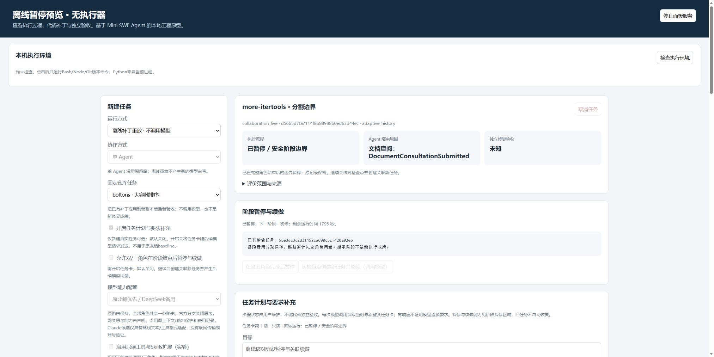

# 43 当前版本集中工程检查与收尾

日期：2026-10-27。范围：按用户要求集中检查现有功能，修复发现的问题，不增加功能项目，不启动付费真实模型。

## 结论与范围

当前代码的集中工程检查已完成：上游原样适用子集301通过，本项目408项中407通过、1项原Windows符号链接权限跳过。执行适配169通过、6失败、1跳过；六项失败名称与旧封存一致，仍是3项环境变量策略和3项路径表示差异，不能写成适配全绿。

新Harness模块另复用了既有一次性检查；模型回复/用量为预设，本机文件修改、独立验收、干净补丁重放、MCP和所属进程退出实际执行。真实Edge页面在无执行器的临时服务中完成创建、保存、暂停请求、关联续做和排队取消，不能推导真实模型在途取消或模型质量。

## 两项集中修复

1. `scripts/run_regression.py`：面板正运行时独占`data/task_service/server.lock`，原指纹采集在读取临时锁时失败，尚未启动测试。现在只精确排除这一临时IPC锁，并把排除路径写入summary；正式任务库、账本及其他源码/配置/数据仍逐项采集，不吞其他读取错误。
2. `scripts/deepseek_budget.py`的`SharedBudget._save`：第一轮完整回归的`test_timeout_can_switch_without_claiming_key_is_invalid`遇到WinError 5，原子替换临时合成账本被拒绝。本轮无法确定瞬时占用的具体进程，不能断言是杀毒软件。现只对Windows拒绝访问/共享/锁冲突（5/32/33）在原预算锁内有限重试同一次替换，最多4次，等待20/50/100ms；不重写请求身份、不重试模型。最终失败仍抛错、保留旧账本，在HTTP请求前停止。

仅为该修复在原`test_deepseek_budget.py`加入2项回归：瞬时拒绝后仍只登记一次；持续拒绝最多4次且不调用传输、旧账本字节保持。原模型路由、价格、预留和权限策略未改，没有引入新开源依赖或更换框架。

## 实际检查结果

| 检查 | 本轮结果 | 证据 |
| --- | --- | --- |
| 首轮完整默认回归 | 上游301通过；项目406项中404通过、1错误、1跳过 | `default-initial/`，原错误保留 |
| 账本与路由定向 | 19项账本、17项路由通过 | `budget-targeted.log`、`provider-targeted.log` |
| 最终完整默认回归 | 上游301通过，41项预先分类排除；项目407通过、1跳过 | `default-final/`，前后4868份保护文件无变化 |
| Windows适配 | 169通过、6既有失败、1跳过；0保护违规 | `adapter-current/`及`adapter-comparison.json` |
| 执行后端 | 11项边界通过，包括超时、环境变量筛选、提交信号与所属进程取消 | `backend-check.json`；最初沙箱Bash系统对象拒绝另留失败日志 |
| 三角色组合 | 开工具/Skills、任务卡、模型配置，查阅后暂停再续做，5阶段累计15次合成请求，修复passed、最终approve | `continuation-check.json`、对应临时库/轨迹 |
| 四个暂停边界 | 查阅/初修/首审/修订后逐段续做，旧身份保持，篡改拒绝、幂等唯一子身份；10次合成请求 | `pause-check.json` |
| 任务卡 | 版本冲突、旧记录不补写、取消后只读、逐调用最新要求一致 | `card-check.json` |
| 工具/Skills/MCP | 11项角色/候选/哈希/伪凭证/真实stdio/取消边界通过 | `boundary-checks.json` |
| 模型协议 | 12类拒绝、原审查解析器可读；15份已保存请求视图格式重放通过 | `protocol-check.json`、`wire-replay.json`，无新厂商传输 |
| 隔离HTTP | 9项配置/幂等/角色绑定/历史兼容/鉴权通过，3条临时任务全部取消，无worker | `http-check.json` |
| 页面脚本 | 快速/普通加载、模式切换和开关组合通过 | `panel-check.json`，Node假DOM另行标明 |
| 真实Edge页面 | 12个操作检查点，2条浏览器新建临时记录；全部队列取消，原暂停保留，控制台无错误 | `browser-check.json`、截图及临时库 |

适配仍失败的六项来自`tests/environments/test_local.py`：`test_local_environment_set_env_variables`、`test_local_environment_existing_env_variables`、`test_local_environment_env_variable_override`、`test_local_environment_custom_cwd`、`test_local_environment_cwd_parameter_override`、`test_local_environment_default_cwd`。前3项与本机白名单环境策略不同，后3项期望Windows字符串而Bash输出POSIX路径；未为了通过而改原测试或扩大权限。旧封存与旧临时报告分别按名称/计数核对，不假称不同运行的原始报告逐字节相同。

## 页面实际验收边界

本轮浏览器控制可用，使用computer-use技能操作Edge，服务仅监听临时回环端口5351。原HTML/JS直接提供，标题改为隔离预览；没有Supervisor/worker，预置暂停点来自3次合成查阅回复，其后模型入口强制拒绝。

实际检查：默认离线；三角色锁定策略；开任务卡后可选暂停；离线候选模型禁用；所有可选项临时创建并保存；任务卡第2版保存；排队取消后只读；暂停点创建关联子任务并显示继承查阅输出/模型配置；原记录不改且重复续做禁用；另一队列显示已请求暂停；单角色/离线模式禁用不支持选项。任务卡在切回离线时保留勾选但禁用，创建重放不发送任务卡；暂停/工具扩展被清除。

临时库最终4条：原暂停1条、取消3条，合成账本仍3请求，无浏览器新增模型调用。服务已通过页面停止，正式8765未重启。没有验证真实模型在途取消、浏览器观察真实worker完成阶段暂停、双页过时保存提示或异机安装；程序层冲突/边界已有本轮检查。

## 数据保护、封存与后续

5374份原配置/数据/评价文件、52条正式payload、2016请求共享账本保持，正式任务卡/续做附加表未创建；旧42封存另核对原哈希。0真实模型调用、0正式新任务，无安装、Docker、医学项目或批量删除操作。

结果封存到`experiments/final_engineering_20261027/`：当前源码/配置/Skills/文档、首次和最终日志/报告、适配对照、原源码、检查脚本、合成库与工作流、截图、成员和外层哈希。pytest生成的scratch环境只留temp，不上传其中`.env`夹具；完整日志、结果、清单和前后哈希已正式封存。上传前扫描两套真实凭据，不输出值；GitHub只同步已扫描交付材料。

程序工程层本轮完成（保留6项已知适配差异），页面层为隔离实点部分完成。当前代码真实三角色完整验收仍待新范围与冻结；正式同题效果比较还需终态保留评分、批次门控与新输入冻结，尚有实施工作；新电脑安装仍未验。Claude联网、混合模型、通用JS/外部MCP等仍是未实现扩展，不自动追加。旧31槽位、v7和失败身份不恢复。下一步围绕原路由完成真实使用验收，再补比较门控与同题评价；本轮范围JSON仍不可执行、无付费授权。
