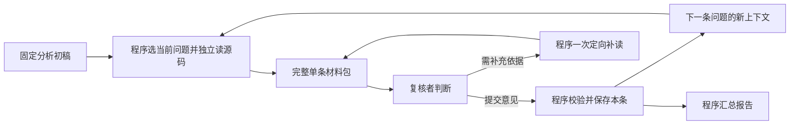

# 74 独立复核读取循环：日志诊断与修改方案

日期：2026-10-30。用户要求先查清三次日志，不再付费测试，再给具体修改方案。本轮只读已有请求、原始回复、冻结源码和费用记录；只生成诊断及输入提案，没有修改运行代码、重启服务或新增项目模型调用。

## 结论与确定程度

**优先需要修改流程设计。当前模型在现有流程中的执行表现也不可靠，但三次日志不足以判断它在简化任务下不会做代码复核。**

已确认：复核被设计成了一个要自行翻页、安排多条问题、维护引用身份和决定何时收尾的长工具循环；它没有保证当前问题正文与相关源码持续共同可见。第三次添加“已读”回执后，这个信息组织缺口仍然存在。读取工具和调用协议也增加了不必要的操作摩擦。

同时，不能把所有失败都解释为上下文丢失。第二次小样例有67个实际请求窗口，同时包含至少一条完整问题及其原分析引用的全部源码，模型依然只读、不提交。这说明当前模型/提示/配置组合下，自主推进到判断和提交的行为不可靠。没有同材料、简化流程的对照，不能分离模型能力的净影响，也不能断言换更贵模型就能解决。

本轮真正观察到的是**执行过程没有进入提交判断**，不是“复核结论错误率很高”。三次连原始、被拒绝的工具调用中，都没有record_finding_review或submit_analysis_review尝试；无法评价它本来会支持、驳回还是标为待验证。

## 检查对象与口径

检查各身份的reviewer-api-requests.jsonl（实际发送前的messages）、reviewer-trajectory.json（包括被拒绝回复的原始response）、reviewer-ledger.json、summary.json、draft-report.json，以及两次冻结的源码包。不是只看最后一条错误或完整轨迹的并集。

复核请求数与上轮总请求数分开：本表仅统计第二个角色，分析者的23次请求不在其中。

| 原身份 | 初稿问题 | 复核平台尝试 / 已记录成功回复 | 解析器接受的读动作 | 尝试提交意见 | 实际收尾 |
| --- | --- | --- | --- | --- | --- |
| ecad5c1b… 公共仓库初版 | 3条 | 134 / 133 | 132 | 0 | 长循环后在期限附近408超时 |
| 2d27e556… 极小计算样例 | 4条 | 99 / 98 | 97 | 0 | 同类循环，正常API取消 |
| 2d54c411… 修正版公共仓库 | 3条 | 15 / 15 | 14 | 0 | 连续8次无新增覆盖/结论而停止 |

这里的读动作包括后来因行数越界而被broker拒绝的读取请求，并不代表每个动作都成功读到内容。三次各有一条多工具原始回复被整体拒绝，所以接受的动作数不等于原始回复数。

246条已记录复核回复的finish_reason全部为tool_calls，未出现length截断；原始工具名称全部为读取类。三次复核实际均走DeepSeek官方deepseek-flash；模型配置请求temperature=0、官方关闭思考。后两项是代码配置事实，不代表能观察服务内部推理，也不能作为因果结论。

完整机器结果在`temp/review_diagnosis_20261030/initial_inspection.json`、`visibility_analysis.json`、`correlated_steps.json`，第三次原始示例在`third_run_key_examples.json`。

## 1. 当前问题和证据没有被当成一份稳定材料

运行代码`analysis_execution.py:116`按约11000字节压缩messages，优先删除最早的完整工具交互，只保留近期交互；项目消息硬上限16384字节。保留策略不区分“当前问题正文”“当前证据”和无关历史。因此，总轨迹上看过，不等于下一次模型请求里还能看见。

第三次最清楚。F001的JSON被read_draft拆成0—800与800—878字符两页；第一页恰好在trigger字段的“传”字后截开。缺失的末页包括实际触发输入与调用目标。以下请求序号对应JSONL行号：

| 实际请求 | 完整F001正文 | encoding.py原文 | url_safe.py 1—80原文 | 下一步实际选择 |
| --- | --- | --- | --- | --- |
| Q6 | 有，两页齐全 | 有 | 无 | 请求url_safe 1—83，因超过80行被拒 |
| Q8 | 有，两页齐全 | 已被移出 | 有 | 重读encoding |
| Q9 | 不完整 | 有 | 有 | 从offset=0重读F001 |
| Q10 | 只有前800字符 | 有 | 已被移出 | 再请求url_safe 1—83 |
| Q13 | 不完整 | 有 | 有 | 再从offset=0重读F001 |

第三次15个请求中，没有一个窗口同时保留完整F001及其原分析指定的两份完整源码引用。虽然program_review_state持续显示fully_read_findings=[F001]和rv编号，那只是读取记录，不是正文。上一轮补“已读状态”的修正并没有建立“当前完整问题＋源码持续可见”这一关键条件。

这不是证明模型在每个时刻都绝无推断空间；标题或局部代码也可能有用。但程序没有保证复核任务所需的完整材料，不能要求模型用已被移出的内容做可靠判断。

## 2. 上下文问题不能独自解释全部循环

按较严格的可见性口径：一条问题的所有分页与其初稿引用的全部源码行段，必须在同一个实际messages窗口中齐全。仅有“读过”标志、文件名或证据ID不计。

| 身份 | 至少一份完整“问题＋引用原文”同窗的请求数 | 其中仍产生复核提交 |
| --- | --- | --- |
| 第一轮公共仓库 | 19 / 134 | 0 |
| 极小计算样例 | 67 / 99 | 0 |
| 修正版公共仓库 | 0 / 15 | 0 |

第二次没有任何行号越界错误，代码也很短，仍未提交。因而80行限制、源码规模和正文移出都不是解释所有失败的充分理由。相同模型完成了三份结构化分析初稿，说明至少能执行这些读取和初稿提交；进入复核后，工具/状态组织与自主收尾的负担增加，当前组合没有可靠地从读取切换到判断。

对调用ID归一、参数JSON规范化后，重复输入窗口分别有28、70、3次；只是定位重复材料，不把它当作温度0的确定性证明或单因素试验。

## 3. 还有哪些确定的问题，哪些没有证据

**调用协议有摩擦。** 三次第一条回复都提出两个合法只读调用，如同时读概览和encoding.py。ReviewModel在`review_model.py:43`要求恰好一个，整体丢弃这两个请求，追加格式纠错。冻结传输代码没有显式传单工具并行控制，实际API日志也未保存tools及生效选项，不能逐字证明远端收到的全部控制项。每次仅发生一次，属于可消除的接口不匹配，不能单独解释上百次后续读取。

**分页交给模型操心。** read_draft返回的是“JSON字符串里的分片”，会切开字段；read_source要求模型自己把83行拆成不超过80行的段。公共仓库两次分别有7、3次1—83读取被拒。工具可以安全限长并返回服务端续页信息，无需把整次请求拒掉，或让模型反复计算范围。安全边界应继续是所选文件、来源版本、权限和字节预算。

**把机械调度和判断混在一个Agent循环。** 初版要求全部问题一次提交；修正版虽可逐条保存，程序仍只在提示和状态里说“下一条是F001”，推进权依旧交给模型。第一条未提交就卡住其他问题；最终还有一次由模型调用总提交工具的收尾环节。逐条存储并不等于程序已经逐条驱动。

**提示与工具说明有可简化处。** 所有新工具复用同一泛化描述；“Never write files”与“record/submit review”在文字上可有歧义。源码只读与保存报告应明确区分。但日志没有展示模型因这句话拒绝提交，不能把这种设计推断当成已证实根因。

**未发现“正确结论被校验器拒绝”的证据。** 被拒绝的是多读取调用和超行读取，未出现过提交意见后因SHA、引用、字段或问题集合不符而被拒。简化这些字段有助减负，但不能追认它们已经拦下了正确结论。

**网络与输出上限不是首要证据。** 第一轮最后408之前已有133次成功复核回复；第三轮15次全部收到成功回复仍不提交。246条回复没有输出截断，所以“加输出token/加时/重新连网”没有直接对症证据。关闭思考、模型能力和提示效果也未做受控分离。

## 4. 为什么几百项离线检查没有提前发现

原测试主要验证来源/权限、冻结版本、独立会话、费用归属、取消、合法/非法回复处理。成功示例由completion_script按固定序号直接返回读取和提交，已经替模型决定了正确操作顺序。压缩测试验证了“回执编号仍在”，没有要求“当前完整问题与判定材料始终在同一请求”。

这些测试对工程合同有用，但不能证明真实模型会主动进入record或submit。不能再把合同检查数量当成Agent任务完成能力。后续应新增材料完整性和程序推进的验收条件，而非继续增加只验证提示文字出现的断言。

## 5. 推荐修改：程序组织单条材料，模型只判断当前问题

保留两个角色：分析者生成初稿；复核者核对代码。把选题、取材、分页、身份绑定和总报告汇总交回程序。复核者仍可提出一次具体补充取材请求，不成为只能复述初稿的封闭打分器。

具体规则：

1. **一条问题一份固定材料、独立上下文。** 输入完整候选文字、触发条件和源码。小工程若所选文件整体能装下，就直接提供全部所选文件；大工程先提供原引用与相邻函数上下文，缺失清单明确。当前条的核心材料不再被历史滑窗移出，下一条不继承上一条的长读取轨迹。
2. **由服务器独立取证。** 取材从同一冻结源码重新读取并校验哈希，使用本条R1/R2短编号；不沿用分析者的证据ID，也不把其推断当真。版本、角色、父任务和SHA由程序绑定，模型不必回填长哈希或证明逐字符翻完了JSON。
3. **只有两个业务动作。** `submit_case_review`提交支持/不支持/待验证、短理由、引用和反例；`request_case_evidence`提出明确的缺失问题和来源位置。材料齐全即可直接判断，不强制先调用读取工具。源码不执行、不修改，允许提交自己的报告。
4. **程序处理分页与补证。** 来源白名单和大小限制保留；83行等请求由程序分页/组装或返回稳定cursor，不整段拒绝。只做一轮定向补证，保留当前核心材料；重复索取已给内容或无法产出合法结论时，本条记系统未完成，继续其他条，不循环追到同意。全局取消、完整性异常或平台不可用仍停止任务。
5. **不用模型做总收尾。** 程序保存每条真实判断并合并报告，移除“模型最后再提交全部意见/长哈希”的必要步骤。复核角色总180秒不增加，不因新开单条上下文重置；共用原路由、共享账本和剩余期限，增加case_id归属。
6. **区分判断与执行状态。** “支持/不支持/待验证”只来自模型真实提交；“材料不足/模型未提交/请求失败/取消”是程序执行状态。系统中止不能自动伪装成模型给出的待验证结论。一条失败不抹去其他条已完成的意见。

### 这份方案的材料体积是否可行

我已按原文件和原初稿生成10份输入提案，均重新读取并核验原所选三个文件，未发送给模型。含示例系统说明和messages JSON，体积1821—7094字节；都小于8192字节，也小于现有16384字节消息上限。最大者正是第三次F001，已经含三个完整所选文件，不只是引用编号。

这只证明这些小样例可以不依赖反复翻页来组织输入，不证明模型会判断正确；工具schema/HTTP封装及补证后的整体预算仍需在实际实现中检查。大仓库仍需按单条材料限额，不能据此宣称所有仓库都能整体塞入。

完整10份提案见`temp/review_diagnosis_20261030/case_packets_proposed/`，索引`all_case_packet_index.json`。第三次F001示例`2d54c4115ab749ec9713dfa8ab35fed3_F001.json`；响应合同草案`proposed_decision_contract.json`。它们是未发送的输入样例，里面没有编造模型结论。

### 文件级实施顺序与验收门槛（尚未实施）

| 步骤 | 拟修改位置 | 必须达到的结果 |
| --- | --- | --- |
| P1 固定材料合同 | 新`review_cases.py`，复用analysis_sources安全读取 | 一条问题、来源和材料引用完整可回读；超预算明确材料不足；本轮10份原例可完整装包，所有引用逐字匹配 |
| P2 单条复核执行器 | analysis_execution.py、analysis_review.py的新协议 | 程序逐条调度，仅提交/补证两类动作；每次判断请求保留完整核心材料；同一角色允许不同case会话，期限/路由/费用不重置；不改旧身份 |
| P3 汇总与页面 | report_text、analysis_panel.js/html | 每条展示模型结论与执行状态，失败可部分交付；程序汇总，无LLM总提交；候选警示及单分析默认在真实门槛前保持 |
| P4 精确离线检查 | 专门的新协议测试，保留旧协议兼容 | 83行不陷入范围重试；JSON不切开trigger；补证时旧核心材料不消失；合法多调用/单调用协议一致；反复索同证据能有限结束；系统失败不冒充待验证；来源/费用/取消/重启保持 |
| P5 后续真实门槛 | 只有用户另行授权后 | 先不重跑分析者；固定旧初稿三条代表问题，复核角色各一次、无选优重跑；核对真实输出及依据，全部结果保留。样例少且已熟悉，不作准确率或多Agent收益结论 |

P2应给两个动作清楚、各自独有的说明。若坚持单工具协议，需在传输适配中一致声明并离线验证；合法只读批量返回不能再无差别丢弃全部调用。记录实际工具名称/schema摘要、生效模型参数和逐平台输入摘要，避免未来仅凭源码推测发送形态；密钥和鉴权头不进入日志。

P5的三条应预先区分：代码异常路径与产品缺陷的差别、可以反驳的错误/纯维护建议、需要调用方或合同才能判断的事项。三种结论均是合法结果，不以“同意分析者”作为成功标准，也不把系统未完成计作正确待验证。应先预定人工判据，再看返回。

## 模型选择的判断顺序

先保持当前模型/路由/2048输出设置和180秒复核期限，隔离流程因素。本轮没有证据要求马上换更贵模型、扩大上下文或加角色。

若单条完整材料、很少的控制动作下，当前模型仍无法给出基本合法判断，才有条件在相同输入/协议上做模型或配置对照；若能提交但判断错误，再诊断语义能力、证据覆盖与反例处理。这比在当前长循环里直接换模型，更能解释改进来自哪里。

## 本轮边界与保全

运行代码、configs、VERSION、旧发布与三次原始成果均按`protected_before.json`核验；原正式54条payload与共享账本4706条保持。候选服务不重启、默认不变，医疗项目不动。未调用项目模型、外发代码、安装依赖、创建运行身份或重评分旧结果。本轮交付诊断和具体方案，不实施上述P1—P5。
